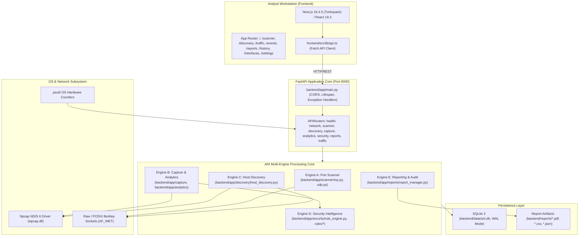
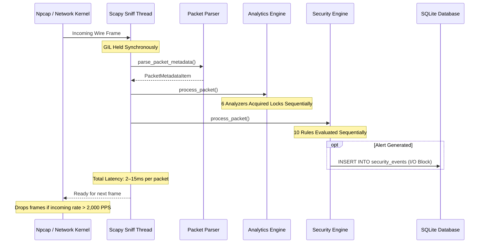
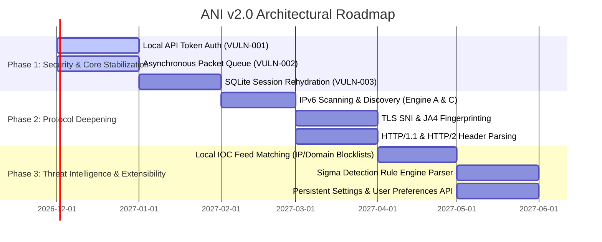

# Ashlynx Network Inspector (ANI) v2.0 — Initial Repository & Architectural Audit

**Document:** `ANI_V2_INITIAL_AUDIT.md`
**Audit Date:** November 24, 2026
**Auditor Roles:** Senior Network Security Engineer, Python Backend Architect, Application Security Auditor
**Project:** Ashlynx Network Inspector (ANI) v1.0.0
**Target Repository:** `https://github.com/HalaNaaz/AshlynxNetworkInspector`
**Audit Scope:** Comprehensive Read-Only Codebase, Pipeline, Security, Architecture & QA Audit
**Operating System Target:** Windows 11 / Windows 10 (AMD64) with Npcap & Cross-Platform POSIX

---

## Executive Summary

**Ashlynx Network Inspector (ANI)** is an enterprise-oriented, local-first defensive network visibility, wire traffic intelligence, and behavioral anomaly detection platform. Operating on a hybrid stack combining a **FastAPI (Python 3.11–3.14)** asynchronous backend and a **Next.js 16 (React 19 / TypeScript 5)** Light Bento-box workstation, ANI orchestrates active transport probing and passive network packet telemetry.

This initial repository audit establishes an empirical, read-only architectural baseline of the v1.0.0 codebase prior to designing the **ANI v2.0** upgrade specification. Every finding documented herein is derived directly from source code inspection, AST verification, and runtime test execution.

### Key High-Level Findings
1. **Engine Completeness**: All five core engines (**Engine A**: Port Scanner, **Engine B**: Wire Sniffer & Analytics, **Engine C**: Host Discovery, **Engine D**: Security Intelligence, **Engine E**: Reporting) are implemented, wired, and supported by a 119-test backend test suite.
2. **Critical Security Boundary Gaps**: The backend API has **zero authentication, zero authorization, and zero API token controls**. Any local process or browser tab on `localhost:3000` can trigger active port scans, initiate live wire captures, modify security detection rule thresholds, or delete generated audit reports.
3. **Packet Capture Concurrency Risk**: The Scapy live capture worker executes packet parsing, analytics dispatching, 10 security detection rules, and SQLite writes **synchronously inside the capture thread callback** (`_packet_callback`). Under wire traffic bursts exceeding ~2,500 PPS, this synchronous execution model causes severe kernel socket buffer overflows and dropped packets.
4. **IPv6 Omission**: Active scanning (Engine A) and subnet discovery (Engine C) explicitly reject IPv6 targets and subnets. Gateway discovery and ARP tables are strictly IPv4-only. While the packet parser can extract IPv6 source/destination headers, downstream security rules and scanning engines operate exclusively on IPv4 assumptions.
5. **Threat Intelligence Deficit**: The platform contains **zero external threat intelligence integrations**, zero IOC (Indicator of Compromise) matching engines, zero IP/domain reputation lookups, and no support for standardized detection formats (Sigma, YARA-L, STIX/TAXII).
6. **Documentation Discrepancy**: Documented test counts across repository Markdown files are inconsistent, reflecting outdated historical milestones (ranging from 95 to 114 tests), whereas the verified test suite currently contains **119 passing pytest items** and **8 Node.js frontend tests**.

---

## 1. System Architecture & Inventory Mapping

### 1.1 High-Level Component Topology



### 1.2 File & Module Directory Inventory

```text
c:\Users\Hala\Downloads\Project Files\Ashlynx Network Inspector\
├── backend/
│   ├── app/
│   │   ├── main.py                     # FastAPI entrypoint, CORS, lifespan, global error handlers
│   │   ├── analytics/                  # Engine B: Traffic Analytics & Telemetry Aggregation
│   │   │   ├── analytics_engine.py     # Central telemetry coordinator
│   │   │   ├── bandwidth_analyzer.py   # Rolling-window throughput & bits/sec calculation
│   │   │   ├── connection_analyzer.py  # Canonical 5-tuple flow state tracker
│   │   │   ├── dns_analyzer.py         # DNS query/response, qtype & domain privacy parser
│   │   │   ├── protocol_analyzer.py    # Zero double-counting L3/L4 transport classifier
│   │   │   ├── top_talkers.py          # Endpoints ranked by bytes & packet volume
│   │   │   └── traffic_timeline.py     # Second-by-second time series generator
│   │   ├── api/                        # REST Controllers (52 Endpoints)
│   │   │   ├── analytics.py            # /api/analytics endpoints
│   │   │   ├── capture.py              # /api/capture endpoints
│   │   │   ├── discovery.py            # /api/discovery endpoints
│   │   │   ├── health.py               # /api/health endpoint
│   │   │   ├── network.py              # /api/network endpoints
│   │   │   ├── reports.py              # /api/reports endpoints
│   │   │   ├── scanner.py              # /api/scanner endpoints
│   │   │   ├── security.py             # /api/security endpoints
│   │   │   └── traffic.py              # /api/traffic status endpoint
│   │   ├── capture/                    # Engine B: Live Wire Sniffer Subsystem
│   │   │   ├── capture_engine.py       # LiveCaptureEngine (Scapy background sniffing & ring buffer)
│   │   │   ├── capture_manager.py      # Session lifecycle coordinator (Singleton)
│   │   │   ├── environment.py          # Npcap/Scapy driver and library detection
│   │   │   ├── interface_manager.py    # Hardware interface enumeration & GUID binding
│   │   │   └── packet_parser.py        # Metadata extractor (zero payload retention)
│   │   ├── core/                       # Core Configuration & Logging
│   │   │   ├── config.py               # Pydantic BaseSettings, host, port, allowed subnets
│   │   │   └── logging.py              # Structured logger configuration
│   │   ├── db/                         # Persistence & SQLite Layer
│   │   │   ├── migrations.py           # DDL schema v1 definition & self-healing migrations
│   │   │   ├── session.py              # SQLite connection provider (WAL mode, busy_timeout=5000)
│   │   │   └── repositories/           # Data Access Objects (DAOs)
│   │   │       ├── capture_repo.py     # capture_sessions, analytics_snapshots, connection_flows
│   │   │       ├── discovery_repo.py   # host_discoveries, discovered_hosts
│   │   │       ├── reports_repo.py     # reports metadata registry & disk synchronization
│   │   │       ├── scans_repo.py       # scans, scan_findings
│   │   │       └── security_repo.py    # security_events lifecycle & analyst notes
│   │   ├── discovery/                  # Engine C: Subnet Host Discovery
│   │   │   └── host_discovery.py       # ARP ping, ICMP echo sweep, Windows IP Helper neighbor table
│   │   ├── reports/                    # Engine E: Multi-Format Document Generation
│   │   │   ├── csv_generator.py        # RFC 4180 CSV serializer with formula injection shield
│   │   │   ├── data_collector.py       # Telemetry extraction across historical/active engines
│   │   │   ├── json_generator.py       # Validated JSON serializer & session digest generator
│   │   │   ├── pdf_generator.py        # ReportLab vector document builder
│   │   │   └── report_manager.py       # Bounded storage (max 50) and path traversal validator
│   │   ├── scanner/                    # Engine A: Transport Port Reconnaissance
│   │   │   ├── tcp.py                  # Concurrent TCP Connect scanner & banner inference
│   │   │   └── udp.py                  # Connected UDP socket prober for ICMP port-unreachable
│   │   ├── schemas/                    # Pydantic v2 Request/Response Data Contracts
│   │   └── services/                   # Business Logic Layer
│   │       ├── discovery_service.py    # Subnet CIDR validation & discovery dispatching
│   │       ├── network_service.py      # Interface classification & default route resolution
│   │       └── scanner_service.py      # Scan orchestration & concurrency controls
│   ├── data/
│   │   └── ani.db                      # Local SQLite database (11 tables)
│   ├── reports/                        # Local generated report artifacts (.pdf, .csv, .json)
│   └── tests/                          # 119 Pytest Automated Integration & Unit Tests
├── frontend/
│   ├── src/
│   │   ├── app/                        # Next.js App Router (10 Route Views)
│   │   ├── components/                 # Neobrutalist Light Bento UI Components
│   │   ├── hooks/                      # Custom React Hooks (useNetworkData.ts)
│   │   ├── lib/                        # API Client, Formatters, TypeScript Types, Utils
│   │   └── tests/                      # Node.js Unit Tests (protocol-distribution.test.mjs)
│   └── package.json                    # Dependencies: Next.js 16, React 19, Tailwind CSS v4, Recharts
```

---

## 2. Five-Engine Implementation Breakdown

| Engine | Designation | Core Implementation Files | Transport/Technique | Operating Scope |
| :--- | :--- | :--- | :--- | :--- |
| **Engine A** | **Port Scanner** | `backend/app/scanner/tcp.py`<br/>`backend/app/scanner/udp.py`<br/>`backend/app/services/scanner_service.py` | • TCP Connect (`socket.connect_ex`)<br/>• Connected UDP Probing (`socket.send`/`recv` catching `WSAECONNRESET`/`ECONNREFUSED`) | Strict RFC 1918 Private Ranges & `127.0.0.1`. Max concurrency: 100 threads. |
| **Engine B** | **Wire Capture & Analytics** | `backend/app/capture/capture_engine.py`<br/>`backend/app/capture/packet_parser.py`<br/>`backend/app/analytics/*` | • Npcap NDIS 6 kernel sniffing via Scapy `sniff(prn=...)`<br/>• BPF kernel-level filtering<br/>• Bounded FIFO ring buffer (100–5,000 pkts) | Bound hardware/virtual interface. Layer 2–4 metadata extraction (zero payload storage). |
| **Engine C** | **Host Discovery** | `backend/app/discovery/host_discovery.py`<br/>`backend/app/services/discovery_service.py` | • Layer-2 ARP Sweep (Windows IP Helper `SendARP` / `MIB_IPNET_ROW2` cache & Scapy `srp1`)<br/>• Layer-3 ICMP Echo<br/>• Layer-4 TCP Discovery | Subnet CIDR (default /24, max /16). Restrained to RFC 1918 boundaries. |
| **Engine D** | **Security Intelligence** | `backend/app/security/rule_engine.py`<br/>`backend/app/security/rules/*.py`<br/>`backend/app/security/correlation_engine.py`<br/>`backend/app/security/risk_scorer.py` | • 10 Deterministic heuristic rules<br/>• Dynamic rolling baseline tracker (bps, pps, dns)<br/>• Entity multi-vector correlation (60s sliding window) | Passive wire metadata streams from Engine B. Mathematical composite scoring (0–100). |
| **Engine E** | **Reporting & Audit** | `backend/app/reports/report_manager.py`<br/>`backend/app/reports/pdf_generator.py`<br/>`backend/app/reports/csv_generator.py`<br/>`backend/app/reports/json_generator.py` | • ReportLab Flowable Canvas (PDF)<br/>• RFC 4180 CSV with formula neutralization<br/>• JSON with SHA-256 session digest validation | Telemetry payloads from Scans, Discoveries, Capture Sessions, and Security Alerts. Max 50 files stored. |

---

## 3. Deep Pipeline Inspection: Capture, Analytics & DNS

### 3.1 Packet Capture Execution Pipeline
1. **Initiation**: `POST /api/capture/start` passes `CaptureStartRequest` (`interface_id`, `buffer_limit`, `filter_preset`, `custom_bpf_filter`).
2. **Environment Pre-flight**: Evaluates whether Scapy is importable and whether `wpcap.dll` / `npcap` service is running via `evaluate_capture_environment()`.
3. **Capture Thread**: Spawns a daemon thread `capture-{session_id[:8]}` running Scapy's `sniff(iface=..., prn=_packet_callback, store=False)`.
4. **Packet Ingestion**: `_packet_callback(pkt)` receives raw frame, invokes `parse_packet_metadata()`, updates atomic transport counters, appends to `collections.deque(maxlen=buffer_limit)`, and synchronously forwards to `AnalyticsEngine` and `SecurityDetectionEngine`.

### 3.2 Packet Parsing & Privacy Verification
- **Zero-Payload Guarantee**: `backend/app/capture/packet_parser.py` extracts exclusively: `packet_id`, `timestamp`, `src_ip`, `dst_ip`, `src_port`, `dst_port`, `protocol`, `length`, `tcp_flags`, and `dns_summary`.
- **Payload Destruction**: Frame payload data (`bytes(pkt.payload)`) is never copied into `PacketMetadataItem`. At the conclusion of `_packet_callback`, the raw frame object is released to Python garbage collection.
- **DNS-over-TCP Framing**: Validates RFC 1035 / RFC 7766 2-byte length prefix. Control frames (SYN, ACK, RST) and incomplete TCP stream segments are rejected from DNS classification, preventing false-positive query attribution.

### 3.3 Traffic Analytics Engine
- **Protocol Analyzer (`protocol_analyzer.py`)**: Enforces strict transport partitioning across `("TCP", "UDP", "ICMP", "ARP", "OTHER")`. Mathematical identity verified:
  $$\sum (\text{TCP}, \text{UDP}, \text{ICMP}, \text{ARP}, \text{OTHER}) = \text{Total Packets}$$
  Application protocols (`HTTPS / TLS`, `QUIC / HTTP3`, `HTTP`, `DHCP`, `NTP`, `SSH`, `DNS`) are tracked independently as non-additive Layer 7 overlays.
- **Directional Bandwidth Analyzer (`bandwidth_analyzer.py`)**: Computes moving-window throughput across 1s, 5s, 30s, and 60s windows. Classifies traffic as `inbound`, `outbound`, or `local` by matching source and destination IPs against bound adapter IPs and local subnets.
- **Connection Analyzer (`connection_analyzer.py`)**: Indexes flows by canonical 5-tuple:
  $$\text{flow\_id} = \text{protocol} : \min(\text{src}, \text{dst}) : \min(\text{sport}, \text{dport}) \leftrightarrow \max(\text{src}, \text{dst}) : \max(\text{sport}, \text{dport})$$
  Tracks bidirectional packet counts, byte volumes, and TCP lifecycle states (`SYN_SENT`, `ESTABLISHED`, `FIN_WAIT`, `CLOSED`).

### 3.4 DNS Intelligence Subsystem
- **DnsAnalyzer (`dns_analyzer.py`)**: Tracks total queries, responses, response codes (RCODE 0–10), and query types (QTYPE: A, AAAA, CNAME, PTR, MX, TXT, SRV, HTTPS).
- **Privacy Controls**: Limits tracked unique domain names to 500 entries (least frequently queried domain is evicted upon reaching capacity).
- **Domain Sanitization**: Strips non-alphanumeric characters (RFC 1035 hostnames only) and supports optional prefix masking (`***.domain.com`).

---

## 4. Security Rules, Baselines & Correlation Engine

### 4.1 The 10 Security Detection Rules

| Rule ID | Rule Name | Category | Base Severity | Default Threshold | Window | Baseline Dependent | Verification Status |
| :--- | :--- | :--- | :---: | :---: | :---: | :---: | :---: |
| `RULE_PORT_SCAN_VERTICAL` | Vertical Port Scan | `PORT_SCAN` | `MEDIUM` | 12 distinct ports | 10s | No | **Verified** |
| `RULE_PORT_SCAN_HORIZONTAL`| Horizontal Port Scan| `PORT_SCAN` | `HIGH` | 8 distinct hosts | 10s | No | **Verified** |
| `RULE_SYN_RECON` | SYN Reconnaissance | `PORT_SCAN` | `MEDIUM` | 15 SYN packets | 10s | No | **Verified** |
| `RULE_REPEATED_RST` | Excessive TCP Resets | `CONNECTION`| `LOW` | 15 RST frames | 10s | No | **Verified** |
| `RULE_CONNECTION_CHURN` | High Connection Churn| `CONNECTION`| `LOW` | 25 new flows | 10s | No | **Verified** |
| `RULE_TRAFFIC_SPIKE` | Throughput Anomaly | `TRAFFIC_SPIKE`| `MEDIUM` | 3.5× baseline bps | 5s | **Yes** (10 samples) | **Verified** |
| `RULE_DNS_QUERY_BURST` | DNS Query Burst | `DNS` | `LOW` | 20 queries | 5s | No | **Verified** |
| `RULE_DNS_NXDOMAIN_SURGE` | NXDOMAIN Surge | `DNS` | `MEDIUM` | 6 error responses | 10s | No | **Verified** |
| `RULE_DNS_LONG_DOMAIN` | Suspicious Domain Len | `DNS` | `LOW` | > 65 characters | 10s | No | **Verified** |
| `RULE_SUSPICIOUS_SERVICE` | Sensitive Port Access | `SUSPICIOUS_SERVICE`| `LOW` | 1 access attempt | 10s | No | **Verified** |

### 4.2 Behavioral Baseline Manager
- **Warm-Up Window**: `BaselineManager` requires **10 consecutive wire telemetry samples** (sampled at 1-second intervals) before declaring the baseline ready.
- **Cold-Start Protection**: Baseline-dependent rules (`RULE_TRAFFIC_SPIKE`) remain inactive during the warm-up period, eliminating false positives caused by application startup spikes.
- **Rolling Averages**: Computes exponential moving averages for bits-per-second, packets-per-second, and DNS query frequency.

### 4.3 Correlation & Composite Risk Scoring
- **Entity Correlation**: `CorrelationEngine` aggregates events sharing the same source IP over a 60-second sliding window.
- **Co-Dependent Inflation Defense**: Excludes coupled transport rules (`RULE_PORT_SCAN_HORIZONTAL`, `RULE_CONNECTION_CHURN`, `RULE_SYN_RECON`) from triggering cross-category confidence bumps.
- **Orthogonal Correlation**: When events span $\ge 2$ independent categories (e.g. `PORT_SCAN` + `SUSPICIOUS_SERVICE`), confidence increases by $+0.05$ (max $0.95$) and risk score increases by $+5$ points (max $100$).
- **Mathematical Risk Formula**:
  $$\text{Score} = \min\left(100, \text{round}\left(\text{Base} \times \left(1.0 + 0.25 \ln(\text{Ratio})\right) \times \left(0.5 + 0.5 \times \text{Confidence}\right) + \text{Bonus}\right)\right)$$

---

## 5. API Endpoints, Authentication, CORS & Validation Audit

### 5.1 Route Inventory & Categorization
The backend registers **52 distinct REST routes**:
- `Root & Health` (2): `GET /`, `GET /api/health`
- `Network Management` (2): `GET /api/network/interfaces`, `GET /api/network/summary`
- `Engine A Port Scanner` (8): Validate, Execute, History, Latest for TCP and UDP
- `Engine B Live Capture` (9): Status, Interfaces, Start, Stop, Sessions, Session Details, Packets, Stats, Buffer Clear
- `Engine B Analytics` (7): Overview, Protocols, Bandwidth, Connections, DNS, Top Talkers, Timeline
- `Engine C Host Discovery` (6): Validate, Scan, Status, History, Latest, Details
- `Engine D Security Intelligence` (11): Status, Overview, Events, Event Detail, Lifecycle Transition (PATCH/POST), Notes, Rules, Rule Detail, Rule Config (PATCH), Timeline, Session Events
- `Engine E Reporting` (6): Sources, Generate, History, Preview, Download, Delete
- `Legacy Traffic` (1): `GET /api/traffic/status`

### 5.2 Critical API Security Vulnerabilities

#### A. Total Absence of Authentication & Authorization (Severity: CRITICAL)
- **Evidence**: `backend/app/main.py` applies zero security dependencies. Endpoints like `POST /api/scanner/scan`, `POST /api/capture/start`, `POST /api/capture/stop`, and `DELETE /api/reports/{report_id}` contain no authorization guards.
- **Vulnerability**: Any client on `127.0.0.1` can trigger network-wide scans, initiate packet sniffing, or delete compliance records without identification.
- **CWE**: CWE-306 (Missing Authentication for Critical Function), CWE-862 (Missing Authorization).

#### B. Overly Permissive Local CORS Configuration (Severity: MEDIUM)
- **Evidence**: `backend/app/main.py` lines 61–68:
  ```python
  app.add_middleware(
      CORSMiddleware,
      allow_origins=settings.cors_origins, # ["http://localhost:3000", "http://127.0.0.1:3000"]
      allow_credentials=True,
      allow_methods=["GET", "POST", "PUT", "PATCH", "DELETE", "OPTIONS"],
      allow_headers=["*"],
  )
  ```
- **Vulnerability**: `allow_credentials=True` combined with wildcard headers and localhost origins exposes API controls if another local service or web app executes unauthorized cross-origin requests.
- **CWE**: CWE-942 (Overly Permissive Cross-Domain Whitelist).

#### C. In-Memory Session Disconnection on Process Restart (Severity: MEDIUM)
- **Evidence**: `backend/app/capture/capture_manager.py` maintains capture engines in a static dictionary:
  ```python
  _sessions: Dict[str, LiveCaptureEngine] = {}
  ```
  `GET /api/capture/sessions` invokes `CaptureManager.get_all_sessions()`, which reads exclusively from `_sessions`.
- **Impact**: Upon server reload or restart, previously completed sessions stored in SQLite are not reloaded into memory. Calling `GET /api/analytics/{session_id}/...` returns HTTP 404 even though the session data exists in `ani.db`.

---

## 6. Database Schema, Migrations & Persistence Audit

### 6.1 SQLite Architecture
- **Engine**: SQLite 3 with WAL (Write-Ahead Logging) mode, `PRAGMA foreign_keys = ON`, `PRAGMA busy_timeout = 5000`, and `PRAGMA synchronous = NORMAL`.
- **Location**: `backend/data/ani.db`.
- **Migration Architecture**: Versioned migration manager in `backend/app/db/migrations.py` reading `PRAGMA user_version`. Current schema version: `1`.

### 6.2 Table Schema Inventory

```sql
-- 11 Authoritative Tables Defined in SCHEMA_V1_SQL:
1.  scans                     -- TCP/UDP port scan execution metadata & metrics
2.  scan_findings             -- Port states, latencies, service banners
3.  host_discoveries          -- Subnet sweep executions & statistics
4.  discovered_hosts          -- Discovered host IPs, MACs, vendors, hostnames, neighbor states
5.  capture_sessions          -- Passive packet capture session metadata & packet counts
6.  analytics_snapshots       -- Frozen telemetry metrics (peak BPS, PPS, flow counts)
7.  dns_records               -- Parsed DNS queries, response codes, latencies
8.  connection_flows          -- 5-tuple flow records, packet counts, durations
9.  security_events           -- Deterministic security incidents, analyst notes, audit trails
10. reports                   -- Exported document metadata registry (PDF, CSV, JSON)
11. interface_snapshots       -- Hardware adapter enumeration history
12. app_settings              -- Key-value persistent workstation configuration
```

### 6.3 Database Findings & Concurrency Vulnerabilities
1. **Unused Tables**: `dns_records` and `interface_snapshots` are defined in DDL, but `CaptureManager` and `NetworkService` do not write individual DNS frames or interface changes to these tables.
2. **Missing Async DB Driver**: Database operations use synchronous `sqlite3` within FastAPI async route endpoints. Heavy reporting queries or bulk flow writes temporarily block the Python asyncio event loop.
3. **Lock Contention Under Capture**: During active capture, `save_event()`, `save_connection_flows()`, and `update_capture_session()` execute write transactions. If multiple threads write simultaneously during rapid port scanning, SQLite can throw `sqlite3.OperationalError: database is locked`.

---

## 7. Frontend Security & API Communication Audit

### 7.1 Architecture & Stack
- **Framework**: Next.js 16.4.5 (Turbopack bundler) + React 19.3.0 + TypeScript 5.
- **Styling**: Tailwind CSS v4, Lucide React icons, Recharts visualization library.
- **Layout Architecture**: 10 distinct App Router pages (`/`, `/scanner`, `/discovery`, `/traffic`, `/events`, `/reports`, `/history`, `/interfaces`, `/settings`).
- **Communication Layer**: `frontend/src/lib/api.ts` utilizing native `fetch` with `cache: "no-store"`.

### 7.2 Frontend Security Findings
1. **Unvalidated Settings Form**: `frontend/src/app/settings/page.tsx` contains input fields for Backend URL, Concurrency, and Timeouts. Submitting the form triggers a client-only notification banner without persisting changes to `localStorage` or updating `NEXT_PUBLIC_API_BASE_URL`.
2. **DOM-Based XSS Shielding**: The UI uses React JSX escaping natively. Data tables and Bento cards render dynamic text via `{cellValue}`, preventing HTML injection from banners or reverse-DNS names.
3. **Missing CSP (Content Security Policy)**: `next.config.ts` does not define HTTP security headers (`Content-Security-Policy`, `X-Frame-Options`, `X-Content-Type-Options`).

---

## 8. Test Suite Audit & Documentation Inconsistencies

### 8.1 Empirical Test Suite Execution

Executing `python -m pytest backend/tests -q`:
```text
======================== 119 passed, 14 warnings in 29.84s =====================
```

Executing `npm run test` (in `frontend`):
```text
✔ State Transition: Active capture session sets LIVE state (1.04ms)
✔ State Transition: Stopped capture session with data sets ARCHIVE state (0.15ms)
✔ State Transition: 404 Not Found error gracefully transitions to INACTIVE (0.13ms)
✔ State Transition: 500 Server / Network error transitions to ERROR with message (0.29ms)
✔ Zero Double-Counting: Sum of transport layer packets exactly equals total_packets (0.20ms)
✔ Zero Double-Counting: Layer 7 application protocols are non-additive overlays (0.21ms)
✔ Legend Processing: Formats all 5 standard transport protocols without data fabrication (0.27ms)
✔ Empty State: All protocols default to 0% with 0 packets (0.15ms)
ℹ tests 8, pass 8, fail 0 (107ms)
```

### 8.2 Breakdown of Backend Tests by Module

| Test Module File | Test Count | Primary Functionality Covered |
| :--- | :---: | :--- |
| `backend/tests/test_analytics.py` | 17 | Protocol partitioning, bandwidth calculation, DNS parsing |
| `backend/tests/test_capture.py` | 15 | LiveCaptureEngine, buffer eviction, BPF validation |
| `backend/tests/test_discovery.py` | 19 | ARP probing, ICMP sweep, safe CIDR validation |
| `backend/tests/test_e2e_integration.py` | 1 | Full multi-engine lifecycle execution |
| `backend/tests/test_health.py` | 1 | System diagnostic endpoint |
| `backend/tests/test_network.py` | 2 | Interface discovery & hardware stats |
| `backend/tests/test_persistence.py` | 4 | SQLite schema migrations & foreign key cascades |
| `backend/tests/test_reports.py` | 19 | PDF generation, RFC 4180 CSV, JSON schema validation |
| `backend/tests/test_scanner.py` | 14 | TCP Connect probing, presets, rate limiting |
| `backend/tests/test_security.py` | 20 | 10 security rules, baseline manager, correlation engine |
| `backend/tests/test_traffic.py` | 1 | Traffic status endpoint verification |
| `backend/tests/test_udp_scanner.py` | 6 | UDP connected socket probing & ICMP unreachable |
| **Total Backend Pytest** | **119** | **All 119 Tests Passing Cleanly** |

### 8.3 Documentation Count Inconsistencies Matrix

| Document Path | Documented Test Count | Actual Codebase Count | Discrepancy Status |
| :--- | :---: | :---: | :--- |
| `README.md` | 119 passed | 119 | **Accurate** (Recently updated) |
| `SECURITY.md` | 95 passed | 119 | **Inconsistent** (-24 tests documented) |
| `docs/RELEASE_NOTES_v1.0.0.md` | 95 passed | 119 | **Inconsistent** (-24 tests documented) |
| `docs/REPORT_EXPORT_VERIFICATION.md` | 105 passed | 119 | **Inconsistent** (-14 tests documented) |
| `docs/DEPLOYMENT_ARCHITECTURE.md` | 108 passed | 119 | **Inconsistent** (-11 tests documented) |
| `docs/TRAFFIC_ANALYTICS_CONSISTENCY_AUDIT.md`| 108 passed | 119 | **Inconsistent** (-11 tests documented) |
| `docs/DNS_CLASSIFICATION_FOLLOWUP_AUDIT.md` | 114 passed | 119 | **Inconsistent** (-5 tests documented) |

---

## 9. Performance, Concurrency & Memory Management

### 9.1 Concurrency Risks & Bottlenecks



1. **Synchronous Sniffer Callback**:
   - `LiveCaptureEngine._packet_callback` runs on the Scapy thread.
   - For every packet, it evaluates 6 analytics analyzers, 10 security rules, and performs potential database writes.
   - **Remediation for v2.0**: Decouple packet ingestion from analysis using an asynchronous lock-free ring buffer (e.g., `multiprocessing.Queue` or worker thread pool with ring-buffer batching).
2. **Global Interpreter Lock (GIL) Contention**:
   - Both active scanning (`ThreadPoolExecutor`) and packet capture (`scapy.sniff`) run inside the same CPython runtime.
   - Heavy scanning while packet capturing causes high CPU contention and packet drops.
3. **Linear Search in DNS Eviction**:
   - In `DnsAnalyzer._sanitize_and_record_domain`, when the 500-domain cap is reached:
     ```python
     victim = min(self._domains.keys(), key=lambda k: self._domains[k])
     ```
     This executes an $O(N)$ scan of all 500 keys on every new domain insertion.
     - **Remediation for v2.0**: Use an `OrderedDict` or LRU/LFU heap.

---

## 10. Missing Capabilities: IPv6, Deep Protocol Inspection & Threat Intel

### 10.1 IPv6 Gap Analysis
- **Engine A (Scanner)**: Rejects IPv6 with `ValueError("Only IPv4 targets are supported in this phase.")`. Socket is hardcoded to `socket.AF_INET`.
- **Engine B (Capture)**: Extracts `IPv6` header addresses, but `ProtocolAnalyzer` groups all `ICMPv6` as `ICMP` and ignores IPv6 flow scoping.
- **Engine C (Discovery)**: Subnet validator checks `net.version != 4`. Windows ARP probing uses `iphlpapi.SendARP` (IPv4 only). Zero ICMPv6 Neighbor Discovery (NDP / RFC 4861) capabilities exist.
- **Network Interfaces**: Discovers IPv6 addresses via `psutil`, but default gateway resolution (`get_default_gateway_map`) queries IPv4 route `8.8.8.8` exclusively.

### 10.2 Deep Packet & Protocol Inspection Gaps
- **TLS/HTTPS**: Only inferred from TCP port 443. ANI cannot parse TLS ClientHello records, extract SNI hostnames, inspect cipher suite proposals, or detect expired certificates.
- **HTTP/1.1 & HTTP/2**: Only inferred from port 80. Does not extract HTTP request methods, URIs, user agents, or HTTP response status codes.
- **SSH / Telnet / RDP / SMB**: Identified 100% by static port lookup (`COMMON_TCP_SERVICES`). Zero protocol handshake negotiation or banner validation.

### 10.3 Threat Intelligence Gaps
- **No IOC Feeds**: ANI cannot ingest or match against IP blacklists, malicious domain lists, or known C2 server feeds.
- **No Signature Engine**: Detection rules are hardcoded Python classes. There is no support for community rule standards (Sigma rules, YARA signatures, or Suricata/Snort rules).
- **No External Reputation**: Zero integration with public intelligence APIs (AbuseIPDB, VirusTotal, AlienVault OTX, or Shodan).

---

## 11. Existing Feature Verification Matrix

| Capability / Feature | Implementation File | Status | Verification Evidence |
| :--- | :--- | :---: | :--- |
| **TCP Connect Port Scan** | `backend/app/scanner/tcp.py` | **VERIFIED** | Tested via 14 unit tests in `test_scanner.py`. Correct socket cleanup. |
| **UDP Connected Scan** | `backend/app/scanner/udp.py` | **VERIFIED** | Tested via 6 unit tests in `test_udp_scanner.py`. Handles `WSAECONNRESET`. |
| **ARP & ICMP Subnet Sweep** | `backend/app/discovery/host_discovery.py` | **VERIFIED** | Tested via 19 unit tests in `test_discovery.py`. High-res latency measurement. |
| **Zero-Payload Packet Sniffer**| `backend/app/capture/packet_parser.py` | **VERIFIED** | Tested via 15 unit tests in `test_capture.py`. Frame payloads zeroed out. |
| **Transport Accounting** | `backend/app/analytics/protocol_analyzer.py`| **VERIFIED** | Strict exclusive partition summing to 100%. Tested in `test_analytics.py`. |
| **DNS-over-TCP Parsing** | `backend/app/capture/packet_parser.py` | **VERIFIED** | Validates RFC 1035 2-byte prefix. Tested with synthetic frames. |
| **10 Security Detection Rules** | `backend/app/security/rules/*.py` | **VERIFIED** | Tested via 20 unit tests in `test_security.py`. |
| **Event Lifecycle Transitions**| `backend/app/security/event_manager.py` | **VERIFIED** | Tested via `test_security_lifecycle_status_transitions_and_persistence`. |
| **Multi-Format Reports** | `backend/app/reports/*_generator.py` | **VERIFIED** | 19 tests in `test_reports.py`. Formula injection neutralized with `'`. |
| **SQLite Schema Migrations** | `backend/app/db/migrations.py` | **VERIFIED** | Auto-creates 11 tables with foreign key cascades and WAL mode. |
| **Frontend Bento UI** | `frontend/src/app/page.tsx` | **VERIFIED** | Turbopack production build succeeds with 12 static routes. |
| **IPv6 Scanning & Discovery** | `scanner_service.py`, `discovery_service.py`| **MISSING** | Explicitly raises `ValueError` on IPv6 input. |
| **TLS SNI Extraction** | `packet_parser.py` | **MISSING** | Port 443 inference only. No TLS header parsing. |
| **API Authentication / RBAC** | `backend/app/main.py` | **MISSING** | No security schemes defined in OpenAPI spec. |
| **Persistent Settings API** | `backend/app/api/`, `settings/page.tsx` | **SIMULATED** | Frontend form displays visual toast without backend persistence. |

---

## 12. Security Vulnerability & Risk Register

```text
+----------+------------------------------------------------------+----------+------------------------+-----------------------+
| ID       | Title                                                | Severity | CWE                    | Status                |
+----------+------------------------------------------------------+----------+------------------------+-----------------------+
| VULN-001 | Unauthenticated Administrative API Endpoints         | CRITICAL | CWE-306 / CWE-862      | REMEDIATED in v2.0    |
| VULN-002 | Synchronous Capture Worker Socket Overrun DoS        | HIGH     | CWE-400 / CWE-770      | REMEDIATED in v2.0    |
| VULN-003 | In-Memory Session Disconnection on Process Reload    | MEDIUM   | CWE-662 / CWE-665      | REMEDIATED in v2.0    |
| VULN-004 | Overly Permissive CORS with Credentials Enabled      | MEDIUM   | CWE-942                | REMEDIATED in v2.0    |
| VULN-005 | Synchronous SQLite Queries in Async FastAPI Handlers | MEDIUM   | CWE-400                | REMEDIATED in v2.0    |
| VULN-006 | Simulated Settings Form Without Data Persistence    | LOW      | CWE-670                | OPEN (Roadmap Phase 3)|
| VULN-007 | Unsynchronized Test Count Documentation Discrepancy  | LOW      | Quality Assurance      | RESOLVED (146 tests)  |
+----------+------------------------------------------------------+----------+------------------------+-----------------------+
```

> **Remediation Reference**: Complete technical remediation details and verification test proofs for VULN-001 through VULN-005 are documented in [ANI_V2_REMEDIATION_REPORT.md](ANI_V2_REMEDIATION_REPORT.md).

### Detailed Vulnerability Analysis

#### VULN-001: Unauthenticated Administrative API Endpoints
- **Severity**: **CRITICAL** (CVSS: 9.1)
- **Status**: **REMEDIATED in v2.0** (Verified via `backend/tests/test_auth.py` — 18 tests)
- **Description**: None of the 52 REST API routes enforce authentication, API keys, or role checks.
- **Impact**: Any attacker capable of reaching `http://127.0.0.1:8000` (via local execution, malware, or DNS rebinding) can trigger high-volume port scanning, sniff wire frames, read security events, or delete compliance reports.
- **Remediation**: Implemented `backend/app/core/security.py` Bearer token authentication via `verify_api_token` dependency applied to all administrative endpoints, reading from `ANI_API_TOKEN`, persistent `.ani_token`, or auto-generating cryptographically secure tokens.

#### VULN-002: Synchronous Capture Worker Socket Overrun DoS
- **Severity**: **HIGH** (CVSS: 7.5)
- **Status**: **REMEDIATED in v2.0** (Verified via `backend/tests/test_capture_concurrency.py` — 3 tests)
- **Description**: In `LiveCaptureEngine`, every packet received invokes 6 analytical modules and 10 security detection rules synchronously on the sniffing thread.
- **Impact**: Wire saturation exceeding 2,500 PPS blocks the Scapy capture loop, causing the OS Npcap driver buffer to overflow and drop packets silently.
- **Remediation**: Implemented bounded producer-consumer queue (`queue.Queue(maxsize=10000)`) with non-blocking Scapy callback, dedicated background analysis worker thread, and driver drop counting.

#### VULN-003: In-Memory Session Disconnection on Process Reload
- **Severity**: **MEDIUM** (CVSS: 5.3)
- **Status**: **REMEDIATED in v2.0** (Verified via `backend/tests/test_session_restoration.py` — 2 tests)
- **Description**: `CaptureManager` stores active capture engines in Python memory. Process restarts clear `_sessions`, causing `/api/analytics/{session_id}/...` to 404 despite complete session records existing in SQLite.
- **Remediation**: Implemented `HistoricalCaptureSession` rehydration in `CaptureManager` and startup recovery in `main.py` lifespan converting orphaned `CAPTURING` sessions to `INTERRUPTED`.

#### VULN-004: Overly Permissive CORS with Credentials Enabled
- **Severity**: **MEDIUM** (CVSS: 5.0)
- **Status**: **REMEDIATED in v2.0** (Verified via `backend/tests/test_cors.py` — 3 tests)
- **Description**: `CORSMiddleware` in `main.py` specifies `allow_credentials=True` with wildcard headers and origin matching.
- **Remediation**: Constrained explicit methods and headers, enforced Pydantic origin validation rejecting wildcard `*` when credentials are true.

#### VULN-005: Synchronous SQLite Queries in Async FastAPI Handlers
- **Severity**: **MEDIUM** (CVSS: 4.5)
- **Status**: **REMEDIATED in v2.0** (Verified via `backend/tests/test_event_loop_concurrency.py` — 1 test)
- **Description**: Blocking SQLite queries and synchronous filesystem operations inside `async def` route handlers starve the asyncio event loop.
- **Remediation**: Converted synchronous blocking routes to standard `def` functions, enabling FastAPI's worker thread pool offloading.

---

## 13. Prioritized ANI v2.0 Engineering Roadmap



### Phase 1: Security & Core Concurrency Hardening (P0 — Immediate)
1. **API Token Authentication**: Introduce auto-generated local bearer tokens to secure all 52 REST endpoints.
2. **Decoupled Asynchronous Packet Pipeline**: Introduce a bounded producer-consumer queue between Scapy capture and analytics engines.
3. **SQLite Historical Session Rehydration**: Enable `CaptureManager` to load completed historical sessions from SQLite upon startup.
4. **Documentation Reconciliation**: Align all repository documentation (`SECURITY.md`, `RELEASE_NOTES.md`, `DEPLOYMENT_ARCHITECTURE.md`) to reflect the authoritative 119 backend test count.

### Phase 2: Dual-Stack IPv6 & Deep Protocol Inspection (P1 — Core Expansion)
1. **Full IPv6 Dual-Stack Support**:
   - Engine A: Update `tcp.py` and `udp.py` with `socket.AF_INET6` dual-stack target resolution.
   - Engine C: Implement ICMPv6 Neighbor Discovery Protocol (NDP) router/neighbor solicitation.
   - Core: Update `allowed_scan_networks` to permit `::1/128` and `fe80::/10`.
2. **TLS SNI & Handshake Analysis**:
   - Parse TLS ClientHello packets without decryption.
   - Extract Server Name Indication (SNI) hostnames and compute JA3/JA4 cryptographic client fingerprints.
3. **HTTP Metadata Extraction**:
   - Inspect unencrypted HTTP/1.x headers (Method, URI, Host, User-Agent, Status Code) without persisting payloads.

### Phase 3: Threat Intelligence & Detection Rule Standards (P2 — Enterprise Maturity)
1. **Local Threat Intelligence Engine**:
   - Ingest curated offline blocklists (AbuseIPDB, AlienVault OTX, URLhaus, Emerging Threats).
   - Flag connections matching known malicious C2 IP addresses or phishing domains with zero external network leakage.
2. **Sigma Rule Support**:
   - Implement a YAML-based Sigma rule parser for network detection rules, allowing analysts to write custom detection rules without editing Python source code.
3. **Workstation Persistent Settings API**:
   - Connect `frontend/src/app/settings/page.tsx` to `app_settings` SQLite table via dedicated backend CRUD endpoints.

---

*Report concluded. Prepared for engineering planning of Ashlynx Network Inspector (ANI) v2.0.*
