# ASHLYNX NETWORK INSPECTOR (ANI)
# SYSTEM ARCHITECTURE SPECIFICATION
**Version:** `1.0.0` • **Release Status:** Production Ready

---

## 1. Architectural Overview

**Ashlynx Network Inspector (ANI)** is an enterprise-grade network security inspection and wire intelligence platform. It brings active reconnaissance (Engine A & C), passive live wire telemetry (Engine B), behavioural anomaly detection (Engine D), and multi-source compliance reporting (Engine E) together under a cohesive, decoupled architecture.

```mermaid
graph TD
    UI[Next.js 16 Light Bento UI] -->|HTTP / REST JSON| API[FastAPI Gateway :8000]
    
    subgraph Engine A: Port Reconnaissance
        API --> ScannerService
        ScannerService --> TCPConnect[TCP Connect Engine: socket.connect_ex]
        ScannerService --> UDPDgram[UDP Datagram Engine: Scapy / ICMP Unreachable]
    end

    subgraph Engine B: Wire Telemetry & Capture
        API --> CaptureManager
        CaptureManager --> LiveCaptureEngine[LiveCaptureEngine: Scapy + Npcap Sniff Loop]
        LiveCaptureEngine --> RingBuffer[Bounded Ring Buffer: Deque 100-5000]
        LiveCaptureEngine --> AnalyticsEngine
        AnalyticsEngine --> ProtoDist[Protocol Distribution: L3/L4 Strict]
        AnalyticsEngine --> Bandwidth[Directional Bandwidth & Peak]
        AnalyticsEngine --> TopTalkers[Top Talkers: TX/RX & Private/Public]
        AnalyticsEngine --> Conns[Connection Tracker: Canonical 5-Tuple]
        AnalyticsEngine --> DNSAnalyzer[DNS Intelligence & Subdomain Tracker]
    end

    subgraph Engine C: Subnet Host Discovery
        API --> DiscoveryService
        DiscoveryService --> SubnetProbe[Subnet Engine: SendARP / ICMP Echo / TCP]
    end

    subgraph Engine D: Security Intelligence
        LiveCaptureEngine --> DetectionEngine
        DetectionEngine --> BaselineMgr[Session Baseline: 10-sample warmup]
        DetectionEngine --> RuleEngine[10 Passive Anomaly Rules]
        DetectionEngine --> CorrEngine[Multi-Vector Correlation Engine]
        DetectionEngine --> EventMgr[Event Lifecycle & Audit History]
    end

    subgraph Engine E: Reporting & Analytics
        API --> ReportManager
        ReportManager --> DataCollector[Unified DataCollector: 6 Data Sources]
        DataCollector --> PDFGen[ReportLab PDF: 10-Section Styled Doc]
        DataCollector --> CSVGen[RFC 4180 CSV Generator]
        DataCollector --> JSONGen[Standardized JSON Schema Export]
    end
```

---

## 2. Core Architectural Principles

1. **Decoupled Asynchronous Processing**:
   - Heavy network I/O (port scanning, packet sniffing, subnet pinging) runs off the main asyncio event loop via thread pools (`asyncio.to_thread`) or dedicated background daemon workers. The FastAPI async HTTP loop never stalls.
2. **Strict Metadata-Only Wire Telemetry**:
   - Packets ingested via Scapy/Npcap are parsed instantly into lightweight Pydantic metadata representations (`PacketMetadataItem`). Raw payloads, application layer credentials, authorization headers, and cookie data are stripped and never stored in memory or disk.
3. **Bounded In-Memory Ring Buffers**:
   - Both live capture frames (100–5,000 max) and historical reports (50 max) enforce FIFO capacity limits. Memory usage is bounded to prevent OOM errors even during sustained multi-gigabit workloads.
4. **Zero Double-Counting In Telemetry**:
   - Transport protocols (`TCP`, `UDP`, `ICMP`, `ARP`, `OTHER`) are partitioned strictly such that $\sum \text{transport} = \text{total frames}$. Inferred application layer protocols (`HTTPS`, `DNS`, `HTTP`, etc.) are tracked independently with explicit semantic labeling.
5. **Passive-Only Defensive Security**:
   - Security intelligence (Engine D) operates completely out-of-band. It never injects packets, never modifies local firewall configurations, and never performs aggressive counter-probing.

---

## 3. Subsystem Breakdown

### 3.1 Backend Application Layout (`backend/app/`)
- **`core/`**: Central configuration (`config.py`) using Pydantic Settings, environment variable overrides, structured logging (`logging.py`), and safe-mode subnet definitions.
- **`scanner/`**: 
  - `tcp.py`: Concurrently scans TCP ports using `socket.connect_ex()`. Accurate error classification: `0` (OPEN), `WSAECONNREFUSED` / `10061` (CLOSED), timeout (NO_RESPONSE/FILTERED).
  - `udp.py`: Protocol datagrams (DNS query, NTP request, etc.) sent to target ports. Captures ICMP Port Unreachable (`WSAECONNRESET` 10054 on Windows) to classify CLOSED vs OPEN|FILTERED.
- **`discovery/`**:
  - `host_discovery.py`: Orchestrates subnet sweeping via Windows native `iphlpapi.SendARP` (L2 hardware MAC discovery), ICMP Echo Ping, and fallback TCP Connect probing. Accurately handles loopback targets (`127.0.0.1/32`) without spoofing MAC addresses.
- **`capture/`**:
  - `capture_engine.py`: Thread-safe worker wrapping Scapy's `sniff()` loop with Npcap integration.
  - `interface_manager.py`: Enumerates physical, virtual, and loopback network adapters using Scapy and Windows registry APIs.
  - `packet_parser.py`: Safe header decoding for Ethernet, IPv4, IPv6, ARP, TCP, UDP, ICMP, and DNS.
- **`analytics/`**:
  - `analytics_engine.py`: Master analytics hub receiving parsed frames.
  - Sub-analyzers: `protocol_analyzer.py`, `bandwidth_analyzer.py`, `top_talkers.py`, `connection_analyzer.py`, `dns_analyzer.py`, `traffic_timeline.py`.
- **`security/`**:
  - `detection_engine.py`: Coordinates rule evaluation, correlation, and lifecycle tracking.
  - `rule_engine.py` & `rules/`: 10 passive anomaly detection rules across 5 categories.
  - `baseline_manager.py`: Rolling EWMA/statistical baseline tracker.
  - `correlation_engine.py`: Aggregates multi-vector incidents by source IP.
  - `event_manager.py`: Manages event statuses, analyst notes, and immutable audit logs.
- **`reports/`**:
  - `data_collector.py`: Collects structured telemetry across all 6 data sources.
  - `pdf_generator.py`: Generates 10-section styled PDFs with ReportLab.
  - `csv_generator.py`: Generates RFC 4180 compliant CSV exports.
  - `json_generator.py`: Produces structured JSON audit logs.
  - `report_manager.py`: Manages filesystem storage, path traversal protection, and memory bounding.

---

## 4. Frontend Architecture (`frontend/src/`)

Built with Next.js 16 (App Router), React 19, TypeScript 5, and Tailwind CSS.
- **Navigation & Layout**: `DashboardLayout.tsx`, `Sidebar.tsx`, `Header.tsx`.
- **Bento System**: `BentoCard.tsx`, `BentoGrid.tsx`, `MetricCard.tsx`.
- **9 Core Workstation Routes**:
  1. `/` (Executive Dashboard): System health, operational engines, interface summary, quick actions.
  2. `/scanner`: Dual-engine TCP Connect and UDP Port Scanner with target validation.
  3. `/traffic`: Real-time packet capture, live packet table, and packet metadata inspector.
  4. `/interfaces`: Discovered network interface adapters, MACs, IP bindings, and capture readiness.
  5. `/discovery`: Subnet host sweep console with adaptive ARP/ICMP/TCP triage.
  6. `/history`: Historical scan and discovery job summaries with search and status badges.
  7. `/events`: Security incident workstation with KPI metrics, rule manager modal, and investigation drawer.
  8. `/reports`: Multi-source compliance report generation workstation with live preview and direct downloads.
  9. `/settings`: Engine tuning, safe mode boundaries, and backend operational parameters.

