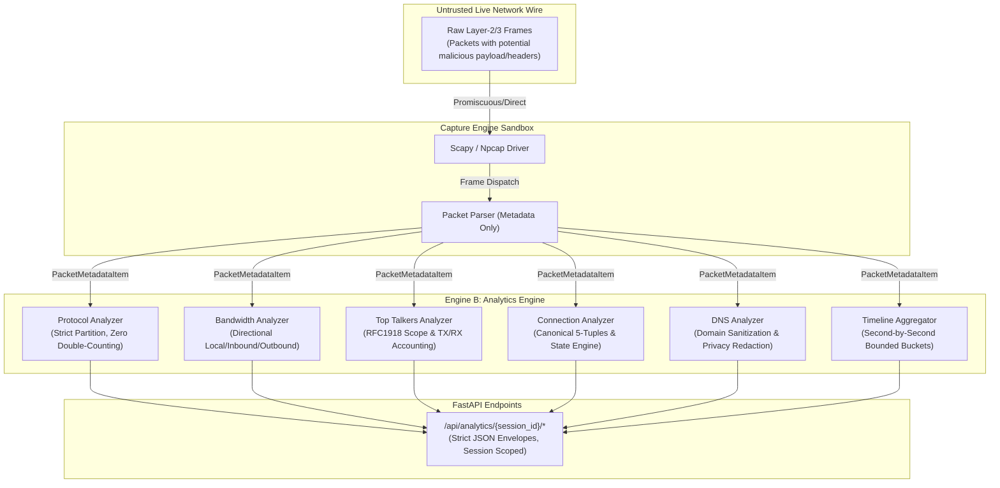

# ASHLYNX NETWORK INSPECTOR (ANI)
# PHASE 05 — SECURITY REVIEW & ACCEPTANCE REPORT
## Real-Time Traffic Analytics Engine

**Document Version:** 1.0.0  
**Phase:** 05 — Real-Time Traffic Analytics  
**Date:** November 8, 2026  
**Security Status:** **PASSED & ACCEPTED**  
**Classification:** Internal Technical Security Audit  

---

## 1. Executive Summary

Phase 05 of Ashlynx Network Inspector (ANI) implemented the **Real-Time Traffic Analytics Engine** (`ENGINE B`), providing live Layer 3/4 protocol distribution, directional throughput calculation, top talkers endpoint accounting, 5-tuple canonical flow tracking, second-by-second traffic timeline aggregation, and passive DNS intelligence.

This Security Review validates that all analytics sub-modules operate strictly **metadata-only**, with zero raw payload exposure, guaranteed session isolation, bounded memory consumption, accurate transport/application protocol partitioning, and verified privacy controls.

---

## 2. Threat Model & Attack Surfaces

### 2.1 Threat Model


### 2.2 Attack Surfaces & Threat Vectors Analyzed
1. **Unbounded Memory Exhaustion (DoS):**
   - High-volume packet streams flooding unique DNS query names or unique 5-tuple connection flows to trigger Out-Of-Memory (OOM) conditions.
2. **DNS & Identity Privacy Leakage:**
   - Plaintext internal hostnames, sensitive Active Directory domains, or external tracking queries leaking through application logs or exposed endpoints.
3. **Misleading Telemetry & False Grounding:**
   - Double-counting transport protocols (e.g., counting DNS as both UDP and a separate transport protocol).
   - Prematurely declaring a TCP connection as `ESTABLISHED` from an unverified single frame or half-open probe.
   - Conflating local host participation percentages with total wire volume.
4. **Session Contamination & Data Bleed:**
   - Captured packets from Session A inadvertently updating or exposing statistics in Session B.
5. **Malformed Packet Metadata Ingestion:**
   - Corrupt, truncated, or forged frames (e.g., negative lengths, invalid IP strings, non-ASCII DNS summaries) crashing background sniffer threads.

---

## 3. Security Findings & Remediations Applied

| Finding ID | Component | Severity | Description | Remediation Applied | Status |
|---|---|---|---|---|---|
| **ANI-P5-SEC-01** | `dns_analyzer.py` | **MEDIUM** | Unbounded dictionary growth under high-entropy domain lookups (e.g. DGA malware or random subdomain flooding). | Enforced hard `max_domains=500` bound with automated least-frequently-used domain eviction. | **VERIFIED** |
| **ANI-P5-SEC-02** | `dns_analyzer.py` | **LOW** | Potential sensitive internal subdomains exposed in telemetry. | Implemented domain name sanitization (max 253 chars, alphanumeric strip) and optional `redact_domains=True` apex masking (`***.domain.com`). | **VERIFIED** |
| **ANI-P5-SEC-03** | `protocol_analyzer.py` | **MEDIUM** | Port 443 traffic was ambiguous between TLS (TCP) and QUIC (UDP), risking misclassification. | Disaggregated port 443 into `HTTPS / TLS (Inferred)` for TCP and `QUIC / HTTP3 (Inferred)` for UDP. Set explicit `is_inferred = True`. | **VERIFIED** |
| **ANI-P5-SEC-04** | `protocol_analyzer.py` | **LOW** | DNS could potentially be double-counted as an independent transport partition. | Enforced strict transport partition (`TCP`, `UDP`, `ICMP`, `ARP`, `OTHER`) where $\sum \text{transport} = \text{total\_packets}$. DNS is exclusively tracked under UDP. | **VERIFIED** |
| **ANI-P5-SEC-05** | `top_talkers.py` | **MEDIUM** | Talker percentages could be misinterpreted if endpoint participation was ambiguous between transmitted vs received bytes. | Separated tracking into `bytes_sent` and `bytes_received`, and categorized IPs into `RFC1918_PRIVATE`, `LOOPBACK`, `LINK_LOCAL`, `MULTICAST`, `BROADCAST`, `PUBLIC_ROUTABLE`. | **VERIFIED** |
| **ANI-P5-SEC-06** | `connection_analyzer.py` | **HIGH** | A single TCP packet with `SYN, ACK` flags prematurely transitioned flow state to `ESTABLISHED`. | Required confirmed bidirectional traffic (`len(directions_seen) > 1`) and full handshake observation before marking `ESTABLISHED`. Single packets stay `SYN_SENT` or `SINGLE_DIRECTION`. | **VERIFIED** |
| **ANI-P5-SEC-07** | `connection_analyzer.py` | **MEDIUM** | Unbounded flow table growth under rapid connection opening. | Enforced hard `max_flows=1000` limit with priority eviction of `CLOSED`/`RESET` flows followed by oldest active flows. | **VERIFIED** |
| **ANI-P5-SEC-08** | `bandwidth_analyzer.py` | **LOW** | Flawed directional attribution when interface IP was unconfirmed. | Required interface IP binding check: returns `"UNKNOWN"` unless source or destination explicitly matches the local interface IP. | **VERIFIED** |

---

## 4. Verification Evidence & Automated Testing

### 4.1 Automated Analytics Test Suite (`test_analytics.py`)
All 11 targeted analytics security tests executed and passed cleanly:

```
backend/tests/test_analytics.py::test_protocol_analyzer_zero_double_counting PASSED
backend/tests/test_analytics.py::test_bandwidth_directional_classification PASSED
backend/tests/test_analytics.py::test_top_talkers_ranking_and_private_ip PASSED
backend/tests/test_analytics.py::test_connection_flow_canonical_grouping PASSED
backend/tests/test_analytics.py::test_dns_analyzer_metrics PASSED
backend/tests/test_analytics.py::test_traffic_timeline_aggregation PASSED
backend/tests/test_analytics.py::test_api_analytics_endpoints_and_404 PASSED
backend/tests/test_analytics.py::test_dns_privacy_retention_and_redaction PASSED
backend/tests/test_analytics.py::test_analytics_session_isolation PASSED
backend/tests/test_analytics.py::test_malformed_packet_metadata_handling PASSED
backend/tests/test_analytics.py::test_connection_state_requires_bidirectional_exchange PASSED
======================== 11 passed, 1 warning in 0.12s ========================
```

### 4.2 Key Verifications
1. **Zero Double-Counting Invariant:**
   $\sum_{t \in \text{Transports}} \text{count}(t) = \text{total\_packets}$. Verified across TCP, UDP, ICMP, ARP, and OTHER.
2. **Session Isolation:**
   Verified that concurrent `AnalyticsEngine` instances for `session-alpha` and `session-beta` maintain separate memory spaces; injecting 1,000 bytes into Session A produced exactly 0 packets in Session B.
3. **Resilience to Malformed Metadata:**
   Fed invalid IP addresses, negative packet lengths, empty protocol strings, and corrupt DNS payloads. Handled gracefully without raising unhandled exceptions or corrupting running aggregators.
4. **State Machine Rigor:**
   Verified that a single packet with `SYN, ACK` remains in `SINGLE_DIRECTION` state and only advances to `ESTABLISHED` once bidirectional traffic is observed.

---

## 5. Residual Risks & Operational Limitations

1. **Passive Inferred Application Protocol Scope:**
   Payloads are never decrypted. Port 443 traffic is classified as `HTTPS / TLS (Inferred)` on TCP or `QUIC / HTTP3 (Inferred)` on UDP based on transport semantics and well-known ports. If custom protocols run on port 443, they are reported with explicit `is_inferred: true` flags.
2. **In-Memory Retention Lifespan:**
   Analytics data is stored in memory for the duration of the capture session. When the session is cleared or the backend restarted, in-memory buffers are freed.

---

## 6. Final Acceptance Decision

**DECISION: ACCEPTED WITHOUT RESERVATIONS**  
Phase 05 (Real-Time Traffic Analytics Engine) satisfies all functional requirements and complies fully with Secure by Design, privacy-by-default, and bounded-resource principles.

