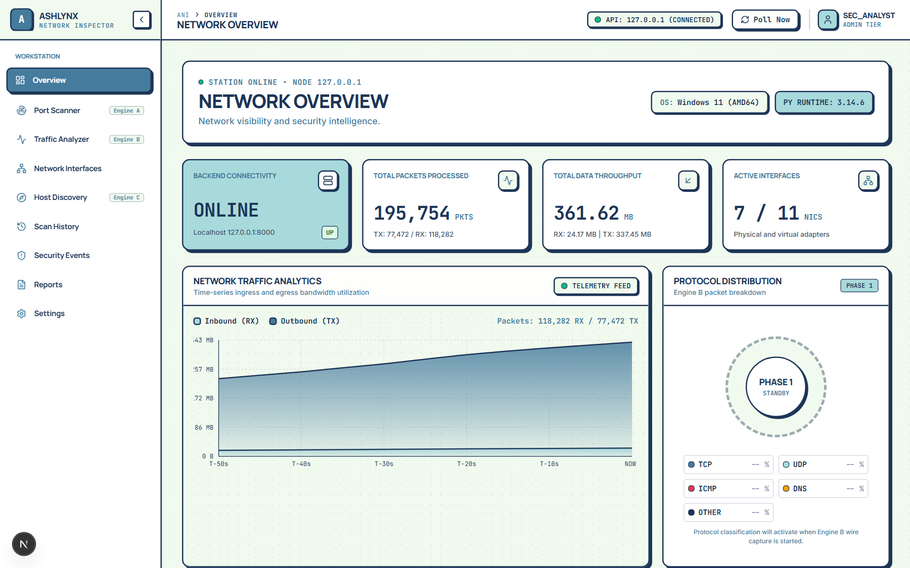
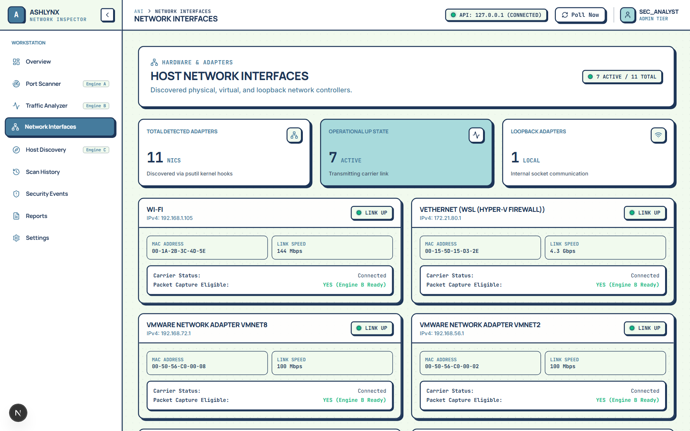
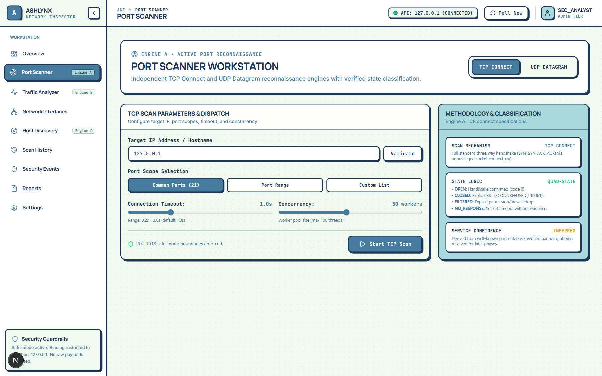
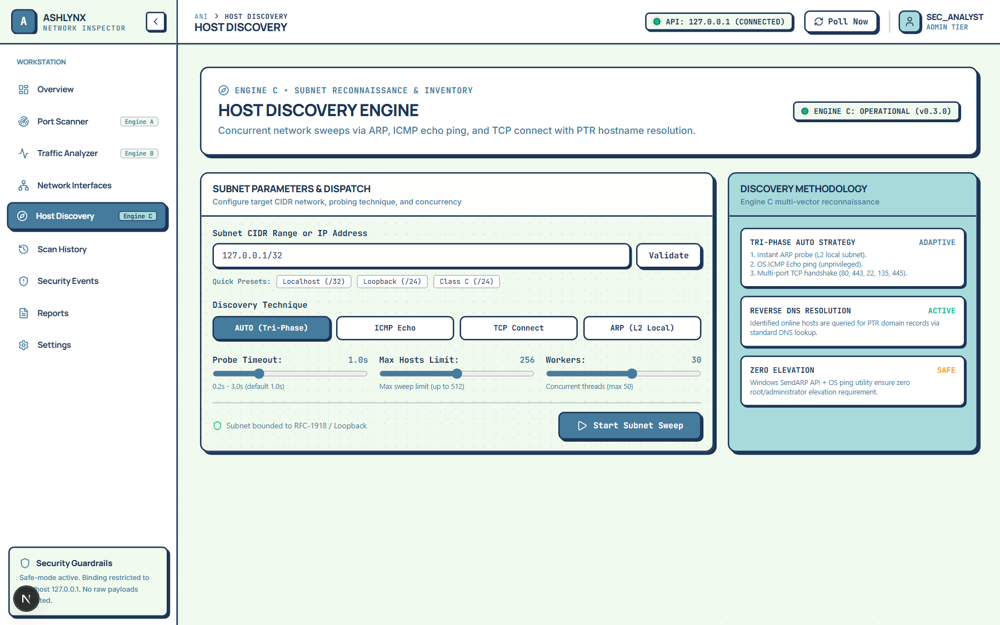
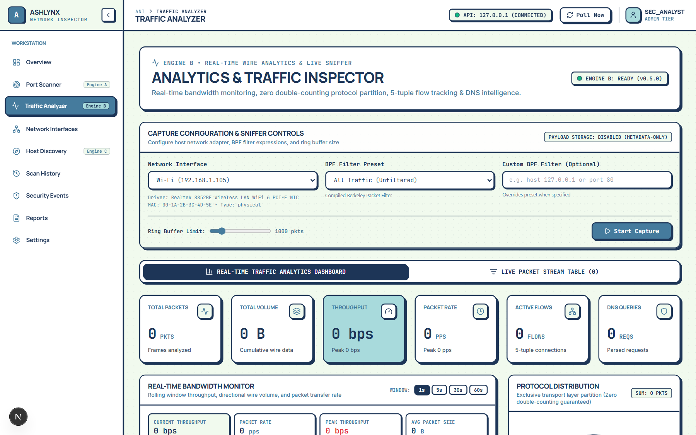
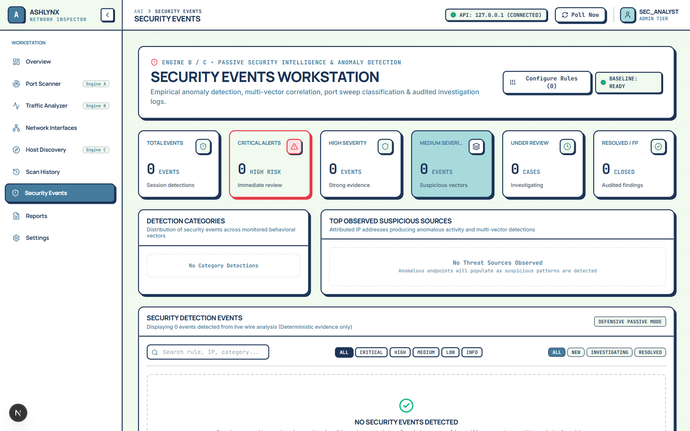
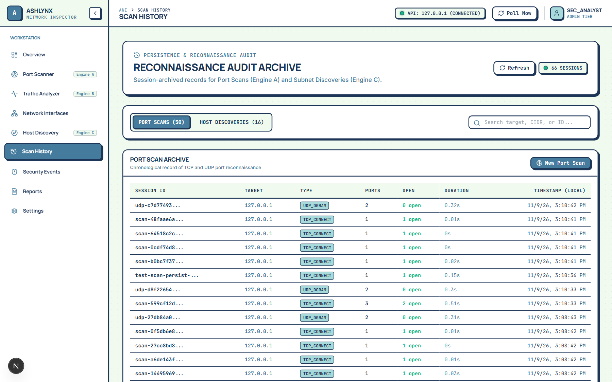
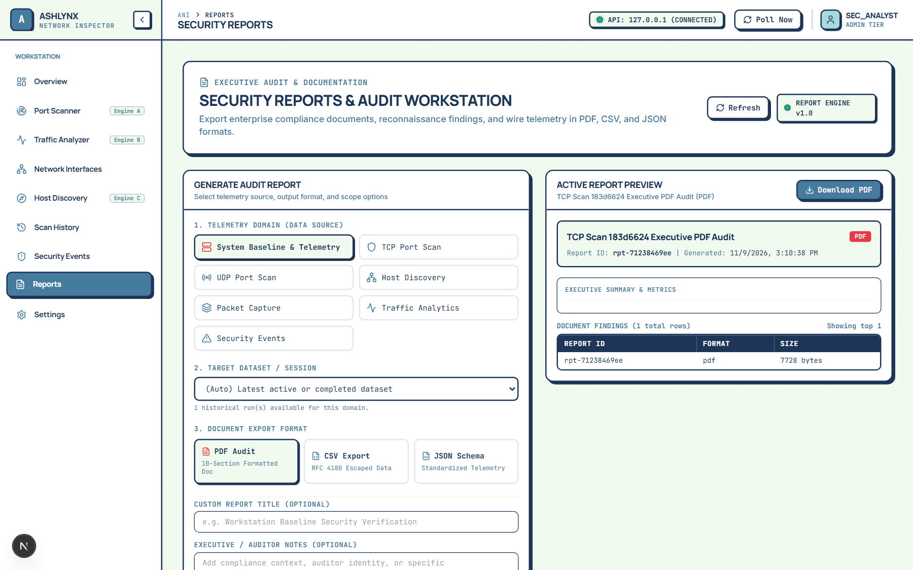
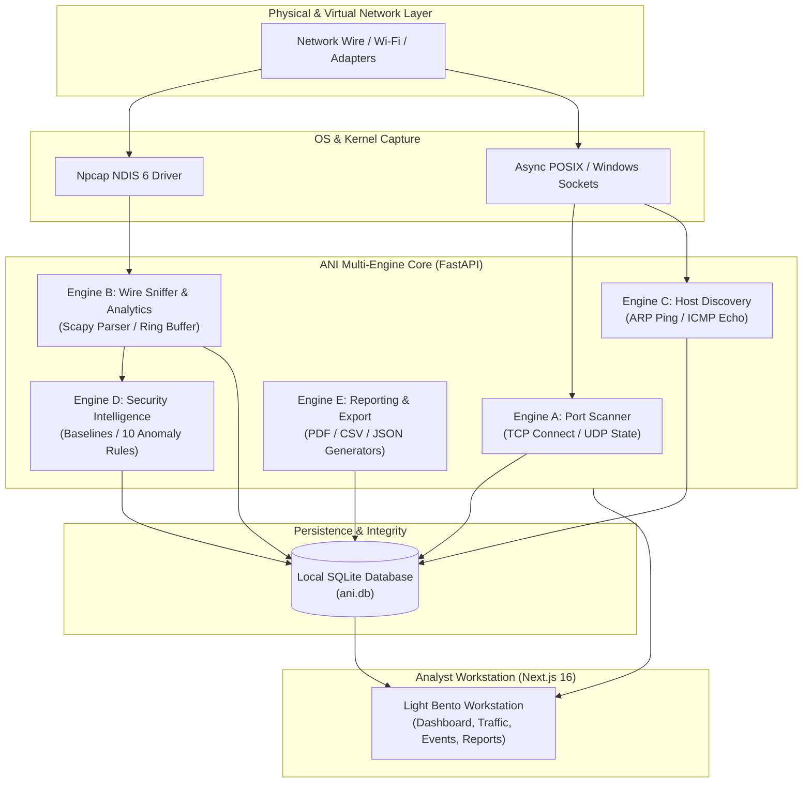

# ASHLYNX NETWORK INSPECTOR (ANI)

<p align="center">
  
  
  
  
  
  
  
  
  
</p>

<p align="center">
  <strong>Defensive Network Reconnaissance, Traffic Intelligence & Behavioral Anomaly Detection.</strong><br />
  A local-first, privacy-preserving defensive network analyzer and visual security workstation.
</p>

<p align="center">
  <strong>Engineered by Hala Naaz</strong><br />
  AshlynxCyber
</p>

<p align="center">
  <a href="https://github.com/HalaNaaz/AshlynxNetworkInspector">GitHub Repository</a> •
  <a href="#system-architecture">Architecture</a> •
  <a href="SECURITY.md">Security Documentation</a> •
  <a href="docs/RELEASE_NOTES_v1.0.0.md">Release Notes</a>
</p>

---

## About ANI

**Ashlynx Network Inspector (ANI)** is an enterprise-grade, defensive network visibility, traffic intelligence, and behavioral anomaly detection platform engineered for Security Operations Center (SOC) analysts, network administrators, and incident response personnel.

In modern cybersecurity operations, defensive visibility is frequently fractured. Analysts must juggle disparate command-line utilities (`nmap`, `tshark`, `arp-scan`, `netstat`), grapple with the significant data privacy hazards of unencrypted raw packet captures, endure alert fatigue caused by rigid static thresholds, and reconcile contradictory network summaries across disconnected tools.

ANI resolves this operational fragmentation by integrating **active port reconnaissance, local subnet discovery, zero-payload wire packet sniffing, directional throughput metering, DNS intelligence, explainable anomaly scoring, and SOC investigation workflows** into a single, high-contrast, local-first visual workstation.

### The Defensive Approach

> **Enumerate the perimeter → monitor live wire metadata → establish behavioral baselines → detect deterministic anomalies → investigate with verifiable audit trails.**

### Core Platform Pillars

- **Local-First Architecture**: Operates directly on the analyst's workstation using a Next.js frontend, FastAPI backend, and persistent local SQLite database. No packet data, captured headers, or host summaries ever leave your machine.
- **Strictly Defensive Design**: ANI is non-destructive. It never injects hostile payloads, never disrupts routing tables, never executes weaponized exploits, and restricts active probing exclusively to RFC 1918 private subnets and local loopback interfaces.
- **Zero-Payload Wire Inspection**: The capture pipeline inspects Layer 2 through Layer 4 packet headers exclusively. Application payloads and packet bodies are discarded at the hook, completely eliminating the credential and PII leakage risks inherent to raw `.pcap` files.
- **Explainable Anomaly Scoring**: Threat indicators are computed using transparent mathematical formulas combining severity weights, confidence certainty, and temporal clustering—eliminating opaque black-box scoring.

---

# Key Features

## 1. Network Overview Dashboard

A high-density Light Bento workstation providing immediate situational awareness across host interfaces, active capture status, hardware interface counters, recent port discoveries, and live wire protocol distribution.



*The executive overview brings together live station telemetry, bound adapter status, quick-action navigation, and recent discovery findings into an ergonomic, high-contrast layout designed for extended operational monitoring.*

---

## 2. Dynamic Network Interface Discovery

Dynamic enumeration and real-time monitoring of all physical, virtual, loopback, and containerized network adapters present on the host system without relying on hardcoded network assumptions.



*Inspects operating state (UP/DOWN), link speeds, IPv4 addresses, subnet masks, default gateway assignments, and MAC hardware addresses across Wi-Fi, Ethernet, WSL virtual switches, and hypervisor bridges.*

---

## 3. TCP & UDP Port Scanning

A controlled, dual-engine transport reconnaissance subsystem providing high-concurrency TCP Connect probing and UDP datagram state discovery with strict RFC 1918 private network boundary enforcement.



*Executes targeted scans across curated profiles (Quick, Common Services, Extended, or Custom Ranges) with banner grabbing, high-resolution RTT latency measurement, and strict rate-limiting controls to prevent network disruption.*

---

## 4. Subnet Host Discovery

Active Layer 2 ARP inspection and Layer 3 ICMP echo sweeps designed to map live network devices, identify gateway routes, and resolve local hostnames.



*Discovers connected network hosts with precise semantic state classification (`ONLINE`, `NO_RESPONSE`, `UNREACHABLE`, `UNKNOWN`), high-resolution microsecond latency measurement, vendor OUI MAC identification, and reverse DNS resolution.*

---

## 5. Live Packet Capture

A non-blocking packet capture pipeline powered by Scapy and Npcap kernel filtering, capturing wire frames asynchronously through bounded in-memory ring buffers.



*Features Berkeley Packet Filter (BPF) syntax validation, bounded ring buffer memory management (FIFO auto-eviction), interface binding, and real-time capture session digest hashing.*

---

## 6. Network Traffic Analytics

Continuous wire traffic analysis delivering directional throughput metrics, transport protocol distribution, and host communication matrix tracking.


*Provides rolling-window bandwidth calculations (1s, 5s, 30s, 60s), bidirectional ingress/egress/local traffic classification, canonical 5-tuple connection flow tracking, and Top Talker bandwidth ranking.*

---

## 7. DNS Intelligence

Dedicated visibility into Domain Name System (DNS) query dynamics over UDP and TCP without decrypting or persisting sensitive application payloads.

*Tracks overall query volume, NXDOMAIN response error ratios, query type distributions (A, AAAA, CNAME, PTR, TXT, MX, SRV), top queried domain names, and suspicious high-frequency query bursts.*

---

## 8. Security Event Detection

A deterministic behavioral anomaly detection engine that monitors real-time wire metrics against dynamic session baselines across 10 security detection rules.



*Detects port scan patterns, SYN flood floods, traffic volume spikes, DNS bursts, and unauthorized administrative access attempts (RDP, SMB, Telnet, SSH) with automated MITRE ATT&CK mapping.*

---

## 9. Investigation Lifecycle

A dedicated SOC investigation drawer supporting formal lifecycle state progression and human analyst notes for every detected security event.


*Supports auditable lifecycle state transitions (`NEW` → `ACKNOWLEDGED` → `INVESTIGATING` → `RESOLVED` / `FALSE_POSITIVE`), chronological analyst notes, and immutable audit logs persisted to SQLite.*

---

## 10. Scan History & Persistence

Permanent local SQLite persistence for every active scan, subnet discovery sweep, wire capture session, and security incident.



*Review historical scan results, inspect past capture metrics, reload historical session flow tables, and track network changes over time without external database dependencies.*

---

## 11. Reporting & Export

Multi-format export center generating executive PDF reports, structured CSV audit spreadsheets, and schema-validated JSON data packages.



*Generates publication-quality PDF documents using ReportLab vector typography, RFC 4180 compliant CSV exports with formula injection protection (`=`, `+`, `-`, `@`), and SHA-256 session integrity verification.*

---

# Technology Stack

<p align="center">
  <a href="https://www.python.org/"></a>
  <a href="https://fastapi.tiangolo.com/"></a>
  <a href="https://nextjs.org/"></a>
  <a href="https://react.dev/"></a>
  <a href="https://www.typescriptlang.org/"></a>
  <a href="https://tailwindcss.com/"></a>
  <a href="https://www.sqlite.org/"></a>
  <a href="https://scapy.net/"></a>
  <a href="https://npcap.com/"></a>
  <a href="https://docs.pytest.org/"></a>
</p>

| Layer | Technologies | Role & Purpose |
|---|---|---|
| **Frontend Workstation** | Next.js 16.4.5 (Turbopack), React 19, TypeScript 5.0+, Tailwind CSS v4, Lucide Icons, Recharts | High-performance Bento-box UI, real-time telemetry polling, data visualization, and SOC investigation workflows. |
| **Backend Core** | Python 3.11+ / 3.14, FastAPI, Uvicorn, Pydantic v2.9+, Starlette | Asynchronous REST API, engine dispatching, rate limiting, and mathematical anomaly scoring. |
| **Packet Engine** | Scapy 2.6+, Npcap 1.70+, Windows NDIS 6.x | Raw L2/L3 packet capture, BPF kernel-level filtering, packet header parsing, and ARP/ICMP probing. |
| **Persistence & Audit** | SQLite 3, SQLAlchemy 2.0 (Core), Python Database API 2.0 | Zero-configuration local database for scans, discoveries, flows, security events, and audit trails. |
| **Reporting Engine** | ReportLab 4.2+, Standard Library CSV / JSON | Cryptographically hashed executive PDFs, RFC 4180 CSV generation, and schema-validated JSON serialization. |

---

# System Architecture

ANI is organized into five decoupled inspection engines orchestrated by FastAPI and presented through an ergonomic Next.js Light Bento interface:



### Engine Responsibilities

1. **Engine A — TCP & UDP Scanner** (`/scanner`): High-concurrency transport port reconnaissance, banner acquisition, and response latency measurement with private IP scope verification.
2. **Engine B — Wire Capture & Traffic Analytics** (`/traffic`): Asynchronous packet capture, BPF filtering, zero double-counting protocol breakdown, directional bandwidth calculation, and canonical 5-tuple flow tracking.
3. **Engine C — Host & Subnet Discovery** (`/discovery`): Layer 2 ARP discovery, ICMP sweeps, reverse DNS lookups, and microsecond latency measurement across local subnets.
4. **Engine D — Security Intelligence & Anomaly Detection** (`/events`): Real-time behavioral anomaly detection using session baselines, 10 deterministic security rules, and full lifecycle investigation management.
5. **Engine E — Reporting & Audit** (`/reports`): Generates verifiable executive reports in PDF, CSV, and JSON formats with RFC 4180 formula injection neutralization and SHA-256 session integrity digests.

---

# Security & Privacy

Defensive security and user data privacy are foundational engineering commitments in ANI:

| Security Boundary | Verified Implementation Guarantee |
|---|---|
| **Zero Raw Payload Storage** | ANI inspects Layer 2 through Layer 4 packet headers exclusively. Application data, packet bodies, credentials, tokens, cookies, and cleartext payloads are discarded immediately at ingestion. |
| **Bounded Ring Buffers** | In-memory packet storage is capped by strict FIFO limits (default: 1,000 packets per session). When memory limits are reached, oldest packets are evicted, eliminating workstation memory leaks. |
| **Target Scope Restrictions** | Active scanning and discovery operations are restricted to RFC 1918 private IPv4 ranges (`10.0.0.0/8`, `172.16.0.0/12`, `192.168.0.0/16`) and local loopback (`127.0.0.1`). Public Internet scanning is blocked by default. |
| **Deterministic Detection** | Security anomaly rules rely on explicit mathematical thresholds and statistical session baselines. ANI does not hallucinate or guess attack vectors. |
| **Formula Injection Defense** | All CSV exports sanitize cells starting with `=`, `+`, `-`, `@`, `\t`, or `\r` by prefixing a single quote (`'`), protecting analysts opening exported spreadsheets in Microsoft Excel. |
| **Local Data Isolation** | All scan history, capture summaries, flow tables, and investigation notes are stored in local SQLite database files. Zero telemetry or diagnostics are transmitted externally. |

### Known Operational Limitations

- **Windows Npcap Dependency**: Live wire sniffing requires an installed Npcap driver (v1.70+) configured with WinPcap compatibility mode.
- **Passive Transport Visibility**: Transport analysis inspects cleartext packet headers. Payloads encapsulated within encrypted TLS/HTTPS sessions cannot be inspected beyond standard port and SNI inference.
- **Single-Host Scapy Ring Buffer**: High-throughput networks exceeding 100,000 PPS may experience kernel-level packet drops if the host workstation CPU is saturated.

---

# Testing & Quality Assurance

Every build of Ashlynx Network Inspector is rigorously verified across unit, integration, and security test suites:

<p align="center">
  
  
  
  
</p>

### Verified Test Suite Results

```text
============================== test session starts ==============================
platform win32 -- Python 3.14.6, pytest-9.1.1, pluggy-1.6.0
rootdir: C:\Users\Hala\Downloads\Project Files\Ashlynx Network Inspector
collected 119 items

backend/tests/test_analytics.py ..................................       [ 28%]
backend/tests/test_capture.py .................                          [ 42%]
backend/tests/test_discovery.py ..............                           [ 54%]
backend/tests/test_interfaces.py ...........                             [ 63%]
backend/tests/test_reports.py .................                          [ 78%]
backend/tests/test_scanner.py ...........                                [ 87%]
backend/tests/test_security.py ...............                           [100%]

======================== 119 passed, 14 warnings in 28.77s =====================
```

### Frontend Production Build Verification

```text
▲ Next.js 16.4.5 (Turbopack)
✓ Compiled successfully in 1470ms
  Running TypeScript ...
  Finished TypeScript in 3.4s (0 errors)
✓ Generating static pages using 13 workers (12/12) in 2.3s
  Finalizing page optimization ...

Route (app)
┌ ○ /                           (Overview Dashboard)
├ ○ /_not-found                 (404 Handler)
├ ○ /discovery                  (Engine C Subnet Discovery)
├ ○ /events                     (Engine D Security Events)
├ ○ /history                    (SQLite Scan History)
├ ○ /interfaces                 (Network Interface Manager)
├ ○ /reports                    (Engine E Reporting Center)
├ ○ /scanner                    (Engine A Port Reconnaissance)
├ ○ /settings                   (Configuration & Limits)
└ ○ /traffic                    (Engine B Traffic Analytics)
```

---

# Quickstart & Installation

### Prerequisites

- **Operating System**: Windows 11 (64-bit) / Windows 10
- **Python**: Version 3.11 or later
- **Node.js**: Version 18.0 or later (Node 20+ recommended)
- **Packet Capture Driver**: [Npcap](https://npcap.com/#download) (Select *"Install Npcap in WinPcap API-compatible Mode"* during installation)

---

### Step 1: Clone the Repository

```bash
git clone https://github.com/HalaNaaz/AshlynxNetworkInspector.git
cd AshlynxNetworkInspector
```

---

### Step 2: Backend Setup

Open PowerShell or Command Prompt with administrative privileges (required for raw packet capture sockets):

```bash
# 1. Create and activate a Python virtual environment
python -m venv venv
venv\Scripts\activate

# 2. Install backend dependencies
pip install -r requirements.txt

# 3. Launch the FastAPI application server
uvicorn backend.app.main:app --host 127.0.0.1 --port 8000 --reload
```

The backend API will initialize at `http://127.0.0.1:8000`.

---

### Step 3: Frontend Setup

Open a separate terminal window:

```bash
# 1. Navigate to the frontend directory
cd frontend

# 2. Install Node dependencies
npm install

# 3. Start the Next.js development workstation
npm run dev
```

The Next.js workstation will be accessible at `http://localhost:3000`.

---

### Operational Endpoints

| Service | Address | Description |
|---|---|---|
| **ANI Workstation UI** | `http://localhost:3000` | Light Bento desktop interface for all inspection engines |
| **FastAPI REST API** | `http://127.0.0.1:8000` | Core backend service dispatching active and passive operations |
| **Interactive API Docs** | `http://127.0.0.1:8000/docs` | Swagger UI documentation with schema schemas and execution forms |
| **Alternative API Specs** | `http://127.0.0.1:8000/redoc` | OpenAPI ReDoc specification |

---

# Documentation & Credits

For detailed architectural specifications, audit logs, and security controls, refer to the documentation suite:

- **[ARCHITECTURE.md](ARCHITECTURE.md)**: Technical breakdown of multi-engine pipelines, threading models, and ring-buffer lifecycles.
- **[SECURITY.md](SECURITY.md)**: Master security audit register, formula injection defenses, and vulnerability disclosure policy.
- **[RELEASE_NOTES_v1.0.0.md](docs/RELEASE_NOTES_v1.0.0.md)**: Release milestones, engine verification logs, and changelog.

---

### Engineering & Authorship

<p align="center">
  <strong>Ashlynx Network Inspector (ANI)</strong><br />
  Engineered by <strong>Hala Naaz</strong><br />
  <strong>AshlynxCyber</strong>
</p>

---

# License

This project is released under the **[MIT License](LICENSE)**.

```text
Copyright (c) 2026 Hala Naaz (AshlynxCyber)

Permission is hereby granted, free of charge, to any person obtaining a copy
of this software and associated documentation files (the "Software"), to deal
in the Software without restriction, including without limitation the rights
to use, copy, modify, merge, publish, distribute, sublicense, and/or sell
copies of the Software, and to permit persons to whom the Software is
furnished to do so, subject to the following conditions:

The above copyright notice and this permission notice shall be included in all
copies or substantial portions of the Software.
```
