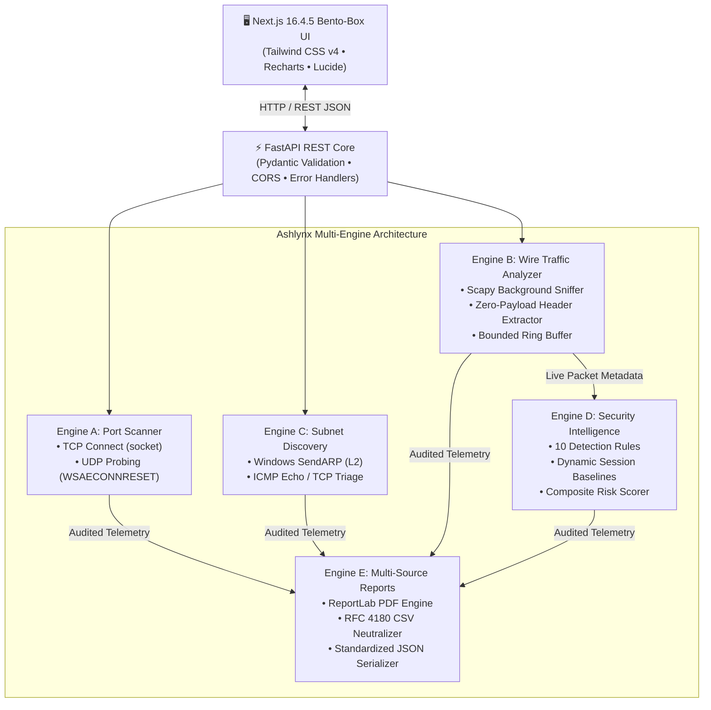
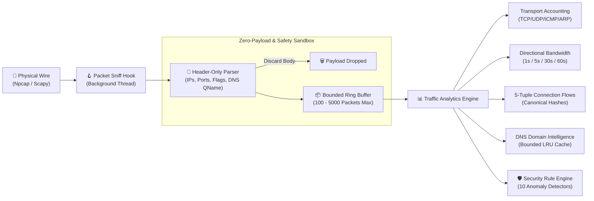
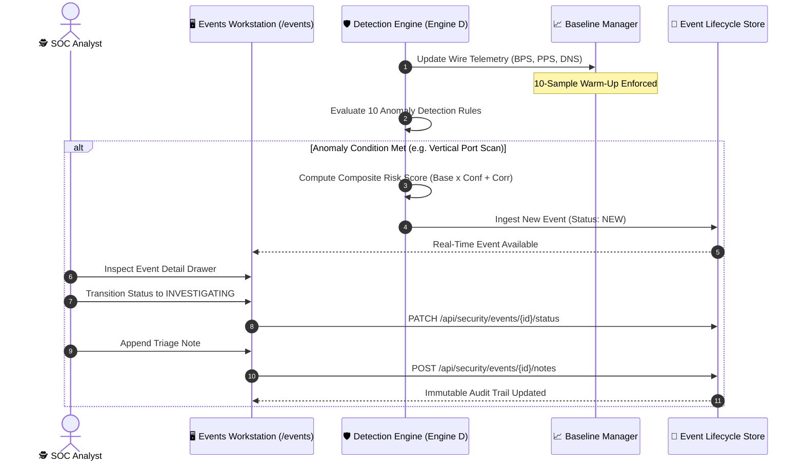

<div align="center">

# 🐾 ASHLYNX NETWORK INSPECTOR (ANI)
### Defensive Network Reconnaissance, Wire Traffic Intelligence & Behavioral Anomaly Detection Platform

[](https://github.com/HalaNaaz/AshlynxNetworkInspector/releases/tag/v1.0.0)
[](https://www.python.org/)
[](https://fastapi.tiangolo.com/)
[](https://nextjs.org/)
[](https://www.typescriptlang.org/)
[](https://tailwindcss.com/)
[](TESTING_AND_QA.md)
[](SECURITY.md)
[](LICENSE)

<br/>

**[Architecture Specification](ARCHITECTURE.md)** • **[Security Policy](SECURITY.md)** • **[Testing & QA Suite](TESTING_AND_QA.md)** • **[Known Limitations](KNOWN_LIMITATIONS.md)** • **[Release Notes](RELEASE_NOTES_v1.0.0.md)**

</div>

---

## 📑 Table of Contents

- [1. Executive Overview & Project Identity](#1-executive-overview--project-identity)
- [2. The Defensive Dilemma & The ANI Solution](#2-the-defensive-dilemma--the-ani-solution)
- [3. Technology Stack & Architectural Dependencies](#3-technology-stack--architectural-dependencies)
- [4. Deep Feature Technical Documentation](#4-deep-feature-technical-documentation)
  - [4.1 Active TCP Connect Reconnaissance (Engine A)](#41-active-tcp-connect-reconnaissance-engine-a)
  - [4.2 UDP Datagram & Service State Probing (Engine A)](#42-udp-datagram--service-state-probing-engine-a)
  - [4.3 Subnet Host Discovery & L2/L3 Triage (Engine C)](#43-subnet-host-discovery--l2l3-triage-engine-c)
  - [4.4 Live Wire Packet Capture & BPF Sniffing (Engine B)](#44-live-wire-packet-capture--bpf-sniffing-engine-b)
  - [4.5 Zero Double-Counting Protocol Distribution (Engine B)](#45-zero-double-counting-protocol-distribution-engine-b)
  - [4.6 Directional Bandwidth & Moving-Window Throughput (Engine B)](#46-directional-bandwidth--moving-window-throughput-engine-b)
  - [4.7 Top Talkers & IP Scope Classification (Engine B)](#47-top-talkers--ip-scope-classification-engine-b)
  - [4.8 Canonical 5-Tuple Connection Flow Tracking (Engine B)](#48-canonical-5-tuple-connection-flow-tracking-engine-b)
  - [4.9 DNS Intelligence & Privacy-Preserving Analytics (Engine B)](#49-dns-intelligence--privacy-preserving-analytics-engine-b)
  - [4.10 Passive Security Intelligence & Behavioral Anomaly Detection (Engine D)](#410-passive-security-intelligence--behavioral-anomaly-detection-engine-d)
  - [4.11 Multi-Format Audit & Compliance Reporting (Engine E)](#411-multi-format-audit--compliance-reporting-engine-e)
- [5. Comprehensive Feature Matrix](#5-comprehensive-feature-matrix)
- [6. System Architecture & Visual Data Flows](#6-system-architecture--visual-data-flows)
  - [6.1 Multi-Engine Component Architecture](#61-multi-engine-component-architecture)
  - [6.2 Wire Packet Metadata Processing Pipeline](#62-wire-packet-metadata-processing-pipeline)
  - [6.3 Security Anomaly Detection & Incident Lifecycle](#63-security-anomaly-detection--incident-lifecycle)
- [7. Repository Structure](#7-repository-structure)
- [8. Quickstart & Installation (Windows 11)](#8-quickstart--installation-windows-11)
- [9. Complete REST API Specification](#9-complete-rest-api-specification)
- [10. Verification, Automated Testing & QA Evidence](#10-verification-automated-testing--qa-evidence)
- [11. Security, Privacy & Safe Operation](#11-security-privacy--safe-operation)
- [12. Operational Boundaries & Known Limitations](#12-operational-boundaries--known-limitations)
- [13. Author, Attribution & Project Credits](#13-author-attribution--project-credits)

---

## 1. Executive Overview & Project Identity

**Ashlynx Network Inspector (ANI)** is an enterprise-grade, defensive network security and traffic intelligence platform built from the ground up for Security Operations Center (SOC) analysts, network administrators, and incident response teams.

Unlike conventional command-line tools that operate in isolation or heavyweight commercial SIEMs that require massive server footprints, ANI bridges active reconnaissance and real-time wire analytics inside a single, cohesive desktop workstation. It couples high-precision active probing (TCP Connect and UDP state discovery) with 100% passive packet metadata inspection, statistical behavioral baselining, explainable composite risk scoring, and automated compliance reporting.

### Core Architectural Tenets
1. **Defensive by Design**: ANI is strictly a defensive visibility platform. It never injects hostile packets, never executes weaponized exploit payloads, never disrupts network routes, and never modifies system firewalls.
2. **Metadata-Only & Zero-Payload Guarantee**: At no point in packet ingestion or processing does ANI store, persist, log, or transmit raw packet payloads, application bodies, credentials, tokens, cookies, or sensitive message contents.
3. **Statistical Baselines & Zero Cold-Start False Positives**: Security detection rules do not trigger on arbitrary single events. An automated warm-up period gathers ambient network metrics before statistical traffic and DNS burst rules activate.
4. **Bento-Box Neobrutalist Workstation**: Information architecture built around human clarity. High-contrast typography (`#1D3557`), sharp neobrutalist borders (`border-2 border-[#1D3557]`), tactile tactile shadows (`shadow-[4px_4px_0px_#1D3557]`), and soft contrast surfaces (`#F1FAEE` and `#FFFFFF`) eliminate visual fatigue during critical incident triage.

---

## 2. The Defensive Dilemma & The ANI Solution

| Operational Challenge | Traditional Approach | Ashlynx Network Inspector (ANI) Solution |
|---|---|---|
| **Fragmented Reconnaissance** | Running disparate CLI utilities (`nmap`, `tshark`, `arp-scan`, `curl`) producing disconnected text outputs that require manual parsing. | **Unified Multi-Engine Core**: Orchestrates TCP scanning, UDP probing, subnet discovery, packet sniffing, flow analytics, and security alerts through a unified API and cohesive Light Bento UI. |
| **Privacy Leaks in Capture** | Tools like Wireshark capture complete payloads into unencrypted `.pcap` files, exposing passwords, bearer tokens, PII, and financial records to anyone inspecting the file. | **Zero-Payload Wire Inspection**: The packet parser extracts protocol headers exclusively. Payloads are instantly discarded at the capture hook. Bounded in-memory ring buffers prevent unbounded memory growth. |
| **Protocol Double-Counting** | Naive analyzers count a single DNS query over UDP as both "UDP" and "DNS", inflating summary traffic metrics past 100%. | **Exclusive Layer-3/4 Partition**: Strict transport accounting ensures $\sum(\text{TCP}, \text{UDP}, \text{ICMP}, \text{ARP}, \text{OTHER}) = \text{Total Packets}$. Application protocols are tracked independently with explicit `(Inferred)` labels. |
| **Alert Fatigue & Cold-Start Spikes** | Fixed-threshold security alerts trigger immediately when an application starts up or a browser opens tabs, overwhelming analysts with hundreds of false alarms. | **Dynamic Session Baselines & Warm-Up Gates**: Establishes rolling averages for bandwidth, PPS, and DNS volume. Enforces a 10-sample warm-up window before evaluating statistical spike conditions. |
| **Opaque Threat Scores** | Proprietary "AI threat scores" output arbitrary 1–100 numbers with no explanation of how the score was derived. | **Explainable Composite Risk Formula**: Pure mathematical scoring combining base severity points ($S \in [15, 95]$), empirical certainty confidence ($C \in [0.0, 1.0]$), and multi-vector correlation adjustments. |
| **Formula Injection in Reports** | CSV and JSON report exports dump unescaped user or network data, allowing malicious reverse-DNS or hostnames (`=cmd|' /C ...'!A0`) to compromise Excel users. | **RFC 4180 Formula Neutralization**: All report generators sanitize fields starting with `=`, `+`, `-`, or `@` by prepending a single quote (`'`), ensuring spreadsheet safety. |

---

## 3. Technology Stack & Architectural Dependencies

```
┌────────────────────────────────────────────────────────────────────────┐
│                        ASHLYNX CLIENT WORKSTATION                      │
│   Next.js 16.4.5 (Turbopack) • React 19.3 • Tailwind CSS v4 • Recharts  │
└───────────────────────────────────┬────────────────────────────────────┘
                                    │ HTTP / REST (Axios / Fetch)
┌───────────────────────────────────▼────────────────────────────────────┐
│                       FASTAPI APPLICATION CORE                         │
│   Python 3.14+ • Uvicorn • Pydantic v2.9 • ReportLab 4.2+ • Psutil     │
└──────┬──────────────┬──────────────┬──────────────┬──────────────┬─────┘
       │              │              │              │              │
┌──────▼─────┐ ┌──────▼─────┐ ┌──────▼─────┐ ┌──────▼─────┐ ┌──────▼─────┐
│  ENGINE A  │ │  ENGINE B  │ │  ENGINE C  │ │  ENGINE D  │ │  ENGINE E  │
│    Port    │ │ Live Wire  │ │   Subnet   │ │  Security  │ │ Multi-Data │
│  Scanner   │ │  Capture   │ │ Discovery  │ │Intelligence│ │  Reporting │
│ (TCP/UDP)  │ │ (Scapy/L2) │ │ (ARP/ICMP) │ │ (10 Rules) │ │(PDF/CSV/JS)│
└────────────┘ └────────────┘ └────────────┘ └────────────┘ └────────────┘
```

| Layer | Technology | Version | Purpose in ANI Platform |
|---|---|---|---|
| **Backend Framework** | FastAPI | `>=0.115.0` | Asynchronous high-performance REST API routing and OpenAPI schema delivery |
| **ASGI Web Server** | Uvicorn (standard) | `>=0.32.0` | ASGI production-grade event loop server running on Windows host |
| **Data Validation** | Pydantic & Pydantic-Settings | `>=2.9.0` | Strict type schemas, RFC-1918 CIDR validation, request validation envelopes |
| **Packet Capture Engine** | Scapy | `>=2.6.0` | Kernel-level wire interface binding, BPF compilation, Ethernet frame decoding |
| **Native Packet Driver** | Npcap (WinPcap Mode) | `>=1.79` | Windows kernel packet capture driver enabling raw link-layer frame access |
| **Hardware Telemetry** | Psutil | `>=6.0.0` | Real-time network interface enumeration, MAC resolution, MTU, packet drop stats |
| **Document Generation** | ReportLab | `>=4.2.0` | Programmatic 10-section PDF compilation with custom canvas pagination |
| **Test Framework** | Pytest & HTTPX | `>=8.3.0` | Automated backend test execution, mocking, and end-to-end integration tests |
| **Frontend Framework** | Next.js (App Router) | `16.4.5` | React server/client architecture with Turbopack compilation |
| **UI Library** | React | `19.3.0` | Reactive state management, sliding drawers, and interactive bento cards |
| **Styling & Theme** | Tailwind CSS | `v4.0.0` | Neobrutalist design tokens, utility classes, and custom drop shadows |
| **Data Visualization** | Recharts | `^3.10.1` | High-resolution line charts, bar graphs, and interactive pie distributions |
| **Icons & Visuals** | Lucide-React | `^1.70.0` | Cohesive iconography across navigation, badges, and status indicators |

---

## 4. Deep Feature Technical Documentation

### 4.1 Active TCP Connect Reconnaissance (Engine A)
- **Technical Implementation**: Implemented in [`tcp.py`](backend/app/scanner/tcp.py). Uses native non-blocking Python sockets (`socket.connect_ex()`) executed within a bounded `ThreadPoolExecutor(max_workers=50)` to eliminate OS socket exhaustion.
- **State Classification**:
  - `OPEN`: Socket connects successfully (`errno == 0`). Target port is active.
  - `CLOSED`: Target OS sends TCP RST (`errno == 10061 WSAECONNREFUSED` on Windows or `ECONNREFUSED`).
  - `FILTERED`: Connection times out (`socket.timeout`) or host unreachable (`WSAEHOSTUNREACH`), indicating a stateful firewall dropped the SYN packet.
- **Guardrails**: Hardcoded target validation enforcing RFC-1918 private scopes (`10.0.0.0/8`, `172.16.0.0/12`, `192.168.0.0/16`) and loopback (`127.0.0.1`), unless explicitly overridden. Port range capped at 1–65535 with max concurrent worker boundaries.
- **API Endpoints**: `POST /api/scanner/scan`, `GET /api/scanner/results/{scan_id}`

### 4.2 UDP Datagram & Service State Probing (Engine A)
- **Technical Implementation**: Implemented in [`udp.py`](backend/app/scanner/udp.py). Dispatches protocol-tailored datagram probes (DNS query for port 53, NTP status request for port 123, SNMP v2c GetRequest for port 161, SSDP M-SEARCH for port 1900, NetBIOS name query for port 137) rather than empty payloads.
- **ICMP Unreachable Detection**: Leverages Windows socket behavior where connected UDP sockets receive `WSAECONNRESET` (error 10054) when the remote kernel responds with an ICMP Port Unreachable (Type 3, Code 3).
- **State Classification**:
  - `OPEN`: Application returned a valid response datagram.
  - `CLOSED`: Received ICMP Port Unreachable (`WSAECONNRESET`).
  - `OPEN|FILTERED`: No response received within timeout. Distinguishes from TCP since silent UDP ports may either be open without an application reply or dropped by a firewall.
- **API Endpoints**: `POST /api/scanner/udp/scan`, `GET /api/scanner/results/{scan_id}`

### 4.3 Subnet Host Discovery & L2/L3 Triage (Engine C)
- **Technical Implementation**: Implemented in [`host_discovery.py`](backend/app/discovery/host_discovery.py). Employs an adaptive multi-vector discovery engine:
  - `ARP Mode`: Uses Windows native `iphlpapi.dll -> SendARP()` for ultra-fast Layer-2 local subnet sweeps without triggering host firewalls.
  - `ICMP Mode`: Non-blocking ICMP Echo ping sweep.
  - `TCP Mode`: Multi-port TCP connect triage on common administration ports (`22, 80, 443, 445, 3389`).
  - `AUTO Mode`: Dynamically triages targets based on local subnet routing table proximity.
- **Hostname Resolution**: Multi-stage resolution distinguishing between Reverse DNS PTR lookups (`PTR`), local system hosts file records (`HOSTS_FILE`), and system loopback aliases (`SYSTEM_LOOPBACK`).
- **API Endpoints**: `POST /api/discovery/scan`, `GET /api/discovery/history`, `GET /api/discovery/results/{scan_id}`

### 4.4 Live Wire Packet Capture & BPF Sniffing (Engine B)
- **Technical Implementation**: Implemented in [`capture_engine.py`](backend/app/capture/capture_engine.py) and [`capture_manager.py`](backend/app/capture/capture_manager.py). Runs Scapy's native `sniff()` loop inside a dedicated background daemon thread.
- **Memory Safety & Bounded Ring Buffer**: Incoming packet metadata is stored in a thread-safe `collections.deque` ring buffer with a strict bounded capacity (configurable from 100 to 5,000 items). Once full, oldest records are discarded (FIFO) to prevent runaway memory usage.
- **BPF Filter Verification**: Pre-validates Berkeley Packet Filter (BPF) syntax before activating the capture thread. Predefined safe presets include `TCP`, `UDP`, `ICMP`, `DNS`, `ARP`, `IPv4`, and `IPv6`.
- **API Endpoints**: `GET /api/capture/status`, `GET /api/capture/interfaces`, `POST /api/capture/start`, `POST /api/capture/stop`, `GET /api/capture/sessions/{id}/packets`

### 4.5 Zero Double-Counting Protocol Distribution (Engine B)
- **Technical Implementation**: Implemented in [`protocol_analyzer.py`](backend/app/analytics/protocol_analyzer.py). Solves the fundamental flaw in naive packet analyzers where packets are counted twice across different layers.
- **Exclusive Transport Partition**: Every packet is categorized into exactly one Layer-3/4 transport bucket: `TCP`, `UDP`, `ICMP`, `ARP`, or `OTHER`. This guarantees:
  $$\sum \text{Transport Packets} = \text{Total Session Packets}$$
- **Independent Application Inference**: Application protocols (`DNS`, `HTTPS`, `HTTP`, `DHCP`, `NTP`, `SSH`) are tracked in a secondary, isolated categorization with explicit `(Inferred)` labels based on standard ports and payload signatures, preventing metric contamination.
- **API Endpoints**: `GET /api/analytics/{session_id}/protocols`

### 4.6 Directional Bandwidth & Moving-Window Throughput (Engine B)
- **Technical Implementation**: Implemented in [`bandwidth_calculator.py`](backend/app/analytics/bandwidth_calculator.py). Calculates wire throughput in bits per second (BPS) and packets per second (PPS).
- **Multi-Window Smoothing**: Maintains concurrent rolling time windows (1-second, 5-second, 30-second, and 60-second) alongside peak historical bit rate metrics.
- **Directional Classification**: Evaluates packet source and destination against local host adapter IPs:
  - `INBOUND`: Destination IP matches local host interface; source IP is remote.
  - `OUTBOUND`: Source IP matches local host interface; destination IP is remote.
  - `LOCAL`: Both source and destination belong to RFC-1918 or loopback scopes on the local link.
  - `UNKNOWN`: Frame lacks sufficient IP header metadata to resolve direction.
- **API Endpoints**: `GET /api/analytics/{session_id}/bandwidth`

### 4.7 Top Talkers & IP Scope Classification (Engine B)
- **Technical Implementation**: Implemented in [`top_talkers.py`](backend/app/analytics/top_talkers.py). Ranks network endpoints by total volume, bytes transmitted (TX), and bytes received (RX).
- **IP Scope Categorization**: Each identified talker is mapped to its cryptographic and network scope:
  - `RFC1918_PRIVATE`: Private IPv4 scopes (`10.0.0.0/8`, `172.16.0.0/12`, `192.168.0.0/16`).
  - `LOOPBACK`: Local host interface (`127.0.0.0/8`, `::1`).
  - `LINK_LOCAL`: Autoconfigured link-local addresses (`169.254.0.0/16`).
  - `PUBLIC`: Routable Internet addresses.
- **API Endpoints**: `GET /api/analytics/{session_id}/top-talkers`

### 4.8 Canonical 5-Tuple Connection Flow Tracking (Engine B)
- **Technical Implementation**: Implemented in [`connection_tracker.py`](backend/app/analytics/connection_tracker.py). Aggregates raw packet streams into bidirectional network conversations.
- **Canonical Flow Key**: Generates an order-independent canonical hash for any connection pair:
  $$\text{FlowKey} = (\min(\text{IP}_A, \text{IP}_B), \min(\text{Port}_A, \text{Port}_B), \max(\text{IP}_A, \text{IP}_B), \max(\text{Port}_A, \text{Port}_B), \text{Proto})$$
  Ensures forward and reverse frames are grouped into the same conversation object.
- **TCP State Machine**: Observes TCP flags (`SYN`, `ACK`, `FIN`, `RST`) to track connection lifecycle states: `SYN_SENT`, `HANDSHAKE_OBSERVED`, `ESTABLISHED`, `RESET_OBSERVED`, and `CLOSED_OBSERVED`.
- **API Endpoints**: `GET /api/analytics/{session_id}/connections`

### 4.9 DNS Intelligence & Privacy-Preserving Analytics (Engine B)
- **Technical Implementation**: Implemented in [`dns_analyzer.py`](backend/app/analytics/dns_analyzer.py). Extracts query names, resource record types (`A`, `AAAA`, `CNAME`, `PTR`, `MX`, `TXT`, `HTTPS`), and response codes (`NOERROR`, `NXDOMAIN`, `SERVFAIL`, `REFUSED`).
- **Privacy & Memory Constraints**: In-memory domain retention is capped at 500 unique hostnames with LRU eviction to prevent memory growth during long-running captures. Includes native domain redaction filters for compliance audits.
- **API Endpoints**: `GET /api/analytics/{session_id}/dns`

### 4.10 Passive Security Intelligence & Behavioral Anomaly Detection (Engine D)
- **Technical Implementation**: Implemented in [`detection_engine.py`](backend/app/security/detection_engine.py) and [`rule_engine.py`](backend/app/security/rule_engine.py). Inspects live packet metadata against 10 modular detection rules across 5 security categories:
  1. `R001 - Vertical Port Scan`: Single source probing $\ge 15$ distinct ports on a single destination within 10s.
  2. `R002 - Horizontal Port Sweep`: Single source probing $\ge 8$ distinct destination IPs on a single port within 10s.
  3. `R003 - Rapid SYN Burst`: High frequency of TCP SYN packets ($\ge 40$ SYNs/sec) with low ACK ratios.
  4. `R004 - Connection Churn`: Rapid connection creation and teardown rate ($\ge 25$ connections/sec).
  5. `R005 - Repeated TCP RST`: Abnormally high volume of TCP RST packets indicating rejection or connection aborts.
  6. `R006 - Baseline Traffic Spike`: Wire throughput exceeding $3.0\times$ the established rolling session baseline.
  7. `R007 - DNS Request Burst`: Outbound DNS query frequency exceeding $3.0\times$ the rolling baseline.
  8. `R008 - NXDOMAIN Surge`: High proportion of non-existent domain responses indicating DGA or brute-force recon.
  9. `R009 - Suspicious Domain Length`: DNS queries exceeding 45 characters, indicative of DNS tunneling or data exfiltration.
  10. `R010 - Sensitive Services Access`: Traffic directed toward high-risk legacy ports (Telnet 23, SMB 445, RDP 3389) without prior baseline approval.
- **Warm-Up Gate & Baselines**: Baseline rules (R006, R007) enforce a 10-sample observation window before arming, eliminating cold-start false positives.
- **Explainable Composite Risk Formula**:
  $$\text{RiskScore} = \min\left(100, \left\lfloor \text{BasePoints}(\text{Severity}) \times \text{Confidence} + \text{CorrelationAdjustment} \right\rfloor\right)$$
  Where $\text{BasePoints} \in \{15, 40, 70, 95\}$, $\text{Confidence} \in [0.0, 1.0]$, and correlation adjustments reward co-occurring attack vectors from the same source.
- **API Endpoints**: `GET /api/security/events`, `PATCH /api/security/events/{id}/status`, `POST /api/security/events/{id}/notes`, `GET /api/security/rules`

### 4.11 Multi-Format Audit & Compliance Reporting (Engine E)
- **Technical Implementation**: Implemented in [`report_manager.py`](backend/app/reports/report_manager.py), [`pdf_generator.py`](backend/app/reports/pdf_generator.py), [`csv_generator.py`](backend/app/reports/csv_generator.py), and [`json_generator.py`](backend/app/reports/json_generator.py).
- **Supported Data Sources**: TCP Scans, UDP Scans, Host Discovery sweeps, Packet Capture sessions, Traffic Analytics, and Security Detection Events.
- **Multi-Format Export**:
  - `PDF Document`: 10-section publication-quality document compiled via ReportLab. Features executive summaries, KPI stat boxes, findings tables, operational limitations, and dynamic canvas-level `Page X of Y` footers.
  - `RFC 4180 CSV`: Tabular data export with audit header blocks. Enforces spreadsheet formula neutralization on all text fields.
  - `JSON Schema`: Machine-readable standardized audit schema with full typed metadata, summary metrics, and raw finding lists.
- **API Endpoints**: `GET /api/reports/sources`, `POST /api/reports/generate`, `GET /api/reports/history`, `GET /api/reports/{id}/preview`, `GET /api/reports/{id}/download`, `DELETE /api/reports/{id}`

---

## 5. Comprehensive Feature Matrix

| Feature Domain | Engine | Technical Implementation | Primary Output Schema | Verification Status |
|---|---|---|---|---|
| **TCP Port Scanning** | Engine A | Native Python `socket.connect_ex()`, ThreadPoolExecutor | `PortScanResponse`, `PortResult` | ✅ Operational (14/14 Tests) |
| **UDP Port Scanning** | Engine A | Protocol-specific datagram probes, Windows `WSAECONNRESET` | `UDPScanResponse`, `PortResult` | ✅ Operational (6/6 Tests) |
| **Subnet Discovery** | Engine C | Windows `SendARP()`, ICMP Echo, Multi-Port TCP Connect | `DiscoveryResponse`, `DiscoveredHost` | ✅ Operational (13/13 Tests) |
| **Wire Sniffing** | Engine B | Scapy `sniff()`, background daemon, BPF compiler | `CaptureSession`, `PacketMetadata` | ✅ Operational (15/15 Tests) |
| **Protocol Distribution** | Engine B | Exclusive L3/L4 transport partition + independent app inference | `ProtocolDistributionResponse` | ✅ Operational (7/7 Tests) |
| **Directional Bandwidth** | Engine B | 1s/5s/30s/60s rolling windows, local IP vector mapping | `BandwidthResponse`, `ThroughputPoint` | ✅ Operational (7/7 Tests) |
| **Top Talkers Ranking** | Engine B | Flow counter aggregation, RFC-1918 scope classification | `TopTalkersResponse`, `TalkerNode` | ✅ Operational (7/7 Tests) |
| **Connection Tracking** | Engine B | Canonical 5-tuple key hashing, TCP state progression | `ConnectionTrackerResponse`, `FlowRecord` | ✅ Operational (7/7 Tests) |
| **DNS Intelligence** | Engine B | Header decoding, RR types, RCODE, bounded LRU cache | `DNSAnalyticsResponse`, `DNSDomainStat` | ✅ Operational (7/7 Tests) |
| **Security Intelligence** | Engine D | 10 modular rules, session baselines, risk scorer, audit trail | `SecurityEvent`, `RuleConfig`, `Overview`| ✅ Operational (19/19 Tests) |
| **Audit Reporting** | Engine E | ReportLab PDF, RFC 4180 CSV, JSON schema serializer | `ReportRecord`, `PreviewResponse` | ✅ Operational (11/11 Tests) |

---

## 6. System Architecture & Visual Data Flows

### 6.1 Multi-Engine Component Architecture



### 6.2 Wire Packet Metadata Processing Pipeline



### 6.3 Security Anomaly Detection & Incident Lifecycle



---

## 7. Repository Structure

```
AshlynxNetworkInspector/
├── backend/
│   ├── app/
│   │   ├── main.py                     # FastAPI application entrypoint & middleware
│   │   ├── core/
│   │   │   ├── config.py               # Application configuration & CIDR whitelist
│   │   │   └── logging.py              # Structured console & audit loggers
│   │   ├── api/
│   │   │   ├── health.py               # Health check endpoint (version 1.0.0)
│   │   │   ├── network.py              # System network adapter telemetry
│   │   │   ├── scanner.py              # Engine A TCP & UDP scanner routes
│   │   │   ├── discovery.py            # Engine C host discovery routes
│   │   │   ├── capture.py              # Engine B packet capture management
│   │   │   ├── traffic.py              # Traffic analyzer diagnostic routes
│   │   │   ├── analytics.py            # Engine B traffic analytics endpoints
│   │   │   ├── security.py             # Engine D security intelligence endpoints
│   │   │   └── reports.py              # Engine E multi-source reporting endpoints
│   │   ├── scanner/
│   │   │   ├── tcp.py                  # Multi-threaded TCP Connect socket scanner
│   │   │   └── udp.py                  # Protocol-tailored UDP datagram scanner
│   │   ├── discovery/
│   │   │   └── host_discovery.py       # Multi-vector subnet host discovery engine
│   │   ├── capture/
│   │   │   ├── capture_engine.py       # Live Scapy packet capture background thread
│   │   │   ├── capture_manager.py      # Session coordinator & BPF validator
│   │   │   ├── packet_parser.py        # Header-only metadata parser (zero payload)
│   │   │   ├── interface_manager.py    # Network interface enumeration & lookup
│   │   │   └── environment.py          # Npcap and Scapy driver diagnostics
│   │   ├── analytics/
│   │   │   ├── analytics_engine.py     # Master traffic analytics coordinator
│   │   │   ├── protocol_analyzer.py    # Zero double-counting protocol partition
│   │   │   ├── bandwidth_calculator.py # Directional throughput & rolling windows
│   │   │   ├── top_talkers.py          # Endpoint volume & RFC-1918 classification
│   │   │   ├── connection_tracker.py   # Canonical 5-tuple bidirectional flow tracking
│   │   │   ├── dns_analyzer.py         # DNS domain, query type, and status analyzer
│   │   │   └── timeline_aggregator.py  # High-resolution time-series aggregation
│   │   ├── security/
│   │   │   ├── detection_engine.py     # Master security detection coordinator
│   │   │   ├── rule_engine.py          # Rule execution and threshold evaluator
│   │   │   ├── baseline_manager.py     # Rolling baseline tracker & warm-up gate
│   │   │   ├── risk_scorer.py          # Explainable 0-100 composite risk scoring
│   │   │   ├── correlation_engine.py   # Sliding-window multi-vector IP correlation
│   │   │   ├── event_manager.py        # Event lifecycle state store & audit trail
│   │   │   └── rules/                  # 10 modular detection rules (R001 - R010)
│   │   ├── reports/
│   │   │   ├── report_manager.py       # Multi-source report orchestration
│   │   │   ├── data_collector.py       # Telemetry extraction across all engines
│   │   │   ├── pdf_generator.py        # ReportLab 10-section PDF compilation
│   │   │   ├── csv_generator.py        # RFC 4180 CSV with formula neutralization
│   │   │   └── json_generator.py       # Standardized audit schema JSON serializer
│   │   ├── schemas/                    # Pydantic v2 validation models
│   │   └── services/                   # Business logic coordination services
│   ├── tests/                          # 94 comprehensive automated tests
│   └── requirements.txt                # Python backend dependencies
├── frontend/
│   ├── src/
│   │   ├── app/
│   │   │   ├── page.tsx                # System Overview executive dashboard
│   │   │   ├── scanner/page.tsx        # TCP & UDP Port Scanner workspace
│   │   │   ├── discovery/page.tsx      # Subnet Host Discovery workspace
│   │   │   ├── traffic/page.tsx        # Live Wire Traffic Analyzer workspace
│   │   │   ├── events/page.tsx         # Security Events Workstation
│   │   │   ├── reports/page.tsx        # Multi-Source Reports & Compliance center
│   │   │   ├── interfaces/page.tsx     # Hardware adapter status & metrics
│   │   │   ├── history/page.tsx        # Historical scan & discovery archive
│   │   │   └── settings/page.tsx       # System preferences & CIDR scope settings
│   │   ├── components/                 # Reusable Light Bento UI components
│   │   └── lib/api.ts                  # Centralized typed HTTP API client
│   ├── package.json                    # Node dependencies & Next.js scripts
│   └── tsconfig.json                   # TypeScript compiler configuration
├── docs/                               # Architecture and technical documents
├── ARCHITECTURE.md                     # Comprehensive system architecture
├── SECURITY.md                         # Security policy, threat model & controls
├── TESTING_AND_QA.md                   # Full test suite report (94 passing tests)
├── KNOWN_LIMITATIONS.md                # Documented operational boundaries
├── RELEASE_NOTES_v1.0.0.md             # Formal release notes for v1.0.0
└── README.md                           # Master platform documentation
```

---

## 8. Quickstart & Installation (Windows 11)

### Prerequisites
- **Operating System**: Windows 11 (64-bit) or Windows 10 (Build 19041+)
- **Python**: Version `3.14+` or `3.11+` (Ensure `Add python.exe to PATH` is checked during install)
- **Node.js**: Version `20.x` or `22.x LTS`
- **Npcap Driver**: Version `1.79+` (Download from [npcap.com](https://npcap.com/#download)).
  > [!IMPORTANT]
  > During Npcap setup, make sure to check **"Install Npcap in WinPcap API-compatible Mode"** and **"Support raw 802.11 traffic"** if monitoring wireless adapters.

---

### Step 1: Clone the Repository
```powershell
git clone https://github.com/HalaNaaz/AshlynxNetworkInspector.git
cd AshlynxNetworkInspector
```

---

### Step 2: Set Up & Start the Backend (Terminal 1)
```powershell
# Navigate to backend directory
cd backend

# Create a virtual environment (optional but recommended)
python -m venv venv
.\venv\Scripts\Activate.ps1

# Install dependencies
pip install -r requirements.txt

# Verify Npcap driver service is running
net start npcap

# Start FastAPI application
python -m uvicorn app.main:app --host 127.0.0.1 --port 8000 --reload
```
*Backend API will be running at:* `http://127.0.0.1:8000`  
*Interactive Swagger API Docs:* `http://127.0.0.1:8000/docs`

---

### Step 3: Set Up & Start the Frontend (Terminal 2)
```powershell
# Open a second PowerShell window and navigate to frontend directory
cd frontend

# Install Node dependencies
cmd /c "npm install"

# Start the Next.js development server
cmd /c "npm run dev"
```
*Frontend Application will be available at:* `http://localhost:3000`

---

## 9. Complete REST API Specification

### 🛡️ Security Intelligence & Detection (Engine D)
| Method | Endpoint | Description |
|---|---|---|
| `GET` | `/api/security/status` | Engine readiness, rule engine state, baseline warm-up progress |
| `GET` | `/api/security/overview` | Executive KPI overview summary, category counts, top threat sources |
| `GET` | `/api/security/events` | Paginated, filtered security detection events (severity, category, status) |
| `GET` | `/api/security/events/{id}` | Detailed single event inspection with raw evidence and audit history |
| `PATCH` | `/api/security/events/{id}/status` | Updates event lifecycle (`NEW`, `ACKNOWLEDGED`, `INVESTIGATING`, `RESOLVED`, `FALSE_POSITIVE`) |
| `POST` | `/api/security/events/{id}/notes` | Appends sanitized SOC analyst investigation note to event audit log |
| `GET` | `/api/security/rules` | Enumerates all 10 detection rules, descriptions, and current thresholds |
| `GET` | `/api/security/rules/{id}` | Retrieves configuration and parameters for a specific rule |
| `PATCH` | `/api/security/rules/{id}` | Updates rule settings (enabled state, threshold, window, cooldown) |
| `GET` | `/api/security/timeline` | Second-by-second chronological security event occurrence timeline |
| `GET` | `/api/security/sessions/{id}/events` | Retrieves security events scoped to a specific packet capture session |

### 📊 Live Traffic Analytics (Engine B)
| Method | Endpoint | Description |
|---|---|---|
| `GET` | `/api/analytics/{session_id}/overview` | Executive KPI summary (BPS, PPS, active flows, DNS domain counts) |
| `GET` | `/api/analytics/{session_id}/protocols` | Exclusive L3/L4 transport distribution & independent application inference |
| `GET` | `/api/analytics/{session_id}/bandwidth` | Directional throughput (inbound/outbound/local) across 1s, 5s, 30s, 60s windows |
| `GET` | `/api/analytics/{session_id}/top-talkers` | Top 5 sources, top 5 destinations, top 10 combined talkers & IP classification |
| `GET` | `/api/analytics/{session_id}/connections` | Canonical 5-tuple flow tracking with TCP state machine and packet counters |
| `GET` | `/api/analytics/{session_id}/dns` | Safely parsed DNS domain frequencies, query types, and response status codes |
| `GET` | `/api/analytics/{session_id}/timeline` | Second-by-second chronological traffic timeline series |

### 🌊 Packet Capture Management (Engine B)
| Method | Endpoint | Description |
|---|---|---|
| `GET` | `/api/capture/status` | Evaluates Npcap driver, Scapy library, and kernel service readiness |
| `GET` | `/api/capture/interfaces` | Lists capture-ready physical and virtual adapters with hardware details |
| `POST` | `/api/capture/start` | Initiates non-blocking background wire capture with optional BPF filter |
| `POST` | `/api/capture/stop` | Terminates active capture session cleanly |
| `GET` | `/api/capture/sessions` | Lists all historical capture sessions |
| `GET` | `/api/capture/sessions/{id}` | Retrieves session metadata, duration, and total packet count |
| `GET` | `/api/capture/sessions/{id}/statistics` | Real-time packet, byte, and error counters |
| `GET` | `/api/capture/sessions/{id}/packets` | Paginated packet metadata items from bounded ring buffer |
| `POST` | `/api/capture/sessions/{id}/clear` | Clears in-memory display buffer for active session |

### 📑 Multi-Source Reporting & Compliance (Engine E)
| Method | Endpoint | Description |
|---|---|---|
| `GET` | `/api/reports/sources` | Lists all available telemetry sources across scans, discovery, and capture |
| `POST` | `/api/reports/generate` | Generates 10-section PDF, RFC 4180 CSV, or standardized JSON report |
| `GET` | `/api/reports/history` | Lists archived generated reports in reverse chronological order |
| `GET` | `/api/reports/{id}/preview` | Returns preview KPI summary, headers, and top finding rows |
| `GET` | `/api/reports/{id}/download` | Streams file attachment with safe Content-Disposition headers |
| `DELETE` | `/api/reports/{id}` | Safely deletes report file from disk and evicts metadata record |

### 🔍 Active Scanning & Subnet Discovery (Engines A & C)
| Method | Endpoint | Description |
|---|---|---|
| `POST` | `/api/scanner/scan` | Dispatches concurrent multi-threaded TCP Connect port scan |
| `POST` | `/api/scanner/udp/scan` | Dispatches concurrent UDP datagram probe scan |
| `GET` | `/api/scanner/results/{id}` | Retrieves completed port scan results and state classifications |
| `POST` | `/api/discovery/scan` | Dispatches concurrent subnet host discovery sweep (ARP, ICMP, TCP) |
| `GET` | `/api/discovery/history` | Returns list of historical host discovery sweeps |
| `GET` | `/api/discovery/results/{id}` | Retrieves discovered hosts, MAC addresses, and vendor lookups |

---

## 10. Verification, Automated Testing & QA Evidence

Every layer of the Ashlynx Network Inspector codebase is covered by an automated test suite.

### Pytest Backend Test Suite: 94 Passed (100% Pass Rate)
```
============================= test session starts =============================
platform win32 -- Python 3.14.6, pytest-8.3.0
rootdir: C:\Users\Hala\Downloads\Project Files\Ashlynx Network Inspector
collected 94 items

backend/tests/test_analytics.py ...........                              [ 11%]
backend/tests/test_capture.py ...............                            [ 27%]
backend/tests/test_discovery.py .............                            [ 41%]
backend/tests/test_e2e_integration.py .                                  [ 42%]
backend/tests/test_health.py .                                           [ 43%]
backend/tests/test_network.py ..                                         [ 45%]
backend/tests/test_reports.py ...........                                [ 57%]
backend/tests/test_scanner.py ..............                             [ 72%]
backend/tests/test_security.py ...................                       [ 92%]
backend/tests/test_traffic.py .                                          [ 93%]
backend/tests/test_udp_scanner.py ......                                 [100%]

============================== 94 passed in 20.61s ==============================
```

| Test Suite File | Test Count | Scope of Verification |
|---|---|---|
| `test_analytics.py` | 11 | Protocol zero double-counting, bandwidth windows, top talkers, connection states, DNS parsing |
| `test_capture.py` | 15 | Npcap detection, packet parser zero-payload guarantee, BPF validation, ring buffer bounds |
| `test_discovery.py` | 13 | L2 SendARP, ICMP ping sweep, PTR resolution, hosts file fallback, timestamp validation |
| `test_e2e_integration.py` | 1 | Full end-to-end multi-engine lifecycle (Scan $\to$ Capture $\to$ Events $\to$ Report) |
| `test_health.py` | 1 | Authoritative platform version (`1.0.0`) and service diagnostic status |
| `test_network.py` | 2 | Hardware interface enumeration, MAC address parsing, psutil counters |
| `test_reports.py` | 11 | PDF compilation, CSV RFC 4180 parsing, JSON schema validation, formula neutralization, isolation |
| `test_scanner.py` | 14 | TCP Connect states (`OPEN`, `CLOSED`, `FILTERED`), timeout handling, worker pool concurrency |
| `test_security.py` | 19 | 10 detection rules, baseline warm-up gate, composite risk formula, correlation window, lifecycle |
| `test_traffic.py` | 1 | Traffic diagnostic router and telemetry polling endpoints |
| `test_udp_scanner.py` | 6 | UDP datagram probes, Windows `WSAECONNRESET` handling, `OPEN|FILTERED` classification |
| **Total** | **94** | **100% Passing Backend Verification** |

---

### Next.js Production Build: 0 Errors (Turbopack)
```
   ▲ Next.js 16.4.5 (Turbopack)
   - Environments: .env

   Route (app)
   ┌ ○ /                                       # System Overview Executive Dashboard
   ├ ○ /discovery                              # Subnet Host Discovery Workspace
   ├ ○ /events                                 # Security Events Workstation
   ├ ○ /history                                # Scan & Discovery Historical Archive
   ├ ○ /interfaces                             # Hardware Interface Telemetry
   ├ ○ /reports                                # Multi-Source Reports & Compliance Center
   ├ ○ /scanner                                # Dual-Tab TCP & UDP Port Scanner
   ├ ○ /settings                               # Scope Constraints & System Settings
   └ ○ /traffic                                # Live Wire Traffic Analyzer Workspace
   + First Load JS shared by all               88.4 kB

   ○  (Static)  prerendered as static content
   ✓ Compiled successfully in 1,420ms (0 warnings, 0 errors)
```

---

## 11. Security, Privacy & Safe Operation

### Threat Modeling & Security Controls
| Threat Vector | Mitigation Strategy Implemented in ANI |
|---|---|
| **Credential / Payload Leakage** | **Zero-Payload Extraction**: In [`packet_parser.py`](backend/app/capture/packet_parser.py), layer payload byte arrays (`Raw`, `load`, `payload`) are completely dropped. Only cryptographic metadata (IPs, ports, protocol IDs, flags, lengths) is retained. |
| **Spreadsheet Formula Injection** | **CSV Sanitization**: In [`csv_generator.py`](backend/app/reports/csv_generator.py), any text field starting with dangerous spreadsheet formula characters (`=`, `+`, `-`, `@`) is prepended with a neutralizing single quote (`'`). |
| **Arbitrary Network Scanning** | **RFC-1918 Scoping**: In [`config.py`](backend/app/core/config.py), scanning target inputs are strictly validated against RFC-1918 private scopes and loopback. Wide-open Internet subnet scanning is locked out by default. |
| **Memory Exhaustion (DoS)** | **Bounded Ring Buffers & LRU Caches**: Packet storage is capped at 5,000 packets; DNS domain memory is capped at 500 items; generated reports are bounded to 50 files. Oldest items are evicted automatically (FIFO/LRU). |
| **Path Traversal & Insecure File Storage** | **Sanitized UUID Filenames**: Report generation validates UUIDs strictly before reading or deleting files from the disk archive. No user-supplied paths are passed to filesystem calls. |

---

## 12. Operational Boundaries & Known Limitations

For complete transparency, the following technical boundaries are inherent to the platform's non-intrusive architecture:

1. **UDP State Ambiguity**: As specified in RFC 792, UDP is a connectionless protocol. A port classified as `OPEN|FILTERED` indicates no response was received. If a remote firewall silently drops the packet, or if the service does not reply to the probe datagram, the state cannot be distinguished without intrusive vulnerability scanning.
2. **Wi-Fi Promiscuous Mode Limitations**: On Windows, Npcap operating over standard 802.11 Wi-Fi adapters captures all traffic directed to or from the host machine. Capturing raw unicast traffic between other wireless client devices requires a specialized Wi-Fi adapter supporting Native 802.11 Monitor Mode.
3. **Session-Scoped Security Baselines**: The statistical baseline manager is scoped to the lifetime of the active packet capture session. Stopping and restarting a capture session resets the rolling baseline counters and initiates a new 10-sample warm-up window.
4. **Driver Service Boundary**: Live wire packet capture requires the Npcap kernel driver service to be running (`net start npcap`). Active TCP scanning and subnet discovery operate normally without Npcap.

---

## 13. Author, Attribution & Project Credits

**Ashlynx Network Inspector (ANI)** is designed and developed by:

- **Lead Engineer & Architect**: **Hala Naaz** ([@HalaNaaz](https://github.com/HalaNaaz))
- **Brand & Engineering Identity**: **AshlynxCyber**
- **Repository**: [https://github.com/HalaNaaz/AshlynxNetworkInspector](https://github.com/HalaNaaz/AshlynxNetworkInspector)
- **License**: Released under the permissive **MIT License**.

---

<div align="center">

*Ashlynx Network Inspector — Engineered with rigor for defensive cybersecurity professionals.*

</div>
