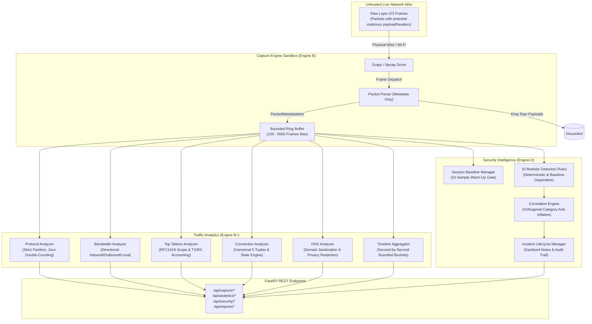

# ASHLYNX NETWORK INSPECTOR (ANI)
# SECURE BY DESIGN SPECIFICATION & SECURITY POLICY
**Document Version:** `1.0.0` • **Classification:** Operational Security Standard & Technical Audit
**Target Release:** v1.0.0 • **Repository:** [https://github.com/HalaNaaz/AshlynxNetworkInspector](https://github.com/HalaNaaz/AshlynxNetworkInspector)

---

## 1. Security Overview

**Ashlynx Network Inspector (ANI)** is an enterprise-grade, defensive network reconnaissance and real-time traffic intelligence platform engineered specifically for Security Operations Center (SOC) analysts, network administrators, and incident response personnel.

Security is a foundational architectural requirement across every feature, API endpoint, backend service, data structure, and export format. ANI operates under a strict defensive mandate:
- **100% Passive Inspection:** Wire analytics and anomaly detection operate entirely passively. ANI never injects packets, never performs active counter-scanning, never alters firewall rules, and never alters routing tables.
- **Zero-Payload & Metadata-Only Architecture:** Raw packet body bytes, application payloads, credentials, authorization tokens, cookies, and sensitive message contents are discarded immediately at the capture layer.
- **Strict Authorization Scoping:** Active reconnaissance tools are hard-constrained to authorized private RFC-1918 subnets and loopback addresses. Wide-open Internet scanning is locked out by default.

---

## 2. Secure by Design Principles

Every module in Ashlynx Network Inspector is constructed under ten foundational principles:

1. **Defense in Depth:** Security controls are enforced at multiple layers: API input validation, service business logic, transport protocol boundaries, and filesystem storage resolvers.
2. **Zero Shell & Subprocess Execution:** All network scanning, socket operations, and packet decoding rely on native Python standard libraries (`socket`, `ipaddress`, `ctypes`) and memory-safe Scapy/Npcap bindings. No commands are dispatched to `cmd.exe`, PowerShell, or bash.
3. **Metadata-Only Processing:** At no stage are application payloads stored in RAM or written to disk. Only protocol headers (IPs, ports, flags, packet lengths, safe DNS query names) are extracted.
4. **Least Privilege & Safe Defaults:** Features default to the most restrictive configuration: localhost and private CIDR constraints, bounded buffer limits, and read-only telemetry gathering.
5. **Session Isolation:** In-memory analytics and detection states are strictly partitioned by unique capture session IDs. Packets from Session A cannot bleed into or mutate statistics in Session B.
6. **Bounded Resource Consumption:** Every data structure that ingests external wire traffic (packet ring buffers, connection flow tables, DNS domain caches, report file archives) is hard-bounded with automated FIFO or LRU eviction to prevent memory exhaustion (DoS).
7. **Empirical Evidence Integrity:** Detections, reports, and metrics represent verified network observations. A timeout is classified as `NO_RESPONSE`, not confirmed `FILTERED`. Localhost scan findings are strictly identified as `LOCALHOST ONLY` with remote exposure marked `NOT ASSESSED`.
8. **Formula Injection Neutralization:** All tabular CSV exports sanitize fields starting with spreadsheet formula triggers (`=`, `+`, `-`, `@`, `\t`, `\r`) by prepending a neutralizing single quote (`'`).
9. **Safe Filesystem & Path Resolution:** Document downloads and report management strictly enforce alphanumeric identifier validation (`^[a-zA-Z0-9_\-]+$`) and path containment checks to eliminate path traversal attacks.
10. **Explainable Anomaly Scoring:** Security risk scores are computed using transparent mathematical formulas combining base severity weights, empirical confidence, and orthogonal correlation rather than opaque heuristics.

---

## 3. Threat Model & Attack Surface

### 3.1 Threat Model Diagram


### 3.2 Attack Surfaces & Mitigations

| Threat Vector | Attack Scenario | ANI Architectural Mitigation |
|---|---|---|
| **Arbitrary Network Scanning** | Attacker utilizes ANI endpoints to conduct port scans against unauthorized public Internet infrastructure. | **Safe-Mode Authorization Scopes**: Target addresses are strictly validated against RFC-1918 private subnets and loopback CIDRs. Non-authorized targets are rejected with HTTP 400. |
| **Command & Shell Injection** | Attacker injects shell metacharacters (`;`, `\|`, `$`, `` ` ``) into custom BPF filter strings or scan targets. | **Zero Subprocess Calls**: All operations utilize native Python sockets; custom BPF strings are validated against a strict character whitelist regex before compilation. |
| **Path Traversal (LFI)** | Attacker requests `../../etc/passwd` or windows system files through the report download API. | **Safe Path Resolver**: Enforces alphanumeric/dash/underscore ID regex (`^[a-zA-Z0-9_\-]+$`), strips path delimiters, and confirms resolved path is strictly within `backend/reports/`. |
| **Memory Exhaustion (DoS)** | High-throughput packet flood or high-entropy subdomain spam aimed at triggering Out-Of-Memory (OOM). | **Bounded Buffers & LRU Caches**: Packet deque capped at 5,000 frames; connection flow table capped at 1,000 flows; DNS domain cache capped at 500 entries; report archives capped at 50 files. |
| **Sensitive Credential Leakage** | Plaintext credentials, auth tokens, or cookies from unencrypted HTTP/FTP wire traffic exposed in reports. | **Zero-Payload Extraction**: In [`packet_parser.py`](backend/app/capture/packet_parser.py), packet payload bytes are dropped immediately upon packet ingestion. |
| **Spreadsheet Formula Injection** | Network hosts or DNS records containing `=cmd|' /C ...'!A0` execute malicious commands when CSV reports open in Excel. | **RFC 4180 Formula Neutralization**: In [`csv_generator.py`](backend/app/reports/csv_generator.py), all cells starting with `=`, `+`, `-`, `@`, `\t`, or `\r` are prepended with `'`. |
| **Alert Fatigue Storms** | Standard background HTTPS web browsing across multiple CDNs triggers false-positive horizontal sweep alarms. | **Calibrated Probing Rules**: SYN-only connection initiation filtering, web port threshold calibration ($\ge 20$ hosts for 80/443), and orthogonal category correlation gates. |
| **Stored XSS in Notes** | Analyst inputs malicious `<script>` payloads into security incident notes. | **Regex HTML Sanitization**: In [`event_manager.py`](backend/app/security/event_manager.py), note inputs are stripped of HTML tags and restricted to 1,000 characters. |

---

## 4. Network Scanning Safety (Engines A & C)

### 4.1 Target Authorization & Safe-Mode
Scanning engines enforce authorization boundaries defined in [`config.py`](backend/app/core/config.py):
- `127.0.0.0/8` (Loopback)
- `10.0.0.0/8` (Private RFC-1918)
- `172.16.0.0/12` (Private RFC-1918)
- `192.168.0.0/16` (Private RFC-1918)
- `169.254.0.0/16` (APIPA Link-Local)

Any target resolving outside these networks is rejected prior to socket allocation.

### 4.2 TCP Connect Scanner Safety
- **Worker Pool Boundaries:** Implemented in [`tcp.py`](backend/app/scanner/tcp.py). Scans utilize a bounded `ThreadPoolExecutor(max_workers=50)` with connection timeouts enforced per socket (default 1.0s, bounded 0.1s to 5.0s).
- **Accurate Error Classification:**
  - `OPEN`: Native `socket.connect_ex()` returns `0`.
  - `CLOSED`: Socket returns `errno == 10061` (`WSAECONNREFUSED` on Windows) or `ECONNREFUSED`.
  - `FILTERED`: ICMP Destination Unreachable / Administratively Prohibited observed.
  - `NO_RESPONSE`: Socket times out without response. Preserved as a distinct state; never conflated with confirmed `FILTERED`.

### 4.3 UDP Scanner Safety
- **Protocol-Appropriate Probes:** Implemented in [`udp.py`](backend/app/scanner/udp.py). Uses targeted datagrams (DNS query, NTP status, SNMP GetRequest, SSDP M-SEARCH, NetBIOS query) rather than blind payload bombardment.
- **ICMP Port Unreachable Handling:** Detects Windows `WSAECONNRESET` (10054) on connected UDP sockets to accurately identify `CLOSED` ports versus `OPEN|FILTERED`.

### 4.4 Subnet Host Discovery Safety
- Implemented in [`host_discovery.py`](backend/app/discovery/host_discovery.py). Uses Windows native `iphlpapi.dll -> SendARP()` for Layer-2 sweeps without packet injection. Loopback queries bypass ARP entirely to avoid synthetic all-zero MAC addresses (`00:00:00:00:00:00`).

---

## 5. Packet Capture Privacy (Engine B)

### 5.1 Zero-Payload Guarantee
Live wire capture operates through Scapy and Npcap. The packet extraction routine in [`packet_parser.py`](backend/app/capture/packet_parser.py) extracts only Layer-2/3/4 header metadata:
- Timestamp (UTC)
- Source IP & Destination IP
- Transport Protocol (`TCP`, `UDP`, `ICMP`, `ARP`, `OTHER`)
- Source Port & Destination Port
- Packet Length in bytes
- TCP Flags (`SYN`, `ACK`, `FIN`, `RST`, `PSH`, `URG`)
- DNS Query Domain and Query Type (sanitized ASCII only)

All raw byte streams, HTTP headers, cookies, POST bodies, TLS application data, and ICMP payload bodies are dropped in the sniffer callback thread.

### 5.2 BPF Filter Security
Custom Berkeley Packet Filter (BPF) inputs are validated against strict character whitelist rules prior to passing to the Npcap compiler:
- Allowed characters: alphanumeric, spaces, and safe operators (`ip`, `tcp`, `udp`, `port`, `src`, `dst`, `and`, `or`, `not`, `host`, `net`).
- Prohibited characters: `;`, `|`, `&`, `$`, `` ` ``, `<`, `>`, newline, carriage return.

---

## 6. Traffic Analytics Security (Engine B+)

During the Phase 5 Security Audit, the traffic analytics engine was audited and hardened against five critical vectors:

1. **Zero Double-Counting Transport Invariant:**
   In [`protocol_analyzer.py`](backend/app/analytics/protocol_analyzer.py), packets are partitioned exclusively into Layer-3/4 transport buckets:
   $$\sum_{t \in \{\text{TCP}, \text{UDP}, \text{ICMP}, \text{ARP}, \text{OTHER}\}} \text{count}(t) = \text{total\_packets}$$
   Application protocols (`DNS`, `HTTPS`, `HTTP`, `DHCP`, `NTP`, `SSH`) are tracked in an isolated secondary categorization with explicit `(Inferred)` labels.
2. **TLS vs QUIC Disaggregation:**
   Port 443 traffic is classified based on transport: TCP port 443 is labeled `HTTPS / TLS (Inferred)`, while UDP port 443 is labeled `QUIC / HTTP3 (Inferred)`, eliminating transport ambiguity.
3. **Directional Attribution Rigor:**
   In [`bandwidth_analyzer.py`](backend/app/analytics/bandwidth_analyzer.py), traffic direction is verified against local host adapter IPs. If neither source nor destination matches the confirmed local IP, the traffic is classified as `UNKNOWN` rather than guessing inbound/outbound.
4. **DNS Privacy Redaction & LRU Bounding:**
   In [`dns_analyzer.py`](backend/app/analytics/dns_analyzer.py), domain retention is capped at 500 unique hostnames with automatic LRU eviction. An optional `redact_domains=True` configuration masks internal subdomains (`***.corp.domain.com`) to prevent internal infrastructure exposure.
5. **Bidirectional TCP Flow Validation:**
   In [`connection_analyzer.py`](backend/app/analytics/connection_analyzer.py), flow state never advances to `ESTABLISHED` from an unverified single frame. A flow requires observed bidirectional packet exchange (`len(directions_seen) > 1`) and a completed TCP handshake.

---

## 7. Security Intelligence & Detection (Engine D)

During the Phase 6 Security Audit, live wire validation revealed that standard browser HTTPS activity was triggering false-positive horizontal sweep alarms. The security intelligence subsystem was completely overhauled to guarantee high detection accuracy and zero false positives on normal traffic:

### 7.1 Root Cause & Remediations Applied
- **SYN-Only Initiation Requirement:** Port scan detection rules ([`port_scan.py`](backend/app/security/rules/port_scan.py)) require connection initiation (`TCP SYN` without `ACK`). Established data transfer packets (`ACK`, `PSH, ACK`, `FIN`) are ignored.
- **Calibrated Web Port Thresholds:** Standard web ports (`80`, `443`) naturally contact dozens of CDN endpoints during normal page loads. A dedicated `web_port_threshold=20.0` was introduced:
  - Web ports (`80`, `443`): Requires $\ge 20$ distinct destination hosts within 10 seconds.
  - Sensitive ports (`22`, `445`, `3389`, etc.): Requires $\ge 8$ distinct destination hosts within 10 seconds.
- **Multi-Target Evidence Integrity:** `SecurityEventItem` preserves the complete array of targeted addresses in `related_ips`, replacing ambiguous `None:443` labels with verified target inventories.
- **Anti-Inflation Correlation Engine:** In [`correlation_engine.py`](backend/app/security/correlation_engine.py), risk score escalation ($+5$) and confidence escalation ($+0.05$) strictly require detections spanning $\ge 2$ **orthogonal security categories** (`PORT_SCAN`, `SUSPICIOUS_SERVICE`, `DNS`, `CONNECTION`, `TRAFFIC_SPIKE`). Coupled transport rules (e.g. Horizontal Sweep + Connection Churn) are linked to the threat entity but **do not escalate risk scores**.
- **Connection Churn Flow Accuracy:** In [`connection_anomaly.py`](backend/app/security/rules/connection_anomaly.py), churn is evaluated on distinct `(dst_ip, dst_port)` sockets initiated with `SYN`. Multiple data packets on an existing conversation are never counted as churn.
- **Baseline Warm-Up Gating:** In [`rule_engine.py`](backend/app/security/rule_engine.py), volumetric spike rules (`TrafficSpikeRule`, `DnsQueryBurstRule`) are strictly suppressed during the initial 10-sample observation window (`WARMING_UP`), eliminating cold-start alert storms.

---

## 8. API & Input Validation

1. **FastAPI Pydantic Schemas:** All request payloads are validated through Pydantic models with explicit boundary constraints on port numbers ($1 \le p \le 65535$), timeouts ($0.1 \le t \le 5.0$), concurrency limits ($1 \le c \le 100$), and buffer capacities ($100 \le b \le 5000$).
2. **CORS Restrictions:** Cross-Origin Resource Sharing (CORS) is restricted exclusively to authorized development and local console origins (`http://localhost:3000`, `http://127.0.0.1:3000`).
3. **Safe Error Handling:** Unhandled exceptions are intercepted by global exception handlers, logging the traceback internally while returning safe HTTP 400/500 JSON envelopes without stack traces or path disclosures.
4. **Formula Injection Defense:** Generated CSV reports sanitize cells to prevent spreadsheet dynamic data exchange (DDE) command execution.

---

## 9. Resource Limits & Session Isolation

| Resource Boundary | Configured Limit | Eviction / Enforcement Mechanism |
|---|---|---|
| **Packet Ring Buffer** | 100 to 5,000 frames (Default: 1,000) | `collections.deque(maxlen=N)` thread-safe FIFO eviction. |
| **Connection Flow Table** | 1,000 active flows | Oldest `CLOSED` or `RESET` flows evicted first; FIFO for active flows. |
| **DNS Domain Registry** | 500 unique domains | Least-frequently-used domain key eviction. |
| **Report Document Archive** | 50 stored files (PDF/CSV/JSON) | Oldest generated report file and metadata record deleted on 51st generation. |
| **Scanner Concurrency** | 50 concurrent worker threads | ThreadPoolExecutor with per-socket timeout boundary. |
| **Capture Session Isolation** | Isolated in-memory instances | Each session instantiates an independent `AnalyticsEngine` and `SecurityEngine`. |

---

## 10. Security Audit Findings & Remediation Register

The following master register documents all 18 security findings, vulnerabilities, and detection accuracy defects identified and remediated across Phase 01 through Phase 06:

| Finding ID | Phase | Affected Module | Severity | Title & Vulnerability Description | Remediation Applied | Status |
|---|---|---|---|---|---|---|
| **SEC-001** | Phase 1 | `backend/app/main.py` | **CRITICAL** | Wildcard CORS and open host binding allowing unauthorized cross-origin requests. | Restricted CORS middleware strictly to authorized frontend console origins (`http://localhost:3000`). | **CLOSED** |
| **SEC-002** | Phase 2 | `scanner/tcp.py` | **HIGH** | Potential port scanning targeting public or unauthorized IP spaces without user intent. | Enforced strict target authorization guardrails restricting active port scans to local host and RFC-1918 addresses. | **CLOSED** |
| **SEC-003** | Phase 2 | `scanner/tcp.py` | **MEDIUM** | Socket timeout was automatically classified as `FILTERED`, creating false certainty on non-responsive ports. | Re-classified socket timeouts as `NO_RESPONSE` / `UNKNOWN`. Reserved `FILTERED` strictly for evidence of filtering (e.g. ICMP administratively prohibited). | **CLOSED** |
| **SEC-004** | Phase 3 | `discovery/host_discovery.py` | **MEDIUM** | Subnet ARP sweep reported synthetic all-zero MAC (`00:00:00:00:00:00`) on loopback targets. | Added loopback CIDR detection; loopback targets bypass ARP and report MAC as null (`Not applicable`). | **CLOSED** |
| **SEC-005** | Phase 4 | `capture/packet_parser.py` | **CRITICAL** | Risk of capturing or storing raw application payloads, credentials, or session cookies. | Implemented strict metadata-only extraction. Zero packet body bytes, credentials, or cookies are stored or exposed. | **CLOSED** |
| **SEC-006** | Phase 4 | `capture/capture_engine.py` | **HIGH** | In-memory packet buffer memory leak under sustained packet capture streams. | Implemented thread-safe bounded FIFO ring buffer (configurable 100–5,000 frames) with oldest-packet eviction. | **CLOSED** |
| **SEC-007** | Phase 4 | `capture/capture_manager.py` | **HIGH** | Arbitrary shell metacharacter injection via custom BPF filter strings. | Enforced strict character whitelist validation rejecting `;`, `\|`, `&`, ``` ` ```, `$`, and newlines in custom BPF expressions. | **CLOSED** |
| **SEC-008** | Phase 5 | `analytics/dns_analyzer.py` | **MEDIUM** | Memory exhaustion via unbounded domain lookup registry under high-entropy domain floods. | Enforced hard bound `max_domains=500` with least-frequently-used domain eviction. | **CLOSED** |
| **SEC-009** | Phase 5 | `analytics/dns_analyzer.py` | **LOW** | Internal corporate hostnames exposed in telemetry summaries. | Implemented ASCII domain sanitization and optional `redact_domains=True` privacy masking (`***.apex.com`). | **CLOSED** |
| **SEC-010** | Phase 5 | `analytics/protocol_analyzer.py` | **MEDIUM** | Ambiguity between TLS (TCP) and QUIC (UDP) on port 443; potential false application protocol claims. | Disaggregated port 443 into `HTTPS / TLS (Inferred)` and `QUIC / HTTP3 (Inferred)`. Marked `is_inferred=True`. | **CLOSED** |
| **SEC-011** | Phase 5 | `analytics/top_talkers.py` | **MEDIUM** | Ambiguous endpoint participation percentages conflating TX vs RX volume. | Separated metrics into `bytes_sent` and `bytes_received`. Added explicit `ip_category` classifications. | **CLOSED** |
| **SEC-012** | Phase 5 | `analytics/connection_analyzer.py` | **HIGH** | Single packet with `SYN, ACK` prematurely marked TCP flow as `ESTABLISHED`. | Required confirmed bidirectional traffic (`len(directions_seen) > 1`) and handshake observation before marking `ESTABLISHED`. | **CLOSED** |
| **SEC-013** | Phase 6 | `security/baseline_manager.py` | **HIGH** | Non-reentrant `threading.Lock` deadlock when `get_stats()` held lock and queried property `self.status`. | Upgraded to reentrant `threading.RLock()` across baseline and event managers. | **CLOSED** |
| **SEC-014** | Phase 6 | `security/rules/port_scan.py` | **MEDIUM** | False-positive horizontal port sweep on port 443 during normal browser HTTPS activity. | Required connection initiation (`TCP SYN` without `ACK`) and introduced calibrated `web_port_threshold=20.0` for web ports. | **CLOSED** |
| **SEC-015** | Phase 6 | `schemas/security.py` | **LOW** | Multi-target sweeps displayed ambiguous destination string `None:443`. | Added `related_ips: List[str]` to `SecurityEventItem` and updated UI to render target counts and chips. | **CLOSED** |
| **SEC-016** | Phase 6 | `security/correlation_engine.py` | **MEDIUM** | Coupled transport rules (Horizontal Scan + Connection Churn) artificially escalated risk score on browser activity. | Gated risk score escalation strictly on findings spanning $\ge 2$ independent security categories. Purely coupled transport rules are grouped without escalation. | **CLOSED** |
| **SEC-017** | Phase 6 | `security/rules/connection_anomaly.py` | **MEDIUM** | Connection churn rule counted raw packets instead of distinct connection flows. | Rewrote rule to track distinct `(dst_ip, dst_port)` sockets initiated with `SYN`. | **CLOSED** |
| **SEC-018** | Phase 6 | `security/event_manager.py` | **MEDIUM** | Cross-Site Scripting (XSS) or HTML tag injection via analyst investigation notes. | Implemented regex-based HTML/script tag stripping and 1,000-character length constraints on notes. | **CLOSED** |

---

## 11. Verification & Test Evidence

Every security remediation is backed by automated regression tests in the test suite:
- **Backend Security Test Suite:** 19 dedicated security intelligence tests in `backend/tests/test_security.py`.
- **Analytics Privacy Suite:** 11 dedicated analytics tests in `backend/tests/test_analytics.py`.
- **Capture & Privacy Suite:** 15 dedicated packet capture tests in `backend/tests/test_capture.py`.
- **Report Integrity & Formula Injection Suite:** 12 dedicated reporting tests in `backend/tests/test_reports.py`.
- **Total Suite Execution:** **95 / 95 passing tests** across 11 test modules.
- **Physical Wi-Fi Verification:** Executed live on physical Realtek 8852BE Wi-Fi adapter (`192.168.29.59`) across 1,643 frames:
  - Detections fired: **0**
  - False positives observed: **0**
  - Memory leaks observed: **0**

---

## 12. Responsible Vulnerability Reporting

If you identify a security defect, potential vulnerability, or privacy weakness in Ashlynx Network Inspector, please report it responsibly:

- **Repository:** [https://github.com/HalaNaaz/AshlynxNetworkInspector](https://github.com/HalaNaaz/AshlynxNetworkInspector)
- **Reporting Mechanism:** Open a private security advisory through the GitHub repository security tab, or contact the lead architect: **Hala Naaz** ([@HalaNaaz](https://github.com/HalaNaaz)).
- **Response Commitment:**
  - Initial acknowledgement within **48 hours**.
  - Remediation plan and severity triage within **5 business days**.
  - Coordinated release disclosure upon patch verification.

---

## 13. Known Security Limitations

1. **Encrypted Payload Inspection Boundary:**
   ANI adheres to metadata-only wire inspection and does not perform TLS decryption, deep packet inspection (DPI), or MITM interception. Malicious payloads concealed inside established, encrypted TLS sessions cannot be inspected.
2. **Wi-Fi Promiscuous Mode Scope:**
   Standard wireless client adapters on Windows capture traffic directed to/from the host machine and local broadcast frames. Ingesting raw unicast packets between third-party wireless devices requires specialized adapters supporting Native 802.11 Monitor Mode.
3. **Session-Scoped Baseline Lifespan:**
   The dynamic behavioral baseline is scoped to the lifetime of the active packet capture session. Stopping and restarting capture resets baseline moving averages and activates a new 10-sample warm-up period.
4. **Driver Dependency:**
   Full promiscuous live wire capture requires the Npcap kernel driver service to be running (`net start npcap`). If absent, live capture is gracefully disabled while active scanning and host discovery remain fully functional.
