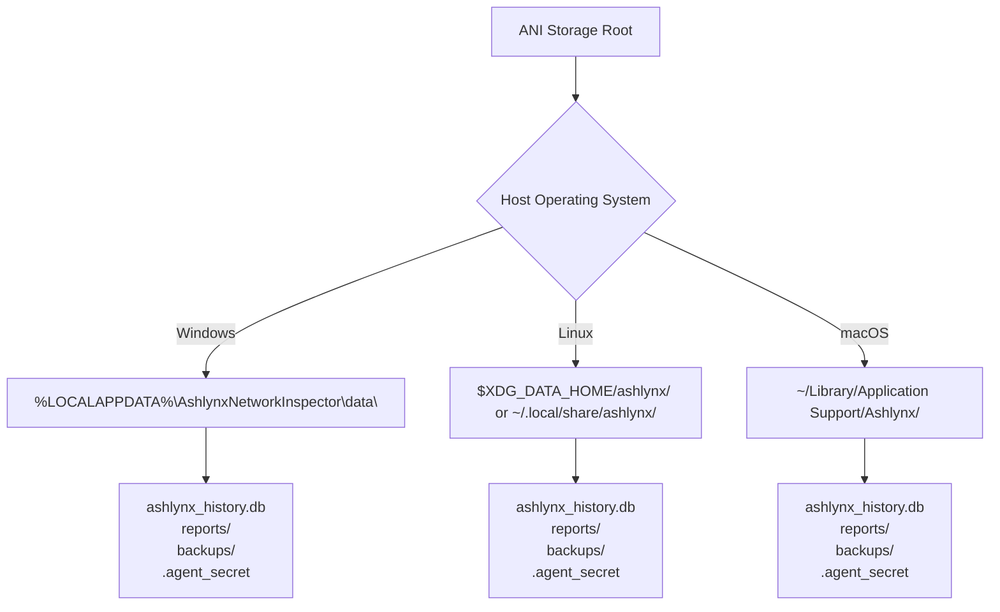
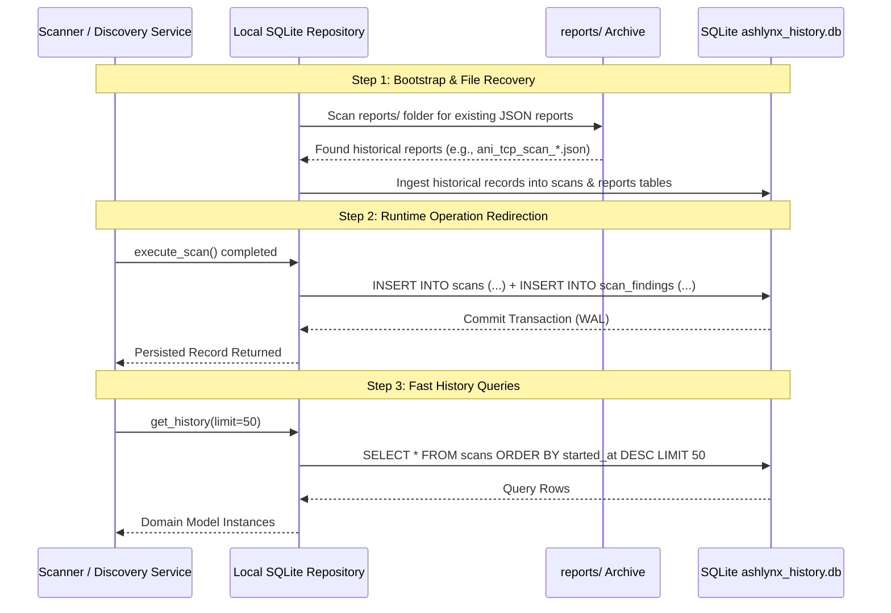

# Ashlynx Network Inspector (ANI) — Data Persistence & Storage Audit

**Document Version:** 1.0.0  
**Audit Date:** 2026-11-09  
**Target Release:** v1.1.0  
**System Classification:** Storage Audit, Data Lifecycle & Database Architecture  
**Status:** AUDIT COMPLETE & MIGRATION BLUEPRINT ESTABLISHED

---

## 1. Audit of Current Storage State in ANI v1.0.0

A systematic source-code inspection was conducted to categorize all telemetry and operational records into **Persistent on Disk** vs **Ephemeral in Memory**:

```
Data Category                 Current Storage Mechanism           Vulnerable to Process Exit?
-------------------------------------------------------------------------------------------------
TCP Scan Results              ScannerService._history (List)      YES (Destroyed on restart)
UDP Scan Results              ScannerService._history (List)      YES (Destroyed on restart)
Host Discovery Sweeps         DiscoveryService._history (List)    YES (Destroyed on restart)
Live Packet Buffers           LiveCaptureEngine._packets (List)   YES (Destroyed on restart)
Traffic Flow Tracking         ConnectionAnalyzer._flows (Dict)    YES (Destroyed on restart)
DNS Telemetry Records         DnsAnalyzer._domains (Dict)         YES (Destroyed on restart)
Security Anomaly Events       RuleEngine._events (List)           YES (Destroyed on restart)
Generated Report Files        reports/ directory (PDF/CSV/JSON)   NO (Files remain on disk)
Report Metadata Index         ReportManager._metadata (Dict)      YES (Index destroyed on restart)
Report Payload Cache          ReportManager._payload_cache (Dict) YES (Cache destroyed on restart)
Network Interfaces            psutil / Scapy dynamic queries      YES (Re-queried dynamically)
App Settings / Preferences    Frontend React State / Env vars     YES (Resets to defaults)
```

### Critical Finding:
While the physical PDF, CSV, and JSON report files are written to the `reports/` folder, the registry `ReportManager._metadata` that tracks them in the API (`/api/reports/history`) is stored entirely in Python memory. When the backend agent process terminates, the `/api/reports/history` endpoint returns an empty list, rendering previously generated reports inaccessible from the user interface until manually recovered.

---

## 2. Standardized Local Storage Paths Across Platforms

To guarantee data isolation and cross-platform operating system standards, the local database and generated report files must not be placed in arbitrary project directories. Instead, they must resolve to standard user application data paths:

### 2.1 OS-Specific Root Directories



| Operating System | Database & Data Directory | Report Archive Directory | Credentials & Agent Secret |
|:---|:---|:---|:---|
| **Windows 11 / 10** | `C:\Users\<User>\AppData\Local\AshlynxNetworkInspector\data\ashlynx_history.db` | `C:\Users\<User>\AppData\Local\AshlynxNetworkInspector\reports\` | `C:\Users\<User>\AppData\Local\AshlynxNetworkInspector\.agent_secret` |
| **Linux (Debian/Ubuntu)** | `~/.local/share/ashlynx/ashlynx_history.db` | `~/.local/share/ashlynx/reports/` | `~/.local/share/ashlynx/.agent_secret` |
| **macOS (Darwin)** | `~/Library/Application Support/Ashlynx/ashlynx_history.db` | `~/Library/Application Support/Ashlynx/reports/` | `~/Library/Application Support/Ashlynx/.agent_secret` |
| **Development Mode** | `./backend/data/ashlynx_history.db` | `./reports/` | `./backend/data/.agent_secret` |

---

## 3. Storage Engine Implementation Specification

### 3.1 Database Engine: SQLite with WAL Architecture
The persistence engine will be implemented as an embedded Python SQLite interface using Python's native `sqlite3` standard library with context-managed connection pooling:

```python
# Conceptual Architecture: backend/app/db/session.py
import sqlite3
from pathlib import Path
from contextlib import contextmanager

class DatabaseManager:
    def __init__(self, db_path: Path):
        self.db_path = db_path
        self._init_db()

    def _init_db(self):
        self.db_path.parent.mkdir(parents=True, exist_ok=True)
        with self.get_connection() as conn:
            conn.execute("PRAGMA journal_mode = WAL;")
            conn.execute("PRAGMA synchronous = NORMAL;")
            conn.execute("PRAGMA foreign_keys = ON;")
            conn.execute("PRAGMA busy_timeout = 5000;")
            self._apply_migrations(conn)

    @contextmanager
    def get_connection(self):
        conn = sqlite3.connect(
            str(self.db_path),
            timeout=10.0,
            check_same_thread=False
        )
        conn.row_factory = sqlite3.Row
        try:
            yield conn
            conn.commit()
        except Exception:
            conn.rollback()
            raise
        finally:
            conn.close()
```

---

## 4. Migration Strategy: In-Memory to Relational SQLite

The migration from in-memory lists to SQLite persistence will occur without disrupting existing API contracts:

### 4.1 Phased Migration Roadmap



### 4.2 Report Archive Self-Healing on Startup
If the local database is wiped or recreated, the Local Agent executes a **Report Directory Ingestion Sweep** on startup:
1. Enumerates all `.json` files in the `reports/` folder.
2. Parses canonical report headers (`report_id`, `product`, `report_type`, `metrics`, `findings`, `session_digest`).
3. Re-inserts missing entries into `reports`, `scans`, and `host_discoveries` tables.
4. Prevents duplicate ingestion using unique constraint on `filename`.

---

## 5. Backup, Export, and Restoration Architecture

To guarantee enterprise data mobility and disaster recovery, ANI v1.1.0 specifies three backup and export mechanisms:

### 5.1 Native SQLite Hot Backup
Uses SQLite Online Backup API (`conn.backup()`):
```python
def create_hot_backup(target_backup_path: Path):
    with db_manager.get_connection() as src_conn:
        dest_conn = sqlite3.connect(str(target_backup_path))
        src_conn.backup(dest_conn, pages=100)
        dest_conn.close()
```
- Can be executed while live packet sniffing or port scanning is actively writing to the database.
- Guarantees zero lock contention and zero transaction corruption.

### 5.2 Complete Audit Archive (Tarball / ZIP)
A single-click export function generates a timestamped `.tar.gz` bundle:
- Contains `ashlynx_history.db`
- Contains all generated `ani_*.pdf`, `ani_*.csv`, and `ani_*.json` files
- Includes a signed `manifest.json` with SHA-256 checksums of every file

### 5.3 User-Controlled Purge & Selective Deletion
The UI will provide explicit granular deletion controls:
- **Delete Single Session:** Removes session, cascading to findings, flows, DNS records, and associated report files.
- **Prune Old Sessions:** Purges records older than $N$ days with explicit modal confirmation.
- **Nuclear Reset:** Erases the database and report directory, reinitializing clean empty tables.

