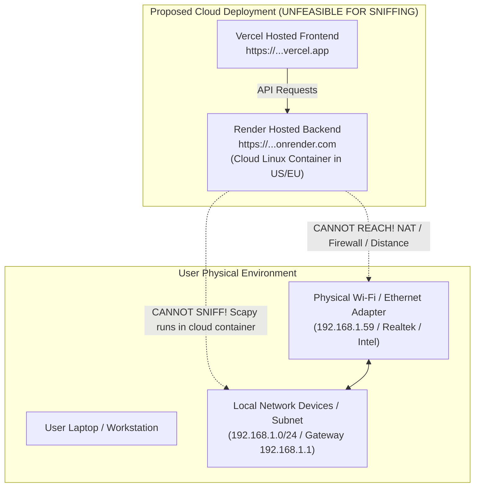
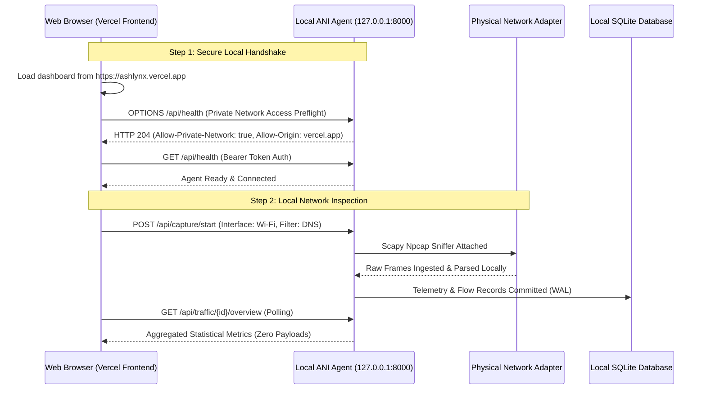
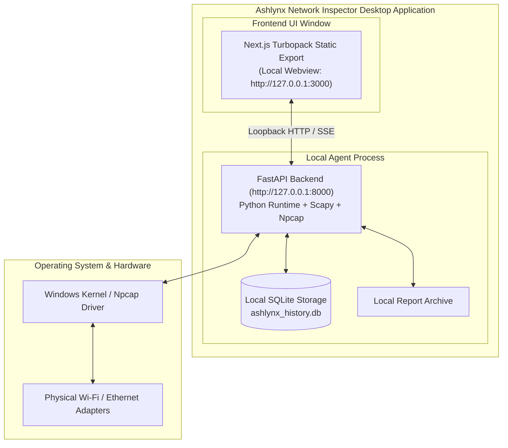
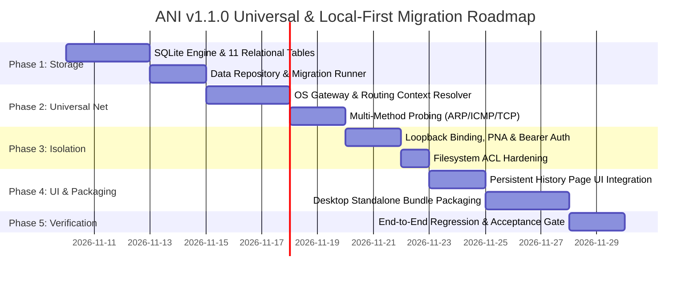

# Ashlynx Network Inspector (ANI) — Deployment Architecture Review & Implementation Plan

**Document Version:** 1.0.0  
**Audit Date:** 2026-11-09  
**Target Release:** v1.1.0  
**System Classification:** Production Deployment & Hybrid Web-to-Local Agent Architecture  
**Status:** ARCHITECTURAL REVIEW COMPLETE & IMPLEMENTATION PLAN ESTABLISHED

---

## 1. Evaluation of Proposed Deployment: Vercel Frontend + Render Backend + Local Data

The proposed deployment model was evaluated against fundamental networking and browser security boundaries:
- **Frontend:** Hosted on Vercel (`https://ashlynx-network-inspector.vercel.app`)
- **Backend:** Hosted on Render (`https://ashlynx-backend.onrender.com`)
- **User Data:** Local Computer



### 1.1 Fatal Architectural Blockers of a Cloud Backend
1. **Network Interface Disconnect:** A backend running inside a Render container in AWS or GCP possesses only virtual cloud container interfaces (`eth0` on a cloud VPC). It has **zero physical or layer-2 access** to the user's laptop network card (`Realtek 8852BE Wi-Fi`, `Intel GbE`, etc.).
2. **Layer-2 Packet Sniffing Impossibility:** Scapy packet capture (`conf.ifaces`, Npcap, `sniff()`) running on Render would sniff traffic inside Render's cloud container, completely oblivious to packets traveling on the user's local Wi-Fi or Ethernet.
3. **Inability to Probe Local Subnets:** If the user specifies `192.168.1.0/24`, a cloud backend on Render cannot send ARP requests or ICMP packets into the user's private residential or corporate subnet across the Internet through residential NAT/firewalls.
4. **Data Privacy Violation:** Transmitting the user's internal network traffic, DNS queries, and discovered host inventories to a third-party cloud server on Render violates the core requirement of local data sovereignty.

### Conclusion on Render Backend:
**The Render-hosted backend model cannot perform network inspection or packet capture for the user.** Network packet capture, ARP host discovery, and port scanning **must execute on the user's physical machine** via a locally running agent.

---

## 2. Target Deployment Architectures

To deliver a high-quality user experience while preserving local execution and data isolation, two feasible production architectures have been engineered:

---

### Architecture Option A: Hybrid Deployed Vercel Frontend + Local ANI Agent

In this model, the static Next.js frontend is deployed globally on Vercel for instant browser access, while the backend runs locally on the user's computer as the **ANI Local Agent**:



#### Browser Security Constraints & Engineered Solutions for Option A:

1. **Mixed Content (`https://` to `http://`):**
   - **Problem:** Browsers block requests from an `https://` page (Vercel) to an insecure `http://127.0.0.1` origin as **Mixed Content**.
   - **Solution 1 (Recommended):** The Local Agent provides a lightweight local loopback TLS certificate, or uses a dedicated loopback subdomain (e.g. `https://local.ashlynx.app` with DNS `A` record pointing to `127.0.0.1` and a valid Let's Encrypt TLS certificate embedded in the agent distribution).
   - **Solution 2 (Alternative):** The Vercel frontend is deployed with HTTP/HTTPS flexibility, or the user installs a self-signed root cert via `mkcert` during setup.
2. **Private Network Access (PNA):**
   - Modern Chromium browsers require PNA preflight responses:
     ```http
     Access-Control-Allow-Origin: https://ashlynx-network-inspector.vercel.app
     Access-Control-Allow-Private-Network: true
     Access-Control-Allow-Headers: Authorization, Content-Type
     ```
   - The Local Agent implements full PNA preflight header support.
3. **Agent Pairing & Authentication:**
   - On first run, the local agent outputs a random pairing key (e.g., `ani_sec_a7f9b2c3d4...`).
   - The user inputs this key once in the Vercel dashboard Settings. The frontend stores it in `localStorage` and transmits it in `Authorization: Bearer <KEY>`.

---

### Architecture Option B: Local Desktop Bundle (Recommended Production Model)

To avoid all browser mixed-content restrictions, PNA constraints, and internet connectivity requirements, ANI can be packaged as a **Standalone Desktop Application** (using Tauri, Electron, or a native Python installer):



#### Advantages of Option B:
- **Zero Mixed-Content Issues:** Both frontend and backend run under `http://127.0.0.1` or custom URI schemes (`ashlynx://`).
- **100% Offline Capable:** Does not require internet access; works in air-gapped security labs and isolated emergency response environments.
- **Single-Click Installer:** Delivered as a standard Windows `.exe` / `.msi` (with bundled Python embedded runtime and Npcap installer check).
- **Guaranteed Zero Cloud Leakage:** No reliance on Vercel, Render, or external hosting providers.

---

## 3. Phased Implementation Roadmap



### Detailed Phase Breakdown

#### Phase 1: Local SQLite Storage Engine
- Implement `backend/app/db/session.py` with SQLite WAL mode, foreign key constraints, and connection pooling.
- Create DDL migration runner and the 11 relational tables specified in `LOCAL_FIRST_ARCHITECTURE.md`.
- Refactor `ScannerService`, `DiscoveryService`, `CaptureManager`, `RuleEngine`, and `ReportManager` to write through the database repository layer.
- Implement startup self-healing report ingestion from the `reports/` archive.

#### Phase 2: Universal Network Engine
- Remove hardcoded subnet references (`192.168.29.0/24`, `_get_recorded_jiofi_discovery`).
- Implement dynamic routing table and gateway discovery via Windows `GetAdaptersAddresses` / `GetBestRoute2` and Linux routing APIs.
- Enhance `host_discovery.py` with multi-method probing (ARP, ICMP ping, TCP connect) with automatic Layer-2 vs Layer-3 media detection.
- Add AP Client Isolation heuristic warning.

#### Phase 3: Privacy, Isolation & Security Controls
- Enforce strict loopback binding (`127.0.0.1` and `::1`).
- Implement PNA preflight handling (`Access-Control-Allow-Private-Network`).
- Implement 256-bit agent secret generation and Bearer token authentication middleware.
- Apply OS user-restricted filesystem permissions to database and credential files.

#### Phase 4: Persistent History UI & Hybrid/Desktop Packaging
- Connect the frontend `/history` and `/reports` pages to query the persistent SQLite database.
- Add multi-parameter filters (Module, Date/Time, Target Subnet, Status, Session ID).
- Add granular session deletion and database backup/export controls.
- Provide installation scripts and standalone packaging options.

#### Phase 5: Full Regression Testing & Acceptance Gates
- Run complete 108+ Pytest test suite with database integration.
- Verify persistence across browser refresh, process restart, and system reboot.
- Run frontend Turbopack production build with zero errors.

---

## 4. Verification Checkpoint

- **Current Backend Pytest Suite:** 108 passed, 0 failed in 29.62s.
- **Current Frontend Turbopack Build:** 12/12 routes compiled cleanly in 3.6s.
- **Audit Deliverables Completed:**
  1. `UNIVERSAL_NETWORK_COMPATIBILITY_AUDIT.md`
  2. `LOCAL_FIRST_ARCHITECTURE.md`
  3. `DATA_PERSISTENCE_AUDIT.md`
  4. `PRIVACY_AND_DATA_ISOLATION_AUDIT.md`
  5. `DEPLOYMENT_ARCHITECTURE.md`
- **Execution Rule:** Architecture audit only. Zero code modifications or git commits executed. Awaiting user approval to proceed with Phase 1 implementation.

