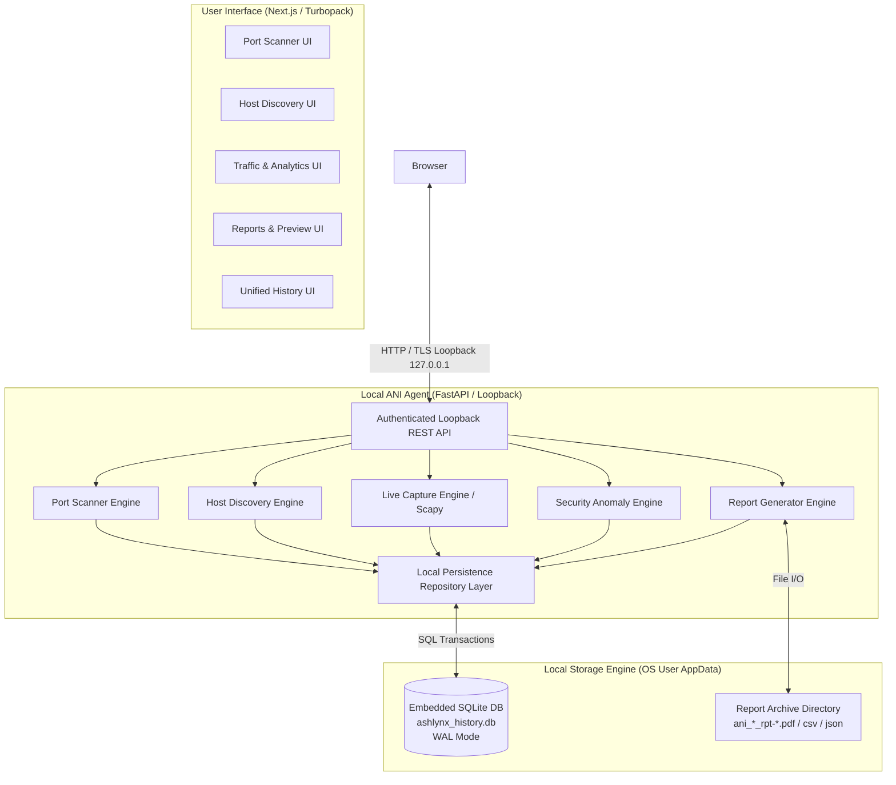
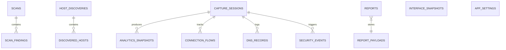

# Ashlynx Network Inspector (ANI) — Local-First Permanent Persistence Architecture

**Document Version:** 1.0.0  
**Audit Date:** 2026-11-09  
**Target Release:** v1.1.0 (Core Storage Engine Specification)  
**System Classification:** Local-First Storage & Relational Persistence Specification  
**Status:** ARCHITECTURAL SPECIFICATION COMPLETE

---

## 1. Executive Summary & Design Principles

Currently, Ashlynx Network Inspector (ANI) maintains runtime state predominantly in Python memory structures (`_history` lists and `_sessions` dictionaries). While generated reports (PDF, CSV, JSON) are stored on disk in the `reports/` folder, historical records, scan findings, discovered hosts, captured traffic metadata, and security events are destroyed whenever:

- The Python backend process is stopped or restarted.
- The operating system reboots.
- A crash or unhandled exception terminates the application.

To meet the requirements of a **defensive, local-first enterprise network inspector**, ANI v1.1.0 establishes an embedded **SQLite-based relational persistence architecture**.

### Core Architecture Pillars:
1. **Zero Cloud Dependency for User Telemetry:** All scans, MAC addresses, private IPs, connection flows, DNS queries, and security alerts remain stored strictly on the user's local filesystem.
2. **Crash & Reboot Resilience:** Historical records survive browser refresh, browser closure, frontend redeployments, backend agent restarts, and laptop reboots.
3. **ACID Transaction Safety:** Uses SQLite Write-Ahead Logging (`WAL` mode) with strict foreign key constraints and atomic transaction boundaries.
4. **Performance & Query Optimization:** Structured indexes on session UUIDs, timestamps, target subnets, and severity ratings ensure sub-millisecond retrieval on large audit datasets.
5. **Zero Raw Payload Retention:** Stores parsed layer-3/4 headers, statistical counters, and sanitized domain names only. Never writes raw packet payloads to the database.

---

## 2. High-Level System Architecture



---

## 3. Relational Schema Specification (The 11 Core Entity Types)

The database schema is structured into 11 interconnected relational tables managed via versioned DDL migrations:



### 3.1 Port Scanning Entities

#### Table 1: `scans` (TCP and UDP Scan Executions)
Stores scan metadata, targets, timing, and aggregate counters.
```sql
CREATE TABLE IF NOT EXISTS scans (
    scan_id TEXT PRIMARY KEY,                       -- UUIDv4 / scan-xxxxxxxx
    scan_type TEXT NOT NULL,                        -- 'TCP_CONNECT' | 'UDP_DGRAM'
    target TEXT NOT NULL,                           -- Target IPv4 or hostname
    status TEXT NOT NULL,                           -- 'running' | 'completed' | 'failed'
    started_at TEXT NOT NULL,                       -- ISO 8601 UTC timestamp
    completed_at TEXT,                              -- ISO 8601 UTC timestamp
    duration_seconds REAL NOT NULL DEFAULT 0.0,
    total_ports INTEGER NOT NULL DEFAULT 0,
    open_ports INTEGER NOT NULL DEFAULT 0,
    closed_ports INTEGER NOT NULL DEFAULT 0,
    filtered_ports INTEGER NOT NULL DEFAULT 0,
    no_response_ports INTEGER NOT NULL DEFAULT 0,
    concurrency INTEGER NOT NULL DEFAULT 100,
    timeout_seconds REAL NOT NULL DEFAULT 1.0,
    session_digest TEXT                             -- SHA-256 session integrity digest
);

CREATE INDEX IF NOT EXISTS idx_scans_started_at ON scans(started_at DESC);
CREATE INDEX IF NOT EXISTS idx_scans_target ON scans(target);
CREATE INDEX IF NOT EXISTS idx_scans_type ON scans(scan_type);
```

#### Table 2: `scan_findings` (Individual Port Probing Records)
Stores detailed results for each probed port.
```sql
CREATE TABLE IF NOT EXISTS scan_findings (
    finding_id INTEGER PRIMARY KEY AUTOINCREMENT,
    scan_id TEXT NOT NULL,
    port INTEGER NOT NULL,
    protocol TEXT NOT NULL,                         -- 'TCP' | 'UDP'
    state TEXT NOT NULL,                            -- 'OPEN' | 'CLOSED' | 'FILTERED' | 'OPEN|FILTERED' | 'NO_RESPONSE'
    service_name TEXT,                              -- 'HTTP', 'SSH', etc.
    latency_ms REAL,
    banner TEXT,
    FOREIGN KEY(scan_id) REFERENCES scans(scan_id) ON DELETE CASCADE
);

CREATE INDEX IF NOT EXISTS idx_scan_findings_scan_id ON scan_findings(scan_id);
CREATE INDEX IF NOT EXISTS idx_scan_findings_state ON scan_findings(state);
```

### 3.2 Host Discovery Entities

#### Table 3: `host_discoveries` (Subnet Sweep Sessions)
Stores discovery session scopes, CIDR targets, and execution summaries.
```sql
CREATE TABLE IF NOT EXISTS host_discoveries (
    discovery_id TEXT PRIMARY KEY,                  -- UUIDv4 / disc-xxxxxxxx
    cidr TEXT NOT NULL,                             -- e.g. '192.168.1.0/24'
    method TEXT NOT NULL,                           -- 'AUTO' | 'ARP' | 'ICMP' | 'TCP'
    status TEXT NOT NULL,                           -- 'running' | 'completed' | 'failed'
    started_at TEXT NOT NULL,                       -- ISO 8601 UTC
    completed_at TEXT,
    duration_seconds REAL NOT NULL DEFAULT 0.0,
    total_probed INTEGER NOT NULL DEFAULT 0,
    online_count INTEGER NOT NULL DEFAULT 0,
    no_response_count INTEGER NOT NULL DEFAULT 0,
    concurrency INTEGER NOT NULL DEFAULT 30,
    timeout_seconds REAL NOT NULL DEFAULT 1.0,
    session_digest TEXT
);

CREATE INDEX IF NOT EXISTS idx_discoveries_started_at ON host_discoveries(started_at DESC);
CREATE INDEX IF NOT EXISTS idx_discoveries_cidr ON host_discoveries(cidr);
```

#### Table 4: `discovered_hosts` (Inventory of Subnet Addresses)
Stores findings for every host address probed within the CIDR block.
```sql
CREATE TABLE IF NOT EXISTS discovered_hosts (
    host_id INTEGER PRIMARY KEY AUTOINCREMENT,
    discovery_id TEXT NOT NULL,
    ip_address TEXT NOT NULL,
    status TEXT NOT NULL,                           -- 'ONLINE' | 'NO_RESPONSE' | 'UNREACHABLE' | 'UNKNOWN'
    mac_address TEXT,
    vendor TEXT,
    hostname TEXT,
    hostname_source TEXT,                           -- 'DNS_PTR' | 'HOSTS_FILE' | 'UNRESOLVED'
    latency_ms REAL,
    probe_method TEXT NOT NULL,                     -- 'ARP' | 'ICMP' | 'TCP'
    first_seen TEXT NOT NULL,
    FOREIGN KEY(discovery_id) REFERENCES host_discoveries(discovery_id) ON DELETE CASCADE
);

CREATE INDEX IF NOT EXISTS idx_discovered_hosts_discovery_id ON discovered_hosts(discovery_id);
CREATE INDEX IF NOT EXISTS idx_discovered_hosts_ip ON discovered_hosts(ip_address);
CREATE INDEX IF NOT EXISTS idx_discovered_hosts_status ON discovered_hosts(status);
```

### 3.3 Passive Packet Capture & Analytical Telemetry Entities

#### Table 5: `capture_sessions` (Passive Sniffing Sessions)
Stores interface bindings, BPF filters, packet counts, and lifetime states.
```sql
CREATE TABLE IF NOT EXISTS capture_sessions (
    session_id TEXT PRIMARY KEY,                    -- 'cap-xxxxxxxxxxxx'
    interface_id TEXT NOT NULL,
    interface_name TEXT NOT NULL,
    status TEXT NOT NULL,                           -- 'CAPTURING' | 'STOPPED' | 'ERROR'
    filter_bpf TEXT,
    buffer_limit INTEGER NOT NULL DEFAULT 1000,
    started_at TEXT NOT NULL,
    stopped_at TEXT,
    duration_seconds REAL NOT NULL DEFAULT 0.0,
    total_captured INTEGER NOT NULL DEFAULT 0,
    bytes_captured INTEGER NOT NULL DEFAULT 0,
    dropped_packets INTEGER NOT NULL DEFAULT 0,
    session_digest TEXT
);

CREATE INDEX IF NOT EXISTS idx_capture_sessions_started_at ON capture_sessions(started_at DESC);
CREATE INDEX IF NOT EXISTS idx_capture_sessions_status ON capture_sessions(status);
```

#### Table 6: `analytics_snapshots` (Frozen Traffic Analytics Telemetry)
Stores aggregated throughput, peak rates, and protocol distribution upon session closure.
```sql
CREATE TABLE IF NOT EXISTS analytics_snapshots (
    snapshot_id INTEGER PRIMARY KEY AUTOINCREMENT,
    session_id TEXT NOT NULL UNIQUE,
    duration_seconds REAL NOT NULL,
    total_packets INTEGER NOT NULL,
    total_bytes INTEGER NOT NULL,
    peak_bps REAL NOT NULL DEFAULT 0.0,
    peak_pps REAL NOT NULL DEFAULT 0.0,
    active_flows_count INTEGER NOT NULL DEFAULT 0,
    dns_queries_count INTEGER NOT NULL DEFAULT 0,
    top_protocol TEXT,
    top_talker_ip TEXT,
    inbound_bytes INTEGER NOT NULL DEFAULT 0,
    outbound_bytes INTEGER NOT NULL DEFAULT 0,
    local_bytes INTEGER NOT NULL DEFAULT 0,
    protocol_distribution_json TEXT,                -- Serialized JSON distribution
    top_talkers_json TEXT,                          -- Serialized JSON top talkers
    FOREIGN KEY(session_id) REFERENCES capture_sessions(session_id) ON DELETE CASCADE
);
```

#### Table 7: `dns_records` (Parsed DNS Queries & Responses)
Stores domain names, query types, response codes, and resolution latency.
```sql
CREATE TABLE IF NOT EXISTS dns_records (
    record_id INTEGER PRIMARY KEY AUTOINCREMENT,
    session_id TEXT NOT NULL,
    timestamp TEXT NOT NULL,
    transaction_id TEXT,
    record_type TEXT NOT NULL,                      -- 'QUERY' | 'RESPONSE'
    query_name TEXT NOT NULL,                       -- Sanitized ASCII domain
    qtype TEXT NOT NULL,                            -- 'A', 'AAAA', 'PTR', etc.
    rcode INTEGER,                                  -- 0 (NOERROR), 3 (NXDOMAIN), etc.
    latency_ms REAL,
    FOREIGN KEY(session_id) REFERENCES capture_sessions(session_id) ON DELETE CASCADE
);

CREATE INDEX IF NOT EXISTS idx_dns_records_session_id ON dns_records(session_id);
CREATE INDEX IF NOT EXISTS idx_dns_records_query_name ON dns_records(query_name);
```

#### Table 8: `connection_flows` (Layer-4 5-Tuple Network Flows)
Stores bidirectional connection flow summaries.
```sql
CREATE TABLE IF NOT EXISTS connection_flows (
    flow_id TEXT PRIMARY KEY,
    session_id TEXT NOT NULL,
    protocol TEXT NOT NULL,                         -- 'TCP' | 'UDP' | 'ICMP'
    src_ip TEXT NOT NULL,
    src_port INTEGER,
    dst_ip TEXT NOT NULL,
    dst_port INTEGER,
    service TEXT,
    packet_count INTEGER NOT NULL DEFAULT 0,
    byte_count INTEGER NOT NULL DEFAULT 0,
    first_seen TEXT NOT NULL,
    last_seen TEXT NOT NULL,
    duration_seconds REAL NOT NULL DEFAULT 0.0,
    is_bidirectional INTEGER NOT NULL DEFAULT 0,    -- 0 or 1
    state TEXT,                                     -- 'ESTABLISHED', 'CLOSED', etc.
    FOREIGN KEY(session_id) REFERENCES capture_sessions(session_id) ON DELETE CASCADE
);

CREATE INDEX IF NOT EXISTS idx_connection_flows_session_id ON connection_flows(session_id);
CREATE INDEX IF NOT EXISTS idx_connection_flows_endpoints ON connection_flows(src_ip, dst_ip);
```

### 3.4 Security Intelligence & Anomaly Detection Entities

#### Table 9: `security_events` (Detected Anomalies & Alerts)
Stores security events, MITRE techniques, severity, and mitigation guidance.
```sql
CREATE TABLE IF NOT EXISTS security_events (
    event_id TEXT PRIMARY KEY,                      -- 'evt-xxxxxxxxxxxx'
    session_id TEXT NOT NULL,
    rule_id TEXT NOT NULL,
    title TEXT NOT NULL,
    category TEXT NOT NULL,                         -- 'PORT_SCAN', 'DNS_ANOMALY', etc.
    severity TEXT NOT NULL,                         -- 'CRITICAL', 'HIGH', 'MEDIUM', 'LOW', 'INFO'
    first_seen TEXT NOT NULL,
    last_seen TEXT NOT NULL,
    event_count INTEGER NOT NULL DEFAULT 1,
    source_ip TEXT,
    destination_ip TEXT,
    mitre_attack_id TEXT,
    summary TEXT NOT NULL,
    recommendation TEXT,
    state TEXT NOT NULL DEFAULT 'ACTIVE',           -- 'ACTIVE', 'RESOLVED', 'DISMISSED'
    FOREIGN KEY(session_id) REFERENCES capture_sessions(session_id) ON DELETE CASCADE
);

CREATE INDEX IF NOT EXISTS idx_security_events_session_id ON security_events(session_id);
CREATE INDEX IF NOT EXISTS idx_security_events_severity ON security_events(severity);
CREATE INDEX IF NOT EXISTS idx_security_events_last_seen ON security_events(last_seen DESC);
```

### 3.5 Reporting & Interface Snapshot Entities

#### Table 10: `reports` (Exported Audit Document Registry)
Stores metadata, file paths, hashes, and download references for generated PDF, CSV, and JSON files.
```sql
CREATE TABLE IF NOT EXISTS reports (
    report_id TEXT PRIMARY KEY,                     -- 'rpt-xxxxxxxxxx'
    title TEXT NOT NULL,
    report_type TEXT NOT NULL,                      -- 'tcp_scan', 'udp_scan', 'host_discovery', etc.
    report_format TEXT NOT NULL,                    -- 'pdf', 'csv', 'json'
    source_id TEXT NOT NULL,
    created_at TEXT NOT NULL,
    file_size_bytes INTEGER NOT NULL,
    item_count INTEGER NOT NULL,
    filename TEXT NOT NULL UNIQUE,
    session_digest TEXT NOT NULL,
    raw_payload_json TEXT                           -- Canonical payload JSON for lossless re-export
);

CREATE INDEX IF NOT EXISTS idx_reports_created_at ON reports(created_at DESC);
CREATE INDEX IF NOT EXISTS idx_reports_type ON reports(report_type);
CREATE INDEX IF NOT EXISTS idx_reports_source ON reports(source_id);
```

#### Table 11: `interface_snapshots` & `app_settings`
Stores hardware adapter snapshots and user preferences (Safe Mode, dark/light themes, concurrency bounds).
```sql
CREATE TABLE IF NOT EXISTS interface_snapshots (
    snapshot_id INTEGER PRIMARY KEY AUTOINCREMENT,
    guid TEXT NOT NULL,
    name TEXT NOT NULL,
    description TEXT,
    mac_address TEXT,
    ipv4_addresses_json TEXT,                       -- JSON array
    ipv6_addresses_json TEXT,                       -- JSON array
    speed_mbps INTEGER,
    interface_type TEXT,
    can_capture INTEGER NOT NULL DEFAULT 0,
    captured_at TEXT NOT NULL
);

CREATE TABLE IF NOT EXISTS app_settings (
    setting_key TEXT PRIMARY KEY,
    setting_value TEXT NOT NULL,
    updated_at TEXT NOT NULL
);
```

---

## 4. SQLite Optimization & Transaction Safety Configuration

To guarantee concurrency and crash safety while running simultaneous packet capture and port scanning threads, the SQLite connection pool enforces the following pragmas at initialization:

```sql
PRAGMA journal_mode = WAL;          -- Write-Ahead Logging: concurrent readers do not block writers
PRAGMA synchronous = NORMAL;        -- Safe fsync on checkpoints with superior write performance
PRAGMA foreign_keys = ON;          -- Cascading deletes ensure zero orphaned finding records
PRAGMA busy_timeout = 5000;        -- Wait up to 5s if locked by another engine thread
PRAGMA cache_size = -64000;         -- 64MB memory cache for fast analytical queries
PRAGMA temp_store = MEMORY;        -- Avoid disk writes for temporary sorts and joins
```

---

## 5. Migration & Versioning Strategy

A versioned schema migration runner is embedded directly in the repository layer using SQLite's native `PRAGMA user_version`:

1. **Version 1 (Initial Schema):** Creates the 11 base tables, constraints, and indexes.
2. **Version Checks on Startup:** During FastAPI lifecycle `SessionStart`, the agent executes:
   ```sql
   PRAGMA user_version;
   ```
   If `user_version < CURRENT_TARGET_VERSION`, migration scripts are executed in sequential transactions.
3. **Rollback & Backup:** Prior to executing any schema migration, the agent creates a backup copy of `ashlynx_history.db` (`ashlynx_history.v{n}.bak`).

---

## 6. Verification Against Lifecycle Termination Scenarios

| Failure Event | Current v1.0.0 Behavior | Proposed v1.1.0 Behavior |
|:---|:---|:---|
| **Browser Refresh (`F5`)** | UI requests API; API serves in-memory history. | API queries SQLite index; UI rehydrates seamlessly. |
| **Browser Tab Closure** | No data lost; backend remains running. | No data lost; DB maintains historical state. |
| **Local Agent Restart** | **ALL HISTORY WIPED** (Memory lists cleared). | **100% PRESERVED** (SQLite loads state on startup). |
| **Operating System Reboot** | **ALL HISTORY WIPED** (Memory lists cleared). | **100% PRESERVED** (DB file stored on disk). |
| **Frontend Rebuild** | UI state resets. | UI re-queries persistent local agent endpoints. |
| **Process Crash / OOM** | Partial or corrupted memory state. | SQLite WAL recovers clean transaction boundary. |

