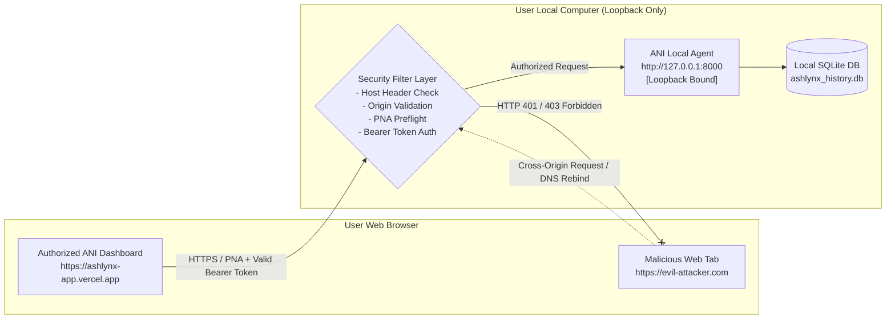
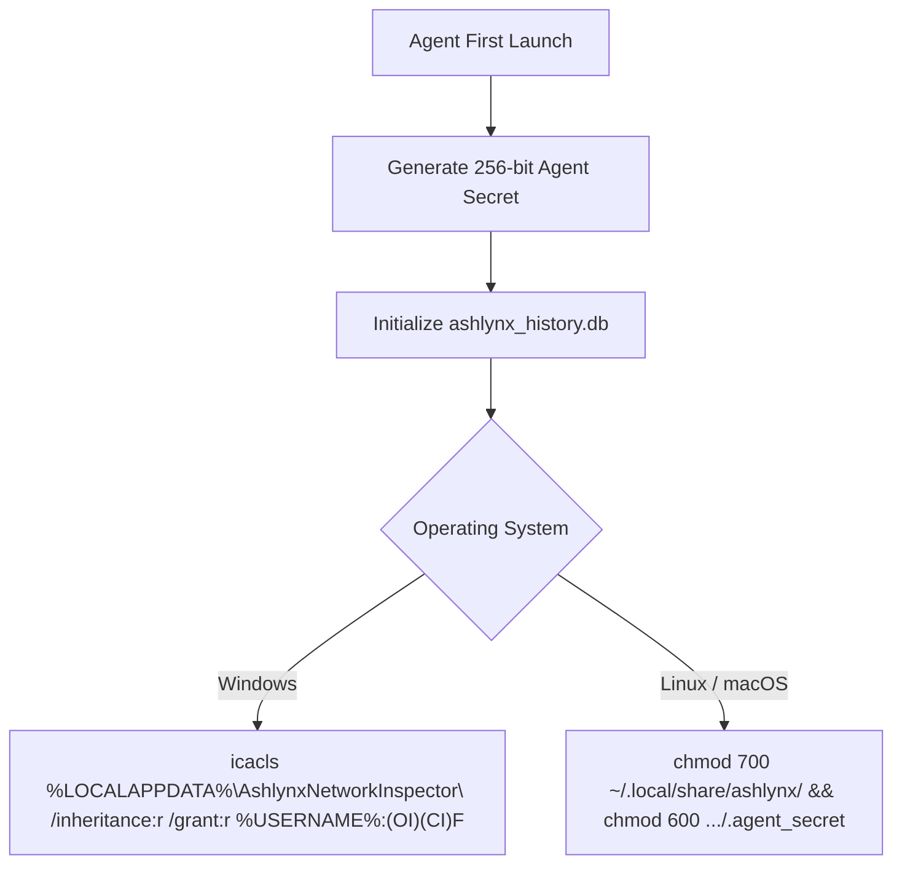

# Ashlynx Network Inspector (ANI) — Privacy, Security & Data Isolation Audit

**Document Version:** 1.0.0  
**Audit Date:** 2026-11-09  
**Target Release:** v1.1.0  
**Classification:** Defensive Security Engineering & Threat Model  
**Status:** SECURITY POSTURE & THREAT MODEL AUDIT COMPLETE

---

## 1. Executive Summary & Zero-Trust Threat Model

Ashlynx Network Inspector (ANI) inspects sensitive network communications: internal IP topologies, open listening ports, active TCP connections, internal DNS queries, host MAC addresses, and security anomalies.

If an unauthorized entity (e.g., an external website visited by the user in another browser tab, or a rogue device on the same local Wi-Fi) gains access to ANI's local HTTP API, they could:
1. Steal the user's complete internal network topology and audit history.
2. Trigger unauthorized network port scans and packet capture sessions against local devices.
3. Access historical PDF, CSV, and JSON audit reports containing vulnerability details.

To eliminate this threat surface, ANI enforces a **Strict Local-First Data Isolation Architecture**:



---

## 2. Threat Analysis & Mitigations

### 2.1 Threat 1: Remote Network Access to Local Telemetry
- **Threat Vector:** If the local agent binds to `0.0.0.0`, any device on the same local Wi-Fi, Ethernet, or mobile hotspot could send HTTP requests to `http://<User_IP>:8000/api` and download internal scan history.
- **Enforced Defense:**  
  1. The Local Agent server socket binds strictly to loopback interfaces: `127.0.0.1` (IPv4) and `::1` (IPv6).
  2. The server configuration strictly rejects binding to `0.0.0.0` or public interface IPs.
  3. A custom middleware validates the socket peer address: if `client.host` is not loopback (`127.0.0.1` or `::1`), the connection is terminated immediately.

### 2.2 Threat 2: Cross-Site Request Forgery (CSRF) & Unauthorized Browser Origin Access
- **Threat Vector:** A malicious site visited by the user in another tab (`https://malicious-site.com`) executes JavaScript `fetch("http://127.0.0.1:8000/api/scanner/scans")`.
- **Enforced Defense:**
  1. **Strict CORS Policy:** The agent inspects the `Origin` header. Only explicitly whitelisted origins are permitted:
     - `http://localhost:3000` (Local Development)
     - `http://127.0.0.1:3000`
     - The user's registered production frontend (e.g., `https://ashlynx-network-inspector.vercel.app`).
  2. All other origins receive HTTP 403 with `Access-Control-Allow-Origin` omitted.

### 2.3 Threat 3: DNS Rebinding Attack
- **Threat Vector:** An attacker registers `attacker-domain.com` with a short TTL, resolves it first to an external server, then switches the DNS record to `127.0.0.1`. The browser considers requests to `http://attacker-domain.com:8000` to be same-origin with the attacker's script, bypassing CORS and accessing the local agent.
- **Enforced Defense:**
  1. **Host Header Validation Middleware:** The agent validates the incoming HTTP `Host` header.
  2. If `Host` does not match `127.0.0.1:8000`, `localhost:8000`, or the user-configured local domain, the request is immediately aborted with `HTTP 400 Bad Request (Invalid Host Header)`.

### 2.4 Threat 4: Drive-By Intranet Port Scanning via Private Network Access (PNA)
- **Threat Vector:** Modern browsers implement W3C **Private Network Access (PNA)** to prevent public websites from probing intranet services.
- **Enforced Defense:**
  1. The agent responds to `OPTIONS` preflight requests containing `Access-Control-Request-Private-Network: true` with header:
     ```http
     Access-Control-Allow-Private-Network: true
     ```
  2. This confirms to the browser that the local agent explicitly consents to receiving requests initiated by the authorized secure frontend.

### 2.5 Threat 5: Local API Authentication via Agent Secret (Pairing Token)
- **Threat Vector:** Any local script or unauthenticated browser page on the computer attempting to control the agent.
- **Enforced Defense:**
  1. On installation/initialization, the agent generates a cryptographically secure 256-bit random pairing secret stored in `%LOCALAPPDATA%\AshlynxNetworkInspector\.agent_secret` (restricted to the user's OS user account).
  2. Every API request must supply this secret in the `Authorization` header:
     ```http
     Authorization: Bearer <AGENT_SECRET>
     ```
  3. When launching the dashboard for the first time, the user enters or imports this pairing token into the UI (stored securely in browser `localStorage`). Requests missing or providing an invalid token receive `HTTP 401 Unauthorized`.

---

## 3. Local Filesystem Permission Hardening

The SQLite database file and agent secret contain sensitive historical evidence. Permissions must be locked down to the executing user account:



### 3.1 Windows ACL Hardening Commands
```powershell
# Remove inherited permissions and grant Full Control strictly to the active user
$dataDir = "$env:LOCALAPPDATA\AshlynxNetworkInspector"
icacls $dataDir /inheritance:r /grant:r "$($env:USERNAME):(OI)(CI)F"
```

### 3.2 Linux / macOS POSIX Hardening Commands
```bash
# Set directory to rwx------ (0700) and database/secret to rw------- (0600)
chmod 700 ~/.local/share/ashlynx
chmod 600 ~/.local/share/ashlynx/ashlynx_history.db
chmod 600 ~/.local/share/ashlynx/.agent_secret
```

---

## 4. Privacy Guarantees & Anti-Telemetry Policy

1. **Zero Raw Packet Payloads:**
   The Scapy live sniffing loop disassembles only Layer 2 (Ethernet MAC), Layer 3 (IP protocol, src/dst IP), and Layer 4 (TCP flags, UDP ports). DNS queries are sanitized to remove non-ASCII bytes and truncated to 253 characters. Application data payloads (HTTP POST bodies, TLS client hellos, email text, passwords) are discarded immediately and never persisted to database or disk.
2. **Zero Cloud Telemetry Upload:**
   ANI contains zero telemetry beacons, Google Analytics, Sentry crash reporters, or external webhook calls. No data ever leaves the local computer without explicit user export actions.
3. **Safe-Mode Subnet Enforcement:**
   Probing is strictly gated to RFC-1918 addresses (`10.0.0.0/8`, `172.16.0.0/12`, `192.168.0.0/16`) and Loopback (`127.0.0.0/8`). Public IPs are rejected at the service validation boundary.

