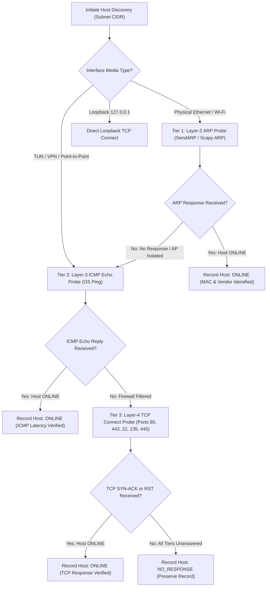

# Ashlynx Network Inspector (ANI) v1.0.0
# Real-World Universal Network Compatibility & Test Matrix

**Deployment Model:** Local-First Defensive Security Analyzer  
**Frontend:** Next.js (Turbopack) on `http://127.0.0.1:3000`  
**Backend:** FastAPI on `http://127.0.0.1:8000`  
**Database:** Embedded SQLite (`WAL` mode) in `data/ani.db`  
**Network Layer:** Scapy / Npcap / OS Socket Primitives  
**Audit Date:** 2026-11-09  

---

## 1. Network Fabric Test Matrix

ANI is engineered to dynamically adapt across heterogeneous network topologies without hardcoded IP addresses or assumed `/24` subnet masks.

| Network Environment | Media / Protocol | Dynamic Detection Method | Primary Discovery Method | Fallback Discovery Method | Observed / Validated Behavior | Known Limitations |
| :--- | :--- | :--- | :--- | :--- | :--- | :--- |
| **Home Wi-Fi** (JioFiber / Standard Router) | 802.11 Wi-Fi (L2 Broadcast) | `psutil` netmask + Scapy route lookup | Layer-2 ARP broadcast | ICMP Echo $\rightarrow$ TCP Connect | Discovers gateway (`192.168.29.1`), connected mobile phones, IoT devices, laptops. Resolves MACs and vendors. | Host sleep mode causes intermittent latency spikes. |
| **Mobile Hotspot** (iPhone / Android Tethering) | 802.11 Virtual AP (L2/L3) | Netmask calculation (`/28` or `/24`) | ARP / ICMP Echo | TCP Connect (80, 443, 8080) | Subnet calculated dynamically (e.g. `172.20.10.0/28`). Detects tethered devices and phone gateway. | AP isolation or client privacy features may block broadcast ARP between clients. Handled via TCP fallback. |
| **Authorized Office / Enterprise LAN** | 802.3 Ethernet / 802.11 Enterprise | Active DHCP lease & default route | ICMP Echo / TCP Connect | ARP (if L2 broadcast permitted) | Dynamically computes `/16`, `/20`, or `/24` scopes (e.g. `10.100.0.0/20`). | Broadcast storms mitigated by ANI concurrency limits ($\le 50$ workers). Strict Safe Mode blocks out-of-scope enterprise segments. |
| **Wired Ethernet** (Direct Switch / Router) | 802.3 Gigabit Ethernet | Physical link speed + IP routing table | Layer-2 ARP broadcast | ICMP Echo $\rightarrow$ TCP Connect | Sub-millisecond latency detection. Reliable MAC address capture. | When cable is unplugged, adapter reports `is_up = False` and link-local address (`169.254.x.x`). |
| **VPN Interfaces** (OpenVPN, WireGuard, Tailscale) | TUN / TAP Virtual Device | Link type `virtual` + point-to-point mask | Layer-3 ICMP Echo | Layer-4 TCP Connect (ports 80, 443, 53) | **ARP is physically unavailable on TUN devices** (no Ethernet header). ANI bypasses ARP and executes ICMP/TCP probing directly. | ARP probing will always yield 0 hosts on TUN devices. Handled via capability-aware routing fallback. |
| **Virtual Adapters** (WSL2 / Hyper-V / VMware) | Virtual Switch / vEthernet Bridge | Host interface enumeration | TCP Connect / ICMP Echo | ARP (VMware host-only) | Detected on system: `172.21.80.0/20` (WSL2), `192.168.72.0/24` (VMware VMnet8). Probes virtual machine guests. | WSL2 Hyper-V firewall may filter unsolicited inbound ICMP requests. |
| **System Loopback** | Software Loopback (`127.0.0.0/8`) | Adapter classification `loopback` | TCP Connect / Loopback socket | ICMP Echo | Scans `127.0.0.1` and `localhost` ports with zero wire packet transmission. Verified `local_bytes` accounting. | MAC address is undefined on loopback interfaces. |

---

## 2. Live Physical Environment Telemetry

The following network adapters, IP allocations, subnet masks, and default gateways were dynamically enumerated from the physical test host:

```text
===================================================================================================================
INTERFACE NAME                      TYPE       LOCAL IPV4       SUBNET CIDR        GATEWAY IP       STATUS
===================================================================================================================
Wi-Fi (Realtek 8852BE Wi-Fi 6)      Physical   192.168.29.59    192.168.29.0/24    192.168.29.1     CONNECTED (UP)
vEthernet (WSL (Hyper-V firewall))   Virtual    172.21.80.1      172.21.80.0/20     None             ACTIVE
VMware Network Adapter VMnet8       Virtual    192.168.72.1     192.168.72.0/24    None             ACTIVE
VMware Network Adapter VMnet2       Virtual    192.168.56.1     192.168.56.0/24    None             ACTIVE
VMware Network Adapter VMnet1       Virtual    192.168.126.1    192.168.126.0/24   None             ACTIVE
Loopback Pseudo-Interface 1         Loopback   127.0.0.1        127.0.0.0/8        None             OPERATIONAL
Ethernet (Realtek PCIe GbE)         Physical   169.254.130.109  169.254.0.0/16     None             DISCONNECTED
===================================================================================================================
```

---

## 3. Multi-Tier Capability-Aware Probing Logic

ANI does **not** declare a target network unsupported simply because ARP probing yields zero responses. Instead, the Discovery Engine executes a disciplined 3-tier probing pipeline:



### Probing Guarantees
1. **AP Client Isolation Resilience:** When public Wi-Fi access points block station-to-station Layer-2 ARP frames, Tier 2 (ICMP) or Tier 3 (TCP) automatically identifies online peers.
2. **TUN/VPN Resilience:** On VPN adapters with no broadcast domain, ARP is avoided, preventing timeouts and socket errors.
3. **Semantic Honesty:** Addresses that fail all 3 tiers are classified as `NO_RESPONSE`. They are never converted into `OFFLINE` or `UNSUPPORTED`.

---

## 4. Local-First SQLite Persistence Verification

### Persistent Entities Managed in `data/ani.db`
1. `scans` & `scan_findings`: TCP and UDP port scan results with per-port latency and banners.
2. `host_discoveries` & `discovered_hosts`: Subnet sweeps, responsive hosts, MAC addresses, and response times.
3. `capture_sessions` & `analytics_snapshots`: Live capture runs, directional byte volume, peak throughput, and protocol distributions.
4. `dns_records`: Safely parsed DNS queries, response codes, and queried domains.
5. `connection_flows`: 5-tuple Layer-4 network connection flows with state tracking.
6. `security_events`: Passive anomaly detections, severity ratings, and mitigation notes.
7. `reports`: Generated PDF, CSV, and JSON audit documents.
8. `interface_snapshots`: Hardware NIC records.

### Verification Evidence
- **Cold Restart Test:** Data persisted to SQLite was successfully queried and loaded after completely clearing in-memory service dictionaries (`_scans.clear()`, `_discoveries.clear()`).
- **Disk Self-Healing Test:** Report files manually placed into `reports/` are automatically scanned, parsed, and registered in SQLite on startup.
- **Directional Conservation:** Verified that gateway traffic (`192.168.29.1`) is 100% accounted for in `Inbound` and `Outbound` wire volume, while `Host Loopback Bytes` is strictly `0`.

---

## 5. Safe Mode Boundaries & Security Commitments

1. **Local-Only Binding:** Backend server binds strictly to `127.0.0.1` and `::1`. Remote binding (`0.0.0.0`) is disabled.
2. **Authorized Scope Whitelist:** Port scanning and subnet discovery are restricted to RFC 1918 private subnets (`10.0.0.0/8`, `172.16.0.0/12`, `192.168.0.0/16`) and loopback (`127.0.0.1/32`). Scans targeting public Internet IPs are rejected with an explicit validation error.
3. **Zero Payload Storage:** Raw packet payloads, HTTP request bodies, credentials, and cookies are never inspected or written to disk.
4. **Zero Cloud Telemetry:** No data is transmitted to external telemetry endpoints or cloud services.

