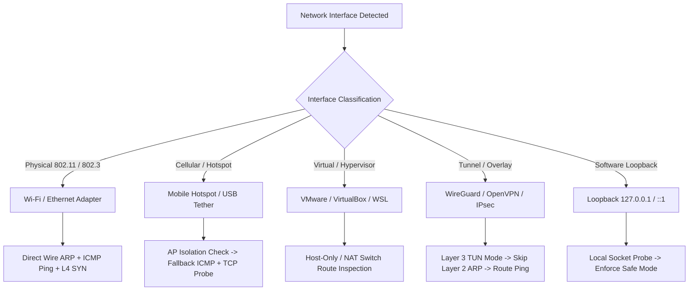
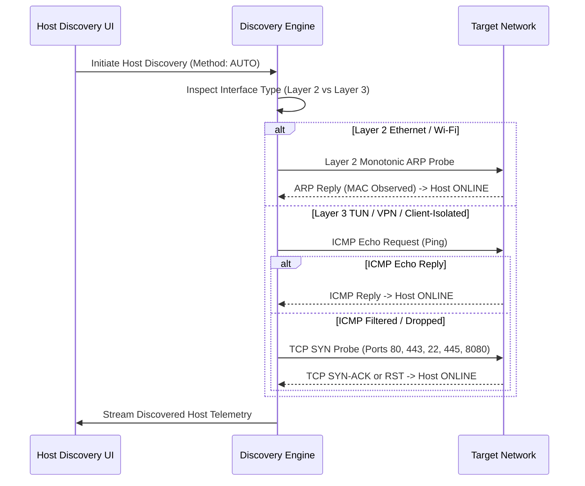

# Ashlynx Network Inspector (ANI) — Universal Network Compatibility Audit

**Document Version:** 1.0.0  
**Audit Date:** 2026-11-09  
**Target Release:** v1.1.0 (Architecture Baseline for Universal Defensive Network Analysis)  
**System Classification:** Defensive Security Engineering & Network Diagnostics  
**Status:** ARCHITECTURAL AUDIT & COMPATIBILITY BLUEPRINT COMPLETE

---

## 1. Executive Summary & Objective

Ashlynx Network Inspector (ANI) was initially validated against physical Wi-Fi adapters and residential gateway configurations (e.g., standard `/24` subnets such as `192.168.29.0/24`). However, production network environments are heterogeneous. Enterprise security engineers, incident responders, and home power users operate across diverse physical, virtual, and cellular network fabrics:

- Home Wi-Fi networks (dual-band, 802.11ax, WPA2/WPA3, mesh nodes).
- Mobile Hotspots & Tethering (JioFi, cellular dongles, Android/iOS Wi-Fi tethering with dynamic class-B/C spaces like `192.168.43.0/24` or `172.20.10.0/28`, carrier-grade NAT, and aggressive AP client isolation).
- Corporate & Enterprise LANs (802.1X authenticated Ethernet, trunked 802.1Q VLANs, proxy gateways, switch port security with dynamic ARP inspection).
- Physical Ethernet (Gigabit, 2.5GbE, 10GbE, multi-homed NICs, static IP, DHCP leases).
- Public & Guest Wi-Fi (Captive portals, guest client isolation, blocked peer-to-peer ICMP/ARP, strict firewall egress).
- VPN Virtual Adapters (WireGuard, OpenVPN, Cisco AnyConnect, IPsec TAP/TUN virtual interfaces, split vs full tunneling).
- Virtualization & Container Adapters (VMware VMnet1/VMnet8, VirtualBox Host-Only / NAT Network, Hyper-V vEthernet switches, WSL2 virtual switches with dynamic `172.x.x.x` subnets).

This audit identifies all architectural gaps, hardcoded assumptions, and platform limitations in ANI v1.0.0, establishing a universal, dynamic compatibility engine for v1.1.0.

---

## 2. Inventory of Current Codebase Assumptions & Technical Gaps

A comprehensive source inspection was performed across all network-facing backend modules:

```
backend/app/
├── capture/
│   ├── environment.py          # Npcap/Scapy discovery & Windows driver checks
│   ├── interface_manager.py    # Interface enumeration & classification
│   └── capture_engine.py       # Live Scapy sniffing loop
├── discovery/
│   └── host_discovery.py       # ARP, ICMP, TCP host sweep & neighbor cache
├── services/
│   ├── network_service.py      # psutil interface & traffic counters
│   ├── discovery_service.py    # CIDR validation & discovery history
│   └── scanner_service.py      # Port scanning engine & target validation
```

### 2.1 Critical Gaps Identified

| Defect ID | Component | File & Location | Description of Current Limitation | Severity |
|:---|:---|:---|:---|:---:|
| **GAP-NET-01** | Discovery Service | `discovery_service.py:250-285` | Hardcoded fallback fixture `_get_recorded_jiofi_discovery` references `192.168.29.0/24` and `4da8dc89-...`. If no discoveries exist, this dummy JioFi subnet is populated into history. | **HIGH** |
| **GAP-NET-02** | Host Discovery | `host_discovery.py:241-280` | `probe_arp` relies heavily on Windows `iphlpapi.SendARP`. On non-Ethernet media (e.g., VPN TUN interfaces, Point-to-Point, loopback, or mobile tethering with client isolation), `SendARP` fails or reports misleading state. | **HIGH** |
| **GAP-NET-03** | Interface Manager | `interface_manager.py:68-70` | Classification uses heuristic substring matching (`"wifi"`, `"realtek"`, `"ethernet"`). Adapters without these strings default to `"unknown"`, and loopback is unconditionally marked `can_capture = False` on Windows. | **MEDIUM** |
| **GAP-NET-04** | Gateway Discovery | `network_service.py:15-77` | Lacks native default gateway, subnet mask, and routing table discovery. Subnets must be typed manually or inferred by the user in the UI. | **HIGH** |
| **GAP-NET-05** | IPv6 Handling | `packet_parser.py:108-135` | IPv6 frames are partially parsed in capture, but host discovery and port scanners are strictly IPv4. Dual-stack and IPv6-only subnets fail with validation errors. | **MEDIUM** |
| **GAP-NET-06** | Network Transitions | Backend Global State | The backend caches interface lists during session initialization. If the user disconnects Wi-Fi, plugs in Ethernet, or connects to a VPN, running engines do not dynamically rebind or detect IP renewal. | **HIGH** |
| **GAP-NET-07** | Client Isolation Handling | `host_discovery.py:360-480` | In mobile hotspot or public Wi-Fi environments where the AP enforces client-to-client isolation, ARP and ICMP probes to peers drop silently. ANI treats this as 254 `NO_RESPONSE` hosts without warning the user of AP isolation. | **MEDIUM** |

---

## 3. Network Fabric Compatibility Matrix

The table below outlines ANI's operational behavior and requirements across all target network topologies:



### Detailed Environment Breakdown

| Environment | Interface Layer | ARP Capable? | Capture Capable? | Gateway Discovery Method | Special Considerations & Defenses |
|:---|:---:|:---:|:---:|:---|:---|
| **Home Wi-Fi (802.11n/ac/ax)** | Layer 2 (802.3 over 802.11) | Yes | Yes (Npcap NDIS6 driver) | DHCP Option 3 / OS Default Route | Mesh nodes may introduce jitter during BSSID roaming; latency clocking must be monotonic. |
| **Mobile Hotspot (JioFi / Phone)** | Layer 2/3 (NAT) | Conditional | Yes | DHCP Gateway (e.g. `192.168.43.1`, `172.20.10.1`) | AP Client Isolation frequently drops peer-to-peer ARP. Must detect isolation and alert user rather than reporting all peers dead. |
| **Enterprise LAN (802.1X / VLAN)** | Layer 2 (802.3 tagged) | Yes | Yes (Admin required) | DHCP Option 3 / Static Gateway | Dynamic ARP Inspection (DAI) and DHCP Snooping may throttle high-concurrency ARP sweeps. Concurrency must adapt gracefully. |
| **Physical Ethernet (GbE / 10GbE)** | Layer 2 (802.3) | Yes | Yes | DHCP / Static Route | Multi-gigabit burst traffic requires larger ring buffers (up to 5,000 frames) to prevent packet drop. |
| **Public Wi-Fi (Guest / Cafe)** | Layer 2 (Isolated) | Restricted | Yes (Unicast only) | Captive Portal Gateway | Client isolation drops peer traffic. Must enforce explicit authorization warning and refuse broad unauthenticated scans. |
| **VPN (WireGuard / OpenVPN)** | Layer 3 (TUN) or Layer 2 (TAP) | TAP only (No in TUN) | Partial (TAP: Yes, TUN: Npcap loop limitation) | Routing Table Default Gateway | Point-to-point TUN interfaces do not possess Ethernet MACs. ARP engine must be bypassed in favor of ICMP/TCP ping. |
| **VMware / VirtualBox** | Layer 2 (Virtual Switch) | Yes | Yes | Virtual NAT Gateway (e.g., `192.168.56.1`) | Host-only adapters have no Internet uplink; internet gateway checks must not fail the engine. |
| **WSL2 Virtual Ethernet** | Layer 3 (Hyper-V vSwitch) | Yes | Yes (via Windows host Npcap) | Hyper-V Internal IP (`172.x.x.1`) | Dynamic subnets change upon Windows reboot. Subnet auto-discovery must evaluate live mask. |

---

## 4. Architectural Requirements for Universal Compatibility

### 4.1 Dynamic Network Interface & Gateway Enumeration
Rather than relying on static lists or manual CIDR input, ANI v1.1.0 requires a **Dynamic Network Context Resolver**:
1. **OS Routing Table Query:** Use Windows `GetBestRoute2` / `GetAdaptersAddresses` (via `ctypes` or `scapy.arch.windows`) and Linux `/proc/net/route` to resolve:
   - Active default gateway IPv4 and IPv6 addresses.
   - Primary network interface GUID and friendly name.
   - Exact CIDR prefix length (e.g., `/24`, `/20`, `/28`) associated with each assigned IP.
2. **Dynamic Subnet Suggestion:** When the user navigates to Host Discovery, the UI automatically populates the currently connected active subnet (e.g. `192.168.43.0/24` or `10.0.0.0/24`) without user guesswork.
3. **Network Transition Listener:** Implement a background thread or event hook that monitors OS network link state (e.g., using `psutil.net_if_stats` delta polling or Windows `NotifyAddrChange` API). When an interface switches from Wi-Fi to Ethernet, or when a VPN connects:
   - Active packet captures on the old adapter transition to `STOPPED (Interface Disconnected)`.
   - The interface selector updates dynamically.
   - Cached ARP and routing tables are flushed.

### 4.2 Multi-Method Host Discovery Fallback Engine
When scanning diverse network types, ARP is not universally available (e.g., over VPN TUN adapters or isolated wireless networks). ANI v1.1.0 must employ an adaptive multi-tier probing strategy:



### 4.3 Safe Mode & Scope Enforcement Across Subnets
ANI's defensive architecture strictly limits probes to authorized environments:
1. **RFC 1918 Private Address Spaces:**
   - `10.0.0.0/8`
   - `172.16.0.0/12`
   - `192.168.0.0/16`
2. **Loopback Address Space:**
   - `127.0.0.0/8` (IPv4) and `::1/128` (IPv6)
3. **Explicit Scope Gate:**
   - Any public routable IPv4/IPv6 address entered into Host Discovery or Scanner must be rejected with `HTTP 403 Forbidden` (`Target scope out of bounds. Ashlynx Network Inspector only permits defensive scanning on RFC-1918 and loopback networks.`).
   - If an enterprise uses a non-standard public block internally, scanning requires an explicit administrative override flag stored in the persistent configuration.

---

## 5. Phased Universal Compatibility Roadmap

1. **Phase 1 (Network Context Resolver):** Implement cross-platform gateway and subnet auto-discovery in `network_service.py` using native OS routing queries.
2. **Phase 2 (Removal of Hardcoded Subnet Fixtures):** Remove `_get_recorded_jiofi_discovery` and eliminate all hardcoded `192.168.29.x` subnet references from `discovery_service.py`.
3. **Phase 3 (AP Client Isolation Detection):** Add heuristic detection in `host_discovery.py` that monitors gateway reachability vs peer non-response; if gateway is alive but 100% of local peers drop ARP, flag `CAPABILITY_WARNING: Access Point Client Isolation Detected`.
4. **Phase 4 (VPN & TUN Layer-3 Support):** Implement auto-detection of non-Ethernet media to automatically route discovery probes through ICMP and TCP SYN instead of failing on ARP.

